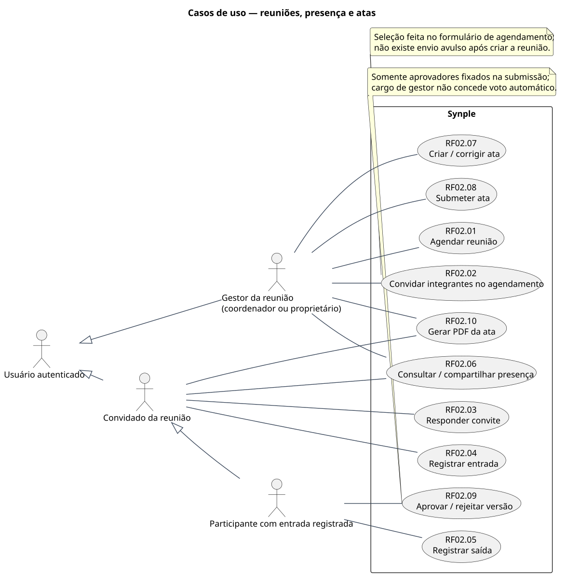
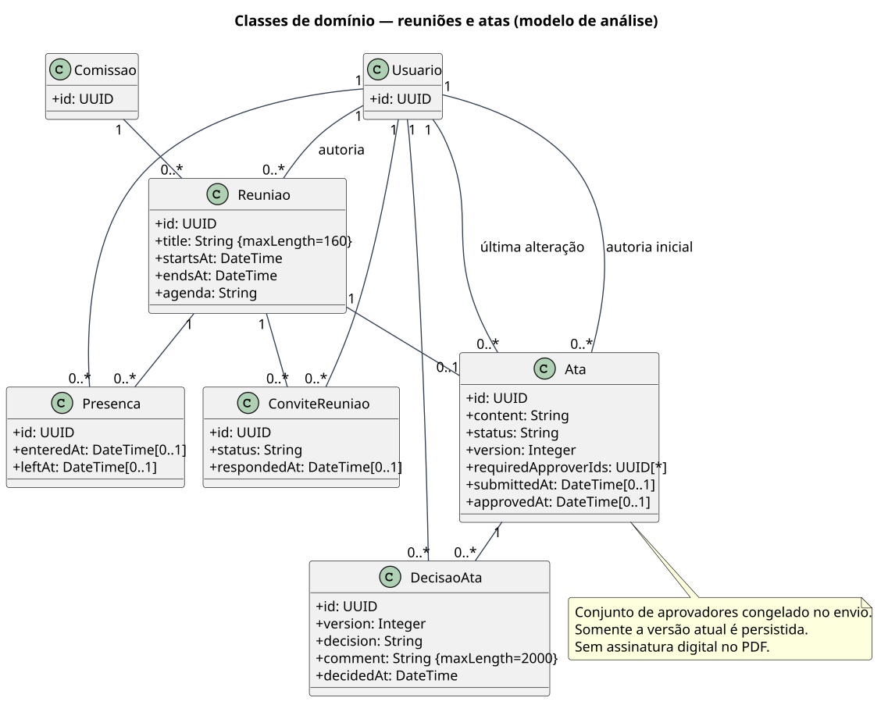
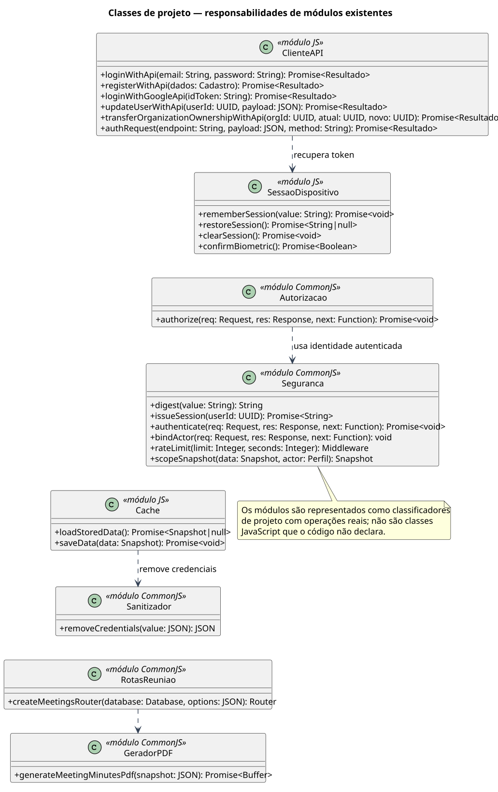
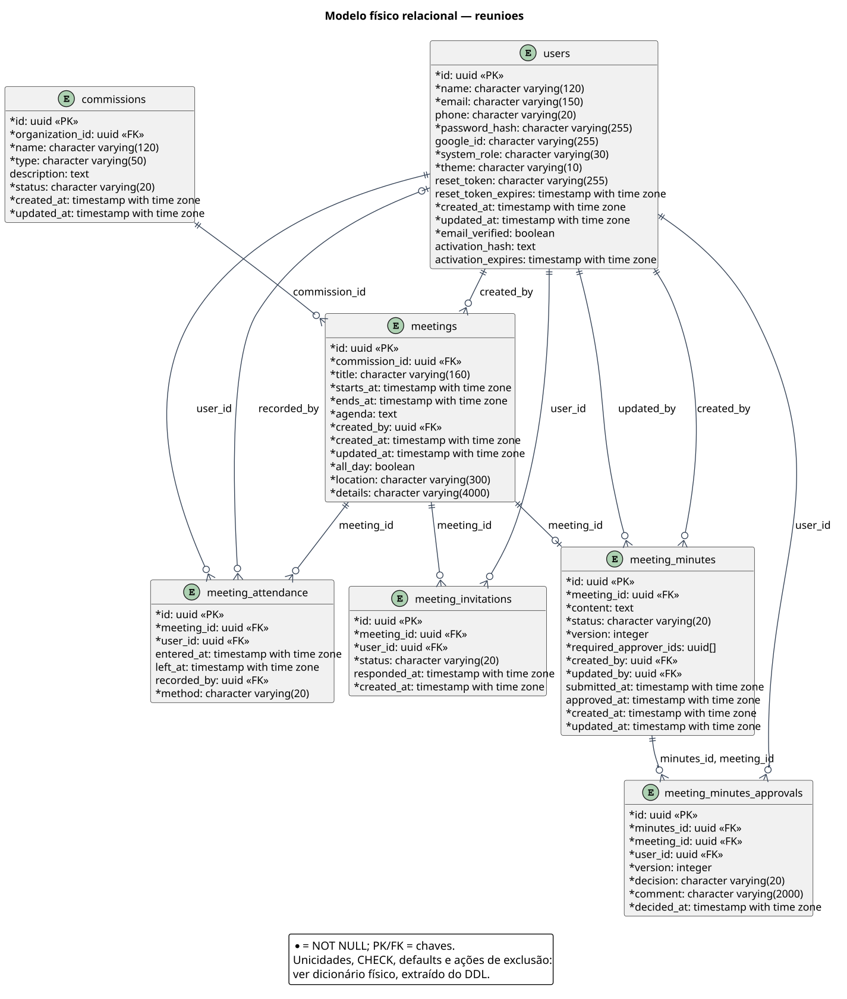

# Synple — Incremento 2: reuniões das comissões

Revisão: 30/10/2026. Este documento é o índice de módulo e roteiro de aceite. Os contratos completos são mantidos na [especificação principal](../../docs/incremento-1-especificacao-completa.md), para não repetir versões divergentes.

## 1. Fontes, escopo e decisões

A documentação anterior identifica como fonte os slides4–10 de f2b56f41bcb6-5d9f38abce32442c931a4ff49a379768.pptx: agendamento, convites, entrada/saída, presença e ata. O arquivo original não está sendo declarado como revalidado nesta revisão. A exigência de aprovar por todos com entrada registrada e a exportação PDF foram registradas na revisão de22/10/2026. Levantamento adicional com a comunidade permanece pendente, sem entrevistas inventadas.

Não há edição/cancelamento de agendamento, reentrada múltipla, anexos, chat ou prazo de votação implementados. O período agendado é informativo; instantes de entrada/saída vêm do servidor. Conteúdos/votos antigos substituídos não têm histórico completo.

## 2. Atores e termos

Coordenador atual da comissão ou proprietário da organização gere reunião/ata. Convidado responde e registra própria presença. Aprovador é pessoa com entrada até a submissão, fixada no conjunto da versão. Gestor presente também precisa votar; seu cargo não aprova automaticamente. Ex-integrante mantém consulta por convite histórico e voto fixado, mas não cargo de gestor anterior. A identidade vem da sessão validada.

## 3. Diagrama de casos de uso

## 4. Requisitos funcionais no formulário de caso de uso

Cada ficha tem campos/ações de interface, pré-condições, entradas, fluxo, exceções, persistência e sequência. Referências canônicas:

| ID | Nome | Contrato |
| --- | --- | --- |
| [RF02.01](../../docs/incremento-1-especificacao-completa.md#rf0201) | Agendar reunião da comissão | POST /meetings |
| [RF02.02](../../docs/incremento-1-especificacao-completa.md#rf0202) | Selecionar e convidar integrantes no agendamento | POST /meetings, campo inviteeIds |
| [RF02.03](../../docs/incremento-1-especificacao-completa.md#rf0203) | Responder convite de reunião | PATCH /meetings/:meetingId/invitation |
| [RF02.04](../../docs/incremento-1-especificacao-completa.md#rf0204) | Registrar entrada | PATCH /meetings/:meetingId/attendance com action=ENTER |
| [RF02.05](../../docs/incremento-1-especificacao-completa.md#rf0205) | Registrar saída | PATCH /meetings/:meetingId/attendance com action=EXIT |
| [RF02.06](../../docs/incremento-1-especificacao-completa.md#rf0206) | Consultar e compartilhar lista de presença | GET /meetings/:meetingId/attendance |
| [RF02.07](../../docs/incremento-1-especificacao-completa.md#rf0207) | Criar ou corrigir ata | POST /meetings/:meetingId/minutes |
| [RF02.08](../../docs/incremento-1-especificacao-completa.md#rf0208) | Submeter ata para aprovação | POST /meetings/:meetingId/minutes/submit |
| [RF02.09](../../docs/incremento-1-especificacao-completa.md#rf0209) | Aprovar ou solicitar correção da versão da ata | PATCH /meetings/:meetingId/minutes/approval |
| [RF02.10](../../docs/incremento-1-especificacao-completa.md#rf0210) | Gerar PDF da ata salva | HEAD/GET /meetings/:meetingId/minutes/pdf; POST /auth/download-ticket |

## 5. Regras de negócio

1. Somente coordenador atual ou proprietário agenda/gera/corrige/submete ata; o cliente não escolhe identidade no JSON.
2. Agendamento exige título/pauta e período válido. Convidados, exceto organizador, pertencem à comissão. Criação é transacional e deduplica convites.
3. Convite aceito é pré-condição de entrada; aceite sozinho não conta presença. Saída exige entrada; primeira entrada permanece registrada.
4. Submissão exige rascunho salvo e pelo menos um presente; fixa todos com entrada, inclusive quem já saiu. Novas entradas bloqueiam durante revisão e após aprovação; saídas continuam possíveis.
5. Voto exige versão atual e pertencimento ao conjunto fixado. Rejeição solicita comentário e correção. Aprovação requer unanimidade; aprovado não é editável.
6. Correção de revisão/rejeição gera nova versão/rascunho e invalida decisões anteriores. Não há histórico completo de conteúdo/votos substituídos.
7. PDF representa os dados atuais, com situação/versão/fuso. Rascunho/revisão/rejeição recebem aviso não final. Não é assinatura digital nem aprovação.
8. Um coordenador por comissão é mantido pelas rotas/índice parcial/migração; a regra requer validação de negócio com a comunidade.

## 6. Diagrama de classes

### 6.1. Dicionário das classes

[Classes, todos os atributos e operações exportadas](../../docs/dicionario-classes.md). As entidades são conceitos de análise; funções reais ficam nos módulos. Não há classes ORM ou métodos de instância inventados.

## 7. Diagrama relacional

### 7.1. Dicionário relacional

[Dicionário físico completo](../../docs/dicionario-banco-dados.md) e [snapshot extraído do DDL](../../docs/modelo-fisico.snapshot.json). Inclui FKs compostas, ações de exclusão, UNIQUE, CHECK e índices. O conjunto UUID[] de aprovadores não tem FK individual; coerência depende das rotas. Não há CHECK SQL de ordem de presença; há validação na API.

## 8. Contrato da API e sincronização

Prefixo /api e sessão Bearer obrigatórios. POST /meetings; PATCH /meetings/:meetingId/invitation e /attendance; GET /attendance; POST /minutes e /minutes/submit; PATCH /minutes/approval; HEAD/GET /minutes/pdf. Identificadores de ator do body/query são substituídos pela sessão. PDF em navegador usa ticket de sessenta segundos restrito ao caminho e ligado à sessão, criado por POST /auth/download-ticket.

GET /sync retorna coleções autorizadas por papel/vínculo/histórico. O app substitui o snapshot e sanitiza credenciais no cache; não autentica por senha offline nem reinjeta dados removidos. Filtro de acesso não equivale a uma política de retenção já aprovada pela comunidade.

## 9. Requisitos não funcionais

[RNF01–RNF17 na especificação](../../docs/incremento-1-especificacao-completa.md#8-requisitos-não-funcionais): autenticação/autorização, integridade/concorrência, persistência confirmada, privacidade, compatibilidade, acessibilidade, desempenho medido, operação e PDF. Metas não medidas são declaradas pendentes; máscaras e seleção de tema ficam como funcionalidades.

## 10. Diagramas de sequência

| Fluxo | Diagrama |
| --- | --- |
| RF02.01–02.03: agendar, convidar e responder | [SQ08](../../docs/Diagramas/renderizados/seq-agendamento.svg) |
| RF02.04–02.06: entrada, saída e consulta de presença | [SQ09](../../docs/Diagramas/renderizados/seq-presenca.svg) |
| RF02.07–02.09: rascunho, submissão e decisão | [SQ10](../../docs/Diagramas/renderizados/seq-ata.svg) |
| RF02.10: PDF, acesso, versão e ticket | [SQ11](../../docs/Diagramas/renderizados/seq-pdf.svg) |

Consulta/compartilhamento de presença não é a mesma escrita de entrada/saída: ler a lista usa GET, com autorização por gestão/convite, e não altera presença. Fontes UML em ../../docs/Diagramas/fontes.

## 11. Matriz de rastreabilidade

| Origem declarada | RF | Dados principais | Evidência automatizada existente |
| --- | --- | --- | --- |
| Slide5 | RF02.01–02.02 | meetings, meeting_invitations | backend/test/meetings.test.js; mobile/test/meetings.test.js |
| Slide6 | RF02.03–02.05 | meeting_invitations, meeting_attendance | backend/test/meetings.test.js |
| Slide7 | RF02.06–02.09 | attendance, minutes, approvals | backend/test/meetings.test.js; mobile/test/meetings.test.js |
| Extensão registrada em22/10/2026 | RF02.10 | Consulta das coleções e download_tickets | Testes PDF mobile/backend e security.test.js |
| Slides8/10 | Compatibilidade/documentos | Diagramas, fichas, dicionários e testes | Exportação JS registrada; aparelhos pendentes |

## 12. Critérios e roteiro de aceitação

Estado de todos os cenários abaixo nesta revisão documental: **roteiro, não executado em aparelho**. Registrar modelo/SO, build/assinatura, conta fictícia, esperado/obtido, data, responsável e evidência.

| CA | Cenário | Resultado esperado |
| --- | --- | --- |
| CA01 | Gestor agenda com título/datas/pauta e dois integrantes | Uma reunião e convites deduplicados; organizador aceito |
| CA02 | Integrante comum tenta agendar | 403 e nenhuma escrita parcial |
| CA03 | Término antes do início ou convidado externo | 400 sem reunião/convites parciais |
| CA04 | Convidado aceita/recusa pela própria conta | Situação e hora da resposta confirmadas |
| CA05 | Tenta entrada sem aceite; depois aceita e entra | Negação antes; horário do servidor depois |
| CA06 | Tenta saída sem entrada; registra saída válida | Negação antes; presença permanece após sair |
| CA07 | Consulta lista e compartilha texto | Aceite não conta presença; ausentes e horários identificados |
| CA08 | Gestor salva rascunho e corrige texto | Texto persistido, erro de rede não vira sucesso |
| CA09 | Submete sem presentes e depois com presença | Negação antes; conjunto fixado depois |
| CA10 | Gestor presente e outro participante votam | Ambos precisam decidir; ausência de voto impede unanimidade |
| CA11 | Dois aprovadores votam simultaneamente | Versão/conjunto preservados e estado correto |
| CA12 | Rejeita, corrige e tenta voto da versão antiga | Nova versão/rascunho; voto antigo negado |
| CA13 | Recarrega app e consulta PostgreSQL | Operações confirmadas permanecem; versão e estados coincidem |
| CA14 | Executa Android/iOS com teclado, fonte e temas | Sem campo focado oculto; registrar problemas, não presumir aprovação |
| CA15 | Remove integrante já convidado/aprovador | Histórico e voto fixado preservados; cargo antigo não concede gestão |
| CA16 | Submete ata enquanto exclui conta de aprovador | Proteções transacionais não deixam aprovador obrigatório inexistente |
| CA17 | Baixa PDF em Android, iOS e computador | Arquivo abre/salva pelo navegador autorizado |
| CA18 | Exporta em cada situação da ata | Status/versão e aviso não final corretos |
| CA19 | Exporta texto longo, acentos e fuso identificado | Paginação e português legíveis, sem cortes |
| CA20 | Tenta versão antiga, usuário sem acesso e ticket expirado | Conflito/negação/expiração sem baixar dado não autorizado |

## 13. Preparar e demonstrar o incremento

1. Atualizar checkout/dependências, preencher .env real de API/OAuth/SMTP e iniciar banco/API conforme [README](../../README.md). Boot migra sem seed automático; dados fictícios são preparação explícita.
2. Instalar novo development build por causa de SecureStore/biometria. Google exige assinatura/SHA-1 e Client IDs compatíveis. Não usar Expo Go para autenticação Google nativa.
3. Preparar contas distintas e organização aprovada; confirmar vínculos e coordenador no banco. Não usar estado local antigo como prova de permissão.
4. Em mobile, executar npm run tunnel, manter processo aberto e usar QR atual no Synple. Túnel Expo sozinho não expõe a API.
5. Demonstrar CA01–CA20 e registrar resultado real. [Verificação anterior de código](VERIFICACAO_CORRECOES.md); [revisão documental](../../docs/VERIFICACAO_DOCUMENTACAO.md).

### Pendências externas ao código

Validar regra de coordenador, dados adicionais de reunião, retenção e acessibilidade com a comunidade; preencher o formulário institucional quando fornecido; testar aparelhos/envio real de e-mail/Google/biometria. Não registrar entrevista ou teste manual como feito sem evidência.
