# Synple — Incremento 2: reuniões das comissões

Versão documental: 22/10/2026. Entrega indicada na apresentação: 23/10/2026, às 18h, com apresentação em 23/10/2026.

Este documento relaciona os requisitos da apresentação fornecida, o modelo de dados, os fluxos e os critérios de aceitação do módulo de reuniões. A operação geral do sistema está no [guia de uso e inicialização](../GUIA_USO_E_INICIALIZACAO.md).

## 1. Fontes, escopo e decisões

A fonte do enunciado é a apresentação `f2b56f41bcb6-5d9f38abce32442c931a4ff49a379768.pptx`, slides 4 a 10. O slide 5 solicita agendamento pelo presidente e convite aos integrantes da comissão, contendo título, início, término e pauta. O slide 6 solicita aceite/recusa e registro de entrada/saída, inclusive pelo presidente. O slide 7 solicita lista de presença, criação e aprovação de ata. O slide 10 relaciona os artefatos documentais exigidos.

A exportação da ata em PDF foi solicitada pelo usuário em 22/10/2026 e constitui uma extensão ao incremento. O slide 7 não determina o formato PDF; a nova opção exporta a ata salva sem alterar as regras originais de presença ou aprovação.

| Origem | Definição |
| --- | --- |
| Enunciado, slides 5–7 | Agendar, convidar, responder convite, registrar entrada e saída, gerar lista de presença, criar e aprovar ata. |
| Confirmação do usuário em 22/10/2026 | Todos os participantes que registraram entrada, incluindo o presidente quando presente, devem aprovar a ata. |
| Solicitação do usuário em 22/10/2026 | Gerar a ata em PDF e atualizar os tutoriais do projeto. A exportação inclui a versão e a situação; atas ainda não aprovadas são identificadas como documento não final. |
| Decisão de implementação | O presidente corresponde ao vínculo `COORDINATOR` em `commission_members`. O proprietário da organização mantém a permissão administrativa para agendar e gerir atas. |
| Decisão de implementação | O organizador recebe um convite aceito automaticamente. Os outros convidados devem pertencer à mesma comissão e responder ao convite. |
| Decisão de implementação | Ao submeter a ata, o sistema fixa os participantes obrigados a aprovar. Quem já saiu, mas registrou entrada, também participa da aprovação. |
| Decisão de implementação | Uma reprovação solicita correção. Salvar alterações em ata ainda não aprovada abre nova versão em rascunho e descarta as decisões anteriores; uma nova submissão exige novas decisões de todos os aprovadores. Ata aprovada não pode ser alterada. |
| Decisão de implementação | Há um registro de entrada e saída por pessoa/reunião. Os horários efetivos são gerados no servidor; o período agendado é informativo. |
| Decisão de implementação | Remover uma pessoa da comissão não apaga seus convites, presença nem obrigação de decidir sobre uma ata já submetida. O acesso histórico por convite permanece; a gestão continua dependendo do cargo atual ou da propriedade da organização. |

**Levantamento a concluir:** a apresentação pede levantamento de outros itens válidos para reunião junto à comunidade. Não foi fornecida evidência desse levantamento. Local/link, reunião presencial ou remota, justificativa de ausência, anexos, reentrada, edição/cancelamento do agendamento e prazo de votação são possibilidades para discutir, sem integrá-las como requisitos já aprovados neste incremento.

**Formulário padrão:** o modelo institucional mencionado no slide 10 não foi anexado. As fichas da seção 4 usam o mesmo formulário para todos os casos de uso, com identificação, ator, condições, fluxos, regras e rastreabilidade. Deve-se transpor essas fichas para o modelo institucional caso ele exija campos ou uma disposição específica.

**Avaliação em dispositivos:** o slide 8 prevê execução em Android e iOS. O roteiro deste documento não constitui evidência de execução em aparelhos físicos. Essa validação deve ser registrada pela equipe antes da apresentação.

## 2. Atores e termos

| Ator/termo | Definição no incremento |
| --- | --- |
| Presidente da comissão | Usuário com `role = COORDINATOR` no vínculo da comissão. Pode agendar, acompanhar presença e elaborar/submeter a ata. |
| Integrante | Usuário vinculado à comissão; recebe convite, responde, registra seus horários e decide sobre a ata se tiver registrado entrada. |
| Proprietário da organização | Responsável identificado por `organizations.owner_id`. Possui a permissão administrativa de gestão da reunião; sua presença e seu voto continuam seguindo os mesmos requisitos de entrada. |
| Gestor da reunião | Presidente ou proprietário da organização, conforme as regras anteriores. Não equivale a qualquer administrador do sistema. |
| Convidado | Usuário com registro em `meeting_invitations` para a reunião. |
| Convidado histórico | Pessoa removida da comissão que mantém convite de uma reunião anterior; continua consultando essa reunião e pode decidir se estiver no conjunto de aprovadores da versão. |
| Presente para aprovação | Pessoa com `entered_at` registrado até a submissão da versão da ata, mesmo quando `left_at` já foi preenchido. |
| Pauta | Texto com os assuntos planejados; integra o agendamento. |
| Ata | Texto com o relato e as deliberações; possui versão, autor, situação e decisões dos participantes. |
| PDF da ata | Arquivo gerado sob demanda a partir da ata salva e dos dados atuais da reunião. Não substitui a aprovação nem contém assinatura digital. |
| Solicitante do PDF | Gestor atual da reunião ou convidado, inclusive histórico, com acesso à reunião. Não precisa integrar o conjunto de aprovadores para consultar o PDF. |

## 3. Diagrama de casos de uso

O Mermaid não possui uma notação nativa de casos de uso UML. O diagrama usa atores, limite do sistema e nós arredondados para representar os casos de uso; os identificadores correspondem às fichas seguintes.

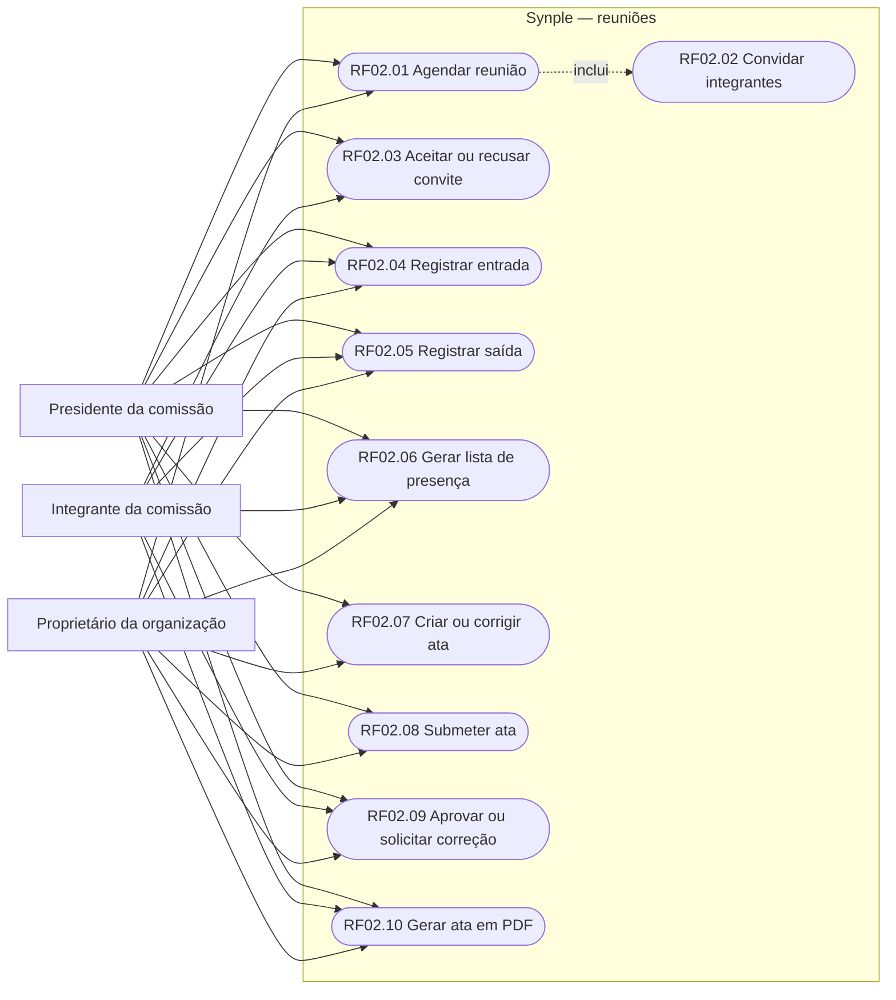

As ligações de participação do presidente/proprietário dependem de convite e presença. A ligação ao caso de aprovação não concede voto a quem não registrou entrada.

RF02.10 também fica disponível ao convidado histórico autorizado, mesmo após sua remoção da comissão. A consulta/exportação não lhe devolve permissão de gestão.

## 4. Requisitos funcionais no formulário de caso de uso

### RF02.01 — Agendar reunião

| Campo | Descrição |
| --- | --- |
| Identificação/nome | RF02.01 / UC02.01 — Agendar reunião. |
| Objetivo | Registrar uma reunião ligada a uma comissão. |
| Fonte/prioridade | Slide 5; obrigatória no incremento. |
| Ator principal | Presidente da comissão; proprietário da organização por permissão administrativa. |
| Gatilho | Ator seleciona uma comissão e escolhe agendar. |
| Pré-condições | Comissão existente; usuário identificado no app; permissão de gestão; API e banco disponíveis. |
| Entradas | `commissionId`, `createdBy`, título, início, término, pauta e integrantes selecionados. |
| Fluxo principal | 1. Ator informa título, início, término e pauta. 2. Seleciona convidados. 3. App valida os campos e envia o pedido. 4. API verifica a permissão e os dados. 5. Em transação, grava reunião e executa RF02.02. 6. App apresenta a reunião confirmada pelo servidor. |
| Fluxos alternativos/exceções | A1. Campo vazio, data inválida ou término menor/igual ao início: rejeitar sem gravar. A2. Usuário sem permissão: negar. A3. Convidado não elegível: rejeitar o pedido. A4. Erro de banco: desfazer a transação. A5. Falta de rede: informar falha; não simular agendamento salvo. |
| Pós-condições | Reunião e convites persistidos de forma atômica e disponíveis após sincronização. |
| Regras | RN02.01, RN02.02, RN02.03. Título limitado a 160 caracteres pelo banco. |
| Interface/API | Tela **Reuniões**; `POST /api/meetings`. |
| Aceitação/rastreabilidade | CA01–CA03; SD02.01; tabelas `meetings`, `meeting_invitations`. |

### RF02.02 — Convidar integrantes

| Campo | Descrição |
| --- | --- |
| Identificação/nome | RF02.02 / UC02.02 — Convidar integrantes da comissão. |
| Objetivo | Disponibilizar um convite individual para cada integrante selecionado no agendamento. |
| Fonte/prioridade | Slides 5 e 6; obrigatória no incremento. |
| Ator principal | Mesmo gestor que agenda a reunião. |
| Gatilho | Execução de RF02.01. |
| Pré-condições | Reunião em criação e convidados elegíveis da mesma comissão. |
| Entradas | Identificadores dos integrantes em `inviteeIds`; organizador. |
| Fluxo principal | 1. Sistema resolve os identificadores. 2. Confere o vínculo com a comissão. 3. Remove duplicidades. 4. Grava um convite `INVITED` para cada convidado. 5. Inclui o organizador com `ACCEPTED`. 6. Confirma os convites junto com a reunião. |
| Fluxos alternativos/exceções | A1. Organizador já selecionado: manter um único convite aceito. A2. Identificador inválido ou usuário de outra comissão: negar o agendamento. A3. Falha de gravação: desfazer reunião e convites. |
| Pós-condições | Convites aparecem no app dos destinatários quando os dados são sincronizados. |
| Regras | RN02.03 e RN02.04. Convites são internos ao app; envio de convite por e-mail/push não faz parte deste caso de uso. |
| Interface/API | Incluído no `POST /api/meetings`; não exige uma chamada HTTP independente. |
| Aceitação/rastreabilidade | CA03–CA04; SD02.02; `meeting_invitations`. |

### RF02.03 — Aceitar ou recusar convite

| Campo | Descrição |
| --- | --- |
| Identificação/nome | RF02.03 / UC02.03 — Responder ao convite. |
| Objetivo | Registrar se o convidado pretende participar. |
| Fonte/prioridade | Slide 6; obrigatória no incremento. |
| Ator principal | Destinatário do convite, inclusive presidente quando convidado por outro gestor. |
| Gatilho | Ator escolhe **Aceitar convite** ou **Recusar**. |
| Pré-condições | Convite existente para a pessoa; reunião acessível; pessoa ainda sem entrada registrada para recusar um convite aceito. Um convite histórico continua válido após remoção da comissão. |
| Entradas | Reunião, usuário e `ACCEPTED` ou `DECLINED`. |
| Fluxo principal | 1. App envia a resposta escolhida. 2. API identifica o convite do usuário. 3. Confere as regras. 4. Atualiza situação e horário da resposta. 5. App atualiza a reunião. |
| Fluxos alternativos/exceções | A1. Situação diferente das duas permitidas: rejeitar. A2. Convite inexistente: informar não encontrado. A3. Entrada já registrada: bloquear recusa posterior para preservar a presença. A4. Falha de rede: manter a resposta anteriormente confirmada. |
| Pós-condições | Convite possui a resposta confirmada e `responded_at`; aceite habilita entrada, recusa não habilita. |
| Regras | RN02.04 e RN02.05. Aceitar não registra presença automaticamente. |
| Interface/API | `PATCH /api/meetings/:meetingId/invitation`. |
| Aceitação/rastreabilidade | CA04–CA05; SD02.03; `meeting_invitations`. |

### RF02.04 — Registrar entrada

| Campo | Descrição |
| --- | --- |
| Identificação/nome | RF02.04 / UC02.04 — Registrar entrada na reunião. |
| Objetivo | Registrar a participação efetiva com o horário do servidor. |
| Fonte/prioridade | Slide 6; obrigatória no incremento. |
| Ator principal | Convidado com convite aceito, incluindo presidente e organizador. |
| Gatilho | Ator escolhe **Registrar entrada**. |
| Pré-condições | Convite `ACCEPTED`; ata fora de `IN_REVIEW`/`APPROVED`; API disponível. |
| Entradas | Reunião, usuário e ação `ENTER`. |
| Fluxo principal | 1. App solicita entrada. 2. API verifica convite e situação da ata. 3. Grava `entered_at` com a hora do servidor. 4. Devolve presença. 5. App mostra entrada e oferece saída. |
| Fluxos alternativos/exceções | A1. Convite pendente/recusado: negar. A2. Ata em aprovação ou aprovada: bloquear nova entrada. A3. Entrada repetida: preservar a primeira marcação, sem gerar outra pessoa na lista. A4. Falha de rede: não confirmar presença localmente. |
| Pós-condições | Um registro de presença por pessoa/reunião; participante passa a constar na lista e poderá integrar a aprovação. |
| Regras | RN02.05, RN02.06, RN02.09. Entrada não é inferida de aceite, abertura da tela ou cargo. |
| Interface/API | `PATCH /api/meetings/:meetingId/attendance`, ação `ENTER`. |
| Aceitação/rastreabilidade | CA05–CA06, CA10; SD02.04; `meeting_attendance`. |

### RF02.05 — Registrar saída

| Campo | Descrição |
| --- | --- |
| Identificação/nome | RF02.05 / UC02.05 — Registrar saída da reunião. |
| Objetivo | Completar o registro de presença com o horário de saída. |
| Fonte/prioridade | Slide 6; obrigatória no incremento. |
| Ator principal | Pessoa que registrou entrada e ainda está sem saída. |
| Gatilho | Ator escolhe **Registrar saída**. |
| Pré-condições | Registro com `entered_at` preenchido e `left_at` vazio. |
| Entradas | Reunião, usuário e ação `EXIT`. |
| Fluxo principal | 1. App solicita saída. 2. API localiza a entrada. 3. Grava `left_at` com a hora do servidor. 4. App mostra os dois horários. |
| Fluxos alternativos/exceções | A1. Sem entrada: rejeitar. A2. Saída já registrada: rejeitar nova marcação sem sobrescrever a original. A3. Ata em aprovação/aprovada: permitir a saída e preservar o conjunto de aprovadores. A4. Rede indisponível: informar falha. |
| Pós-condições | Saída registrada; pessoa permanece na lista histórica e, se exigida na submissão, continua responsável pela aprovação. |
| Regras | RN02.06, RN02.07 e RN02.09. Não há reentrada neste incremento. |
| Interface/API | `PATCH /api/meetings/:meetingId/attendance`, ação `EXIT`. |
| Aceitação/rastreabilidade | CA06–CA07; SD02.05; `meeting_attendance`. |

### RF02.06 — Gerar lista de presença

| Campo | Descrição |
| --- | --- |
| Identificação/nome | RF02.06 / UC02.06 — Gerar lista de presença. |
| Objetivo | Apresentar os participantes que efetivamente registraram entrada e seus horários. |
| Fonte/prioridade | Slide 7; obrigatória no incremento. |
| Ator principal | Gestor da reunião ou convidado com acesso à reunião. |
| Gatilho | Ator abre a lista de presença na reunião. |
| Pré-condições | Reunião existente e usuário autorizado a consultá-la por gestão atual ou convite, inclusive após remoção da comissão. |
| Entradas | Reunião e identificador do solicitante. |
| Fluxo principal | 1. App solicita a lista. 2. API verifica acesso. 3. Consulta convidados, presença e identificação dos usuários. 4. Retorna convidados, situação do convite e horários, nulos para ausentes. 5. App apresenta a lista e a quantidade de entradas registradas, com opção de compartilhar texto. |
| Fluxos alternativos/exceções | A1. Ninguém entrou: apresentar lista vazia com explicação. A2. Pessoa que saiu: continuar na lista com horário da saída. A3. Usuário sem acesso: negar. A4. Rede indisponível: informar que não foi possível obter a lista atualizada. |
| Pós-condições | Lista consultável sem modificar presença. |
| Regras | RN02.07. Aceite sem entrada não compõe a contagem de presentes. A listagem também identifica convidados sem entrada como ausentes. Este caso de uso gera a consulta estruturada e apresentação/compartilhamento textual da lista; a exportação da ata em PDF está em RF02.10. |
| Interface/API | `GET /api/meetings/:meetingId/attendance?userId=...`. |
| Aceitação/rastreabilidade | CA07; SD02.06; `meeting_attendance`, `users`, `meeting_invitations`. |

### RF02.07 — Criar ou corrigir ata

| Campo | Descrição |
| --- | --- |
| Identificação/nome | RF02.07 / UC02.07 — Elaborar ata. |
| Objetivo | Salvar o relato da reunião como rascunho e corrigir uma ata devolvida. |
| Fonte/prioridade | Slide 7; obrigatória no incremento. Correção detalha o ciclo de aprovação adotado. |
| Ator principal | Gestor da reunião. |
| Gatilho | Ator informa o texto e escolhe salvar a ata. |
| Pré-condições | Reunião existente; permissão de gestão; ata ainda não aprovada. |
| Entradas | Reunião, usuário e conteúdo da ata. |
| Fluxo principal | 1. Gestor escreve relato/deliberações. 2. App envia conteúdo. 3. API valida permissão e conteúdo. 4. Cria a ata ou salva a alteração como `DRAFT`, identificando autor/editor e versão. Uma alteração invalida o conjunto de aprovadores e as decisões da revisão anterior. 5. App apresenta o texto confirmado. |
| Fluxos alternativos/exceções | A1. Texto vazio ou maior que 50.000 caracteres: rejeitar. A2. Ata em `IN_REVIEW` ou `REJECTED`: salvar correção como nova versão em rascunho e exigir nova submissão/votação. A3. Ata `APPROVED`: bloquear alteração. A4. Salvar o mesmo conteúdo de um rascunho: preservar a versão. A5. Sem permissão/rede: rejeitar ou informar falha sem confirmar salvamento. |
| Pós-condições | Uma ata por reunião, persistida como rascunho e disponível para submissão. |
| Regras | RN02.08 e RN02.11. Toda mudança de conteúdo incrementa a versão; reabrir uma revisão/reprovação também exige nova versão. Votos anteriores são removidos e não aprovam a nova versão. |
| Interface/API | `POST /api/meetings/:meetingId/minutes`. |
| Aceitação/rastreabilidade | CA08, CA11–CA12; SD02.07; `meeting_minutes`. |

### RF02.08 — Submeter ata à aprovação

| Campo | Descrição |
| --- | --- |
| Identificação/nome | RF02.08 / UC02.08 — Submeter ata. |
| Objetivo | Abrir a aprovação da versão e definir de forma estável quem deve aprová-la. |
| Fonte/prioridade | Detalhamento do processo de aprovação do slide 7 e da decisão confirmada pelo usuário. |
| Ator principal | Gestor da reunião. |
| Gatilho | Ator escolhe enviar a ata para aprovação. |
| Pré-condições | Ata `DRAFT` com texto; ao menos um participante com entrada registrada; permissão de gestão. |
| Entradas | Reunião e usuário responsável. |
| Fluxo principal | 1. API bloqueia a reunião/ata para alteração concorrente. 2. Consulta todos os usuários com entrada registrada. 3. Salva os IDs em `required_approver_ids`. 4. Define ata `IN_REVIEW` e registra `submitted_at`. 5. App mostra versão e progresso das decisões. |
| Fluxos alternativos/exceções | A1. Sem presentes: rejeitar submissão. A2. Ata sem rascunho, já em revisão/aprovada ou sem permissão: rejeitar. A3. Falha de banco: desfazer operação. A4. Reenvio de ata corrigida: usar a nova versão, sem aproveitar votos da anterior. |
| Pós-condições | Conjunto de aprovadores fixado para a versão; alterar o texto encerra essa revisão e exige outra submissão. |
| Regras | RN02.09, RN02.10 e RN02.11. O presidente precisa aprovar quando registrou entrada; seu cargo não substitui a decisão. |
| Interface/API | `POST /api/meetings/:meetingId/minutes/submit`. |
| Aceitação/rastreabilidade | CA09–CA11; SD02.08; `meeting_minutes`, `meeting_attendance`. |

### RF02.09 — Aprovar ata ou solicitar correção

| Campo | Descrição |
| --- | --- |
| Identificação/nome | RF02.09 / UC02.09 — Decidir sobre a ata. |
| Objetivo | Obter a aprovação unânime dos participantes presentes, ou devolver a ata para correção. |
| Fonte/prioridade | Slide 7; regra de unanimidade confirmada pelo usuário. |
| Ator principal | Cada usuário incluído nos aprovadores da versão submetida. |
| Gatilho | Ator escolhe aprovar ou solicitar correção. |
| Pré-condições | Ata `IN_REVIEW`; usuário no conjunto `required_approver_ids`; versão atual submetida. |
| Entradas | Reunião, usuário, versão que foi lida, decisão `APPROVED`/`REJECTED` e comentário, quando aplicável. |
| Fluxo principal | 1. App mostra o conteúdo e a versão. 2. Usuário decide. 3. API confere situação e elegibilidade. 4. Registra a decisão e seu horário. 5. Reconta as decisões da versão. 6. Com todas as aprovações, marca `APPROVED` e preenche `approved_at`. 7. App apresenta o resultado. |
| Fluxos alternativos/exceções | A1. Uma decisão `REJECTED`: marcar ata `REJECTED` e permitir correção pelo gestor. A2. Usuário ausente ou convidado que só aceitou: negar voto. A3. Decisão inválida ou ata fora de revisão: rejeitar. A4. A versão lida foi substituída: retornar conflito HTTP 409; o usuário toca em **Atualizar reuniões e aprovações** e lê a versão atual antes de decidir. A5. Falha de rede: não exibir voto como confirmado. |
| Pós-condições | Decisão persistida. Ata permanece em revisão enquanto faltam aprovações; fica aprovada por unanimidade ou reprovada para correção. |
| Regras | RN02.09–RN02.13. O voto é ligado à versão; não há aprovação automática pelo presidente. Remover o vínculo com a comissão não retira um aprovador obrigatório da versão já submetida. |
| Interface/API | `PATCH /api/meetings/:meetingId/minutes/approval`. |
| Aceitação/rastreabilidade | CA10–CA12; SD02.09; `meeting_minutes`, `meeting_minutes_approvals`. |

### RF02.10 — Gerar ata em PDF

| Campo | Descrição |
| --- | --- |
| Identificação/nome | RF02.10 / UC02.10 — Gerar ata em PDF. |
| Objetivo | Baixar uma representação da ata salva com seus dados de reunião, versão, situação, presença e aprovação. |
| Fonte/prioridade | Extensão solicitada pelo usuário em 22/10/2026; não é um formato exigido pelo slide 7. |
| Ator principal | Gestor atual ou convidado com acesso à reunião, inclusive convidado histórico. |
| Gatilho | Ator toca em **Gerar ata em PDF** na reunião. |
| Pré-condições | Ata salva no servidor em `DRAFT`, `IN_REVIEW`, `REJECTED` ou `APPROVED`; API disponível; acesso à reunião; tela sem edição local não salva. |
| Entradas | Identificadores de reunião e usuário, versão lida e fuso IANA do dispositivo (`timeZone`). Sem fuso informado, usa `America/Sao_Paulo`. |
| Fluxo principal | 1. App confere se há uma ata salva e nenhuma alteração local pendente. 2. Faz `HEAD` para validar acesso e versão. 3. Abre a URL de download no navegador externo. 4. API verifica novamente acesso e versão, consulta os dados atuais e gera PDF. 5. Navegador recebe o arquivo para salvar, abrir ou compartilhar. |
| Fluxos alternativos/exceções | A1. Sem ata salva: opção ainda não exibida; edição local pendente: botão desabilitado até salvar. A2. Reunião/ata ausente: HTTP 404. A3. Sem acesso: HTTP 403. A4. Versão mudou: HTTP 409, atualizar a reunião e gerar novamente. A5. Parâmetro/fuso inválido: HTTP 400. A6. Sem rede ou API/túnel inacessível pelo navegador: informar falha e permitir nova tentativa. |
| Pós-condições | Arquivo entregue sem modificar conteúdo, versão, situação ou votos. PDF baixado permanece como cópia do momento da geração; não acompanha alterações posteriores. |
| Regras | RN02.13 e RN02.15. Identificar versão/situação e marcar documento não final em `DRAFT`, `IN_REVIEW` e `REJECTED`. PDF não é assinatura digital. |
| Interface/API | **Gerar ata em PDF**; `HEAD`/`GET /api/meetings/:meetingId/minutes/pdf?userId=...&version=...&timeZone=...`. |
| Aceitação/rastreabilidade | CA17–CA20; SD02.10; leitura de `meeting_minutes`, `meetings`, organização/comissão, presença e decisões; sem nova tabela. |

## 5. Regras de negócio

| ID | Regra |
| --- | --- |
| RN02.01 | Apenas presidente (`COORDINATOR`) ou proprietário da organização agenda e gere ata da comissão. Integrante comum não ganha essa permissão por ter aceitado convite. |
| RN02.02 | Reunião requer título, pauta e datas válidas; término deve ser posterior ao início. Os horários agendados não são usados como comprovação de presença. |
| RN02.03 | Os convidados selecionados devem pertencer à comissão. O organizador é incluído, com aceite automático, por sua responsabilidade de gestão. |
| RN02.04 | Existe no máximo um convite por reunião/usuário. Situações: `INVITED`, `ACCEPTED`, `DECLINED`; a resposta usa o horário do servidor. |
| RN02.05 | Só convite aceito habilita entrada. O participante não pode recusar o convite depois de ter registrado entrada. |
| RN02.06 | Existe no máximo um registro de presença por reunião/usuário. Entrada e saída usam o relógio do servidor; entrada repetida não altera a primeira marcação; saída requer entrada e não sobrescreve uma saída existente. |
| RN02.07 | A lista contém convidados e seus horários, identificando ausentes; a quantidade de presentes inclui somente quem tem entrada registrada, com saída opcional. Não confundir convidados, aceites e presentes. |
| RN02.08 | Existe no máximo uma ata por reunião; conteúdo é obrigatório. Estados: `DRAFT`, `IN_REVIEW`, `REJECTED`, `APPROVED`. |
| RN02.09 | A submissão exige ao menos uma entrada e fixa em `required_approver_ids` todos os participantes que entraram até então, inclusive quem já saiu. Durante `IN_REVIEW`/`APPROVED`, novas entradas são bloqueadas; saídas continuam permitidas. |
| RN02.10 | A versão só é aprovada quando todos os IDs obrigatórios tiverem decisão `APPROVED`. Presidente presente vota como os demais. Ausentes não votam. |
| RN02.11 | Uma reprovação devolve a ata. Mudança de conteúdo de ata ainda não aprovada gera nova versão em DRAFT, remove decisões/conjunto de aprovadores e exige nova submissão. Uma ata em revisão também pode ser corrigida, encerrando a votação anterior. Ata aprovada fica bloqueada. |
| RN02.12 | Existe uma decisão atual por ata/usuário, identificada pela versão. A chamada deve informar a versão lida e ser rejeitada com conflito se ela mudou. Um pedido repetido não pode aumentar o total de aprovadores. As decisões da versão anterior são removidas na correção; o sistema não mantém histórico completo de votos/textos antigos. |
| RN02.13 | A remoção do vínculo com a comissão preserva convites e presença anteriores. O convidado histórico mantém acesso à reunião e continua podendo decidir quando integra `required_approver_ids`. O convite não conserva poderes de gestão: estes são verificados pelo cargo atual ou pela propriedade da organização. |
| RN02.14 | A exclusão da conta de um aprovador obrigatório é bloqueada enquanto existir ata em revisão ou aprovada que o referencie. A submissão e a exclusão são serializadas para preservar o conjunto de aprovadores e as evidências de presença/voto. |
| RN02.15 | A exportação exige ata salva e versão atual. O PDF identifica versão e situação, marca como documento não final toda ata diferente de `APPROVED` e não altera o ciclo de aprovação. O app bloqueia a exportação de edições locais ainda não confirmadas; a API usa somente os dados persistidos. |

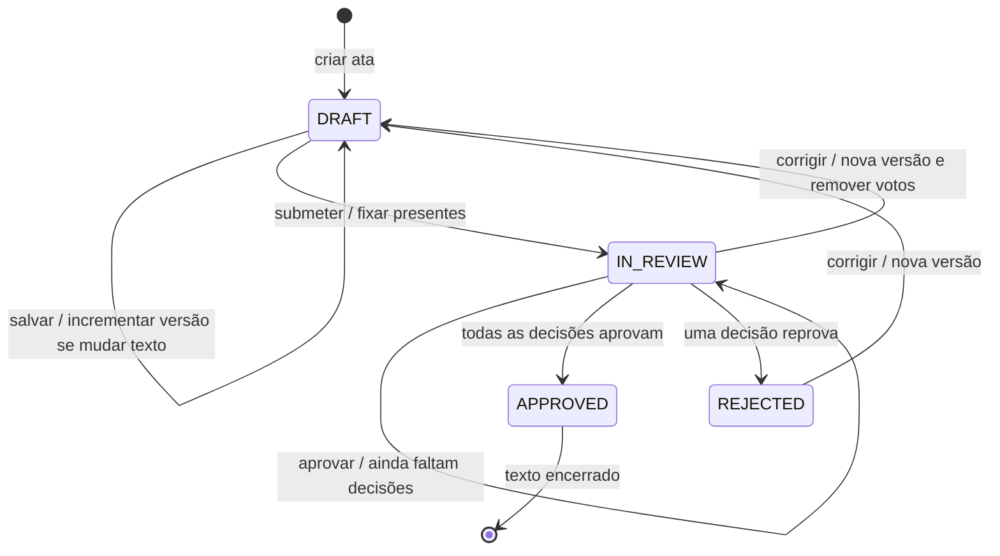

## 6. Diagrama de classes

O diagrama representa o domínio do incremento. Identificação, organização e comissão são entidades preexistentes; seus atributos mostrados são os usados neste módulo. Os serviços são responsabilidades implementadas nas rotas Express e funções do app, sem exigir classes JavaScript formais.

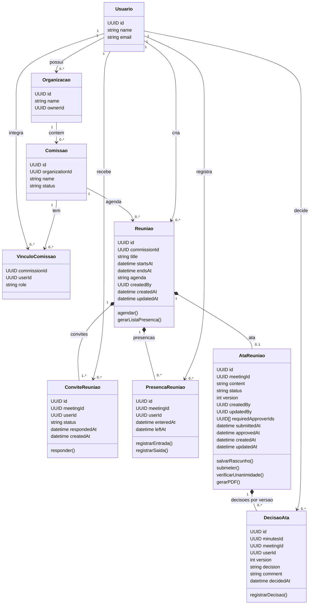

### 6.1. Dicionário das classes

| Classe | Responsabilidade e dados | Invariantes |
| --- | --- | --- |
| `Usuario` | Identifica a pessoa por UUID, nome e e-mail. | Mesmo usuário é usado em vínculo, convite, presença e decisão. |
| `Organizacao` | Contexto das comissões; `ownerId` identifica o gestor com permissão administrativa. | Proprietário existente. |
| `Comissao` | Agrupa os membros e as reuniões; pertence a uma organização. | Reunião usa uma comissão existente. |
| `VinculoComissao` | Associação usuário/comissão com papel. `COORDINATOR` representa presidente. | Uma associação por par usuário/comissão. |
| `Reuniao` | Armazena título, pauta, período agendado e autoria. Os dois campos de auditoria guardam criação/atualização. | Título/pauta preenchidos; `endsAt > startsAt`. |
| `ConviteReuniao` | Registra destinatário, situação e instante da resposta. | Um convite por pessoa/reunião; situação no domínio permitido. |
| `PresencaReuniao` | Registra a primeira entrada e a saída; `leftAt` pode ser nulo. | Um registro por pessoa/reunião; saída não antecede entrada. |
| `AtaReuniao` | Guarda conteúdo atual, versão, situação, responsáveis e datas de auditoria/submissão/aprovação. `requiredApproverIds` é o conjunto fixado para a versão. O serviço de PDF lê esses dados e os da reunião para gerar o arquivo sob demanda. | Uma ata por reunião; aprovação exige unanimidade do conjunto; texto aprovado imutável; exportação não altera o estado. |
| `DecisaoAta` | Guarda ata/reunião, decisão, comentário, versão, autor e instante. | Só `APPROVED`/`REJECTED`; no máximo uma decisão atual por usuário/ata. A FK composta impede vincular a decisão à reunião errada. |

## 7. Diagrama relacional

Recorte relacional das tabelas usadas pelo incremento. `PK` indica chave primária, `FK` chave estrangeira e `UK` unicidade. A chave de `commission_members` é composta por `commission_id` e `user_id`; as demais unicidades compostas constam no dicionário.

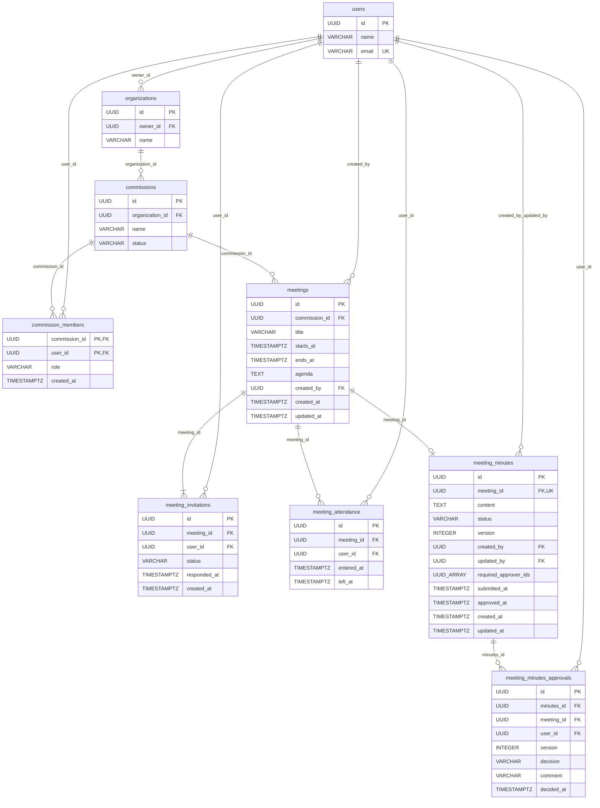

`UUID_ARRAY` representa o tipo PostgreSQL `UUID[]`. O conjunto de aprovadores fica na própria ata como uma fotografia dos presentes na submissão; as linhas de decisões são criadas somente quando alguém decide. A integridade de cada elemento desse array é garantida pelo processo de submissão da API, e não por uma chave estrangeira individual do banco.

### 7.1. Dicionário relacional

O DDL de referência está em [backend/src/db/schema.sql](../backend/src/db/schema.sql). Os nomes `snake_case` são do PostgreSQL; a API usa `camelCase`.

**Entidades preexistentes — atributos utilizados pelo incremento**

| Tabela/coluna | Tipo | Obrigatoriedade/chave | Significado |
| --- | --- | --- | --- |
| `users.id` | UUID | PK, gerada pelo banco | Identificador da pessoa. |
| `users.name` | VARCHAR(120) | NOT NULL | Nome exibido na lista. |
| `users.email` | VARCHAR(150) | NOT NULL, UNIQUE | Identificação complementar do participante. |
| `organizations.id` | UUID | PK | Organização da comissão. |
| `organizations.name` | VARCHAR(150) | NOT NULL | Nome da organização. |
| `organizations.owner_id` | UUID | NOT NULL, FK → users | Proprietário com permissão administrativa. |
| `commissions.id` | UUID | PK | Comissão da reunião. |
| `commissions.organization_id` | UUID | NOT NULL, FK → organizations | Organização responsável. |
| `commissions.name` | VARCHAR(120) | NOT NULL | Nome da comissão. |
| `commissions.status` | VARCHAR(20) | NOT NULL, padrão ACTIVE | Situação cadastral. |
| `commission_members.commission_id` | UUID | PK composta, FK → commissions | Comissão do vínculo. |
| `commission_members.user_id` | UUID | PK composta, FK → users | Integrante do vínculo. |
| `commission_members.role` | VARCHAR(20) | NOT NULL, padrão MEMBER | Papel; COORDINATOR equivale a presidente. |
| `commission_members.created_at` | TIMESTAMPTZ | NOT NULL, padrão NOW() | Criação do vínculo. |

As demais colunas de cadastro/autenticação dessas entidades permanecem descritas no DDL e não integram os dados da reunião. O módulo não usa hash de senha, token de recuperação ou ID Google para aprovar ata.

**`meetings` — agendamentos**

| Coluna | Tipo | Obrigatoriedade/chave | Significado |
| --- | --- | --- | --- |
| `id` | UUID | PK, padrão gen_random_uuid() | Identificador da reunião. |
| `commission_id` | UUID | NOT NULL, FK → commissions | Comissão responsável; exclusão da comissão remove suas reuniões. |
| `title` | VARCHAR(160) | NOT NULL | Título sem espaços vazios como único conteúdo. |
| `starts_at` | TIMESTAMPTZ | NOT NULL | Início planejado. |
| `ends_at` | TIMESTAMPTZ | NOT NULL | Término planejado; CHECK maior que início. |
| `agenda` | TEXT | NOT NULL | Pauta planejada. |
| `created_by` | UUID | NOT NULL, FK → users | Gestor que agendou. |
| `created_at` | TIMESTAMPTZ | NOT NULL, padrão NOW() | Data de criação. |
| `updated_at` | TIMESTAMPTZ | NOT NULL, padrão NOW() | Data de atualização. |

**`meeting_invitations` — convites internos**

| Coluna | Tipo | Obrigatoriedade/chave | Significado |
| --- | --- | --- | --- |
| `id` | UUID | PK, padrão gen_random_uuid() | Identificador do convite. |
| `meeting_id` | UUID | NOT NULL, FK → meetings | Reunião; exclusão remove convites. |
| `user_id` | UUID | NOT NULL, FK → users | Destinatário. |
| `status` | VARCHAR(20) | NOT NULL, padrão INVITED, CHECK | INVITED (aguardando), ACCEPTED (aceito), DECLINED (recusado). |
| `responded_at` | TIMESTAMPTZ | Opcional | Última resposta válida; preenchido no aceite automático do organizador. |
| `created_at` | TIMESTAMPTZ | NOT NULL, padrão NOW() | Momento do convite. |

Unicidade: `(meeting_id, user_id)`.

**`meeting_attendance` — presença efetiva**

| Coluna | Tipo | Obrigatoriedade/chave | Significado |
| --- | --- | --- | --- |
| `id` | UUID | PK, padrão gen_random_uuid() | Identificador do registro. |
| `meeting_id` | UUID | NOT NULL, FK → meetings | Reunião. |
| `user_id` | UUID | NOT NULL, FK → users | Pessoa que registra sua presença. |
| `entered_at` | TIMESTAMPTZ | Opcional no esquema; obrigatório para presença válida | Primeira entrada, atribuída pelo servidor. |
| `left_at` | TIMESTAMPTZ | Opcional | Saída; só preenchida após entrada. |

Unicidade: `(meeting_id, user_id)`. Regras de sequência de marcação também são verificadas pela API.

**`meeting_minutes` — ata e conjunto de aprovadores**

| Coluna | Tipo | Obrigatoriedade/chave | Significado |
| --- | --- | --- | --- |
| `id` | UUID | PK, padrão gen_random_uuid() | Identificador da ata. |
| `meeting_id` | UUID | NOT NULL, FK → meetings, UNIQUE | Uma ata por reunião. |
| `content` | TEXT | NOT NULL, CHECK texto não vazio | Texto atual do relato/deliberações, limitado a 50.000 caracteres na API. |
| `status` | VARCHAR(20) | NOT NULL, padrão DRAFT, CHECK | DRAFT, IN_REVIEW, REJECTED ou APPROVED. |
| `version` | INTEGER | NOT NULL, padrão 1, CHECK > 0 | Versão positiva; alteração de texto ou reabertura de revisão/reprovação incrementa a versão. |
| `created_by` | UUID | NOT NULL, FK → users | Autor original da ata. |
| `updated_by` | UUID | NOT NULL, FK → users | Responsável pelo conteúdo mais recente. |
| `required_approver_ids` | UUID[] | NOT NULL, padrão '{}' | Participantes com entrada no instante da submissão. |
| `submitted_at` | TIMESTAMPTZ | Opcional | Data da submissão atual. |
| `approved_at` | TIMESTAMPTZ | Opcional | Data da unanimidade; nula enquanto não aprovada. |
| `created_at` | TIMESTAMPTZ | NOT NULL, padrão NOW() | Criação da ata. |
| `updated_at` | TIMESTAMPTZ | NOT NULL, padrão NOW() | Última alteração de conteúdo/situação. |

**`meeting_minutes_approvals` — decisões realizadas**

| Coluna | Tipo | Obrigatoriedade/chave | Significado |
| --- | --- | --- | --- |
| `id` | UUID | PK, padrão gen_random_uuid() | Identificador da decisão. |
| `minutes_id` | UUID | NOT NULL, parte da FK composta → meeting_minutes(id, meeting_id) | Ata decidida. |
| `meeting_id` | UUID | NOT NULL, parte da mesma FK composta | Reunião da ata; deve corresponder à ata indicada. |
| `user_id` | UUID | NOT NULL, FK → users | Participante que decidiu. |
| `version` | INTEGER | NOT NULL, CHECK > 0 | Versão a que a decisão pertence. |
| `decision` | VARCHAR(20) | NOT NULL, CHECK | APPROVED (aprova) ou REJECTED (solicita correção). |
| `comment` | VARCHAR(2000) | NOT NULL, padrão vazio | Observação opcional da decisão, limitada a 2.000 caracteres. |
| `decided_at` | TIMESTAMPTZ | NOT NULL, padrão NOW() | Instante da decisão. |

Unicidade: `(minutes_id, user_id)`. Somente as decisões da revisão atual são mantidas; a correção remove as anteriores. Ausência de linha para um aprovador significa decisão pendente. A chave composta de referência exige unicidade de `(id, meeting_id)` em `meeting_minutes`; a exclusão da ata remove suas decisões. O estado da ata exige pelo menos um ID obrigatório quando diferente de `DRAFT`.

**Exportação PDF (dados derivados, sem nova tabela):** o arquivo é gerado sob demanda a partir da reunião, organização, comissão, conteúdo/versão/situação da ata e registros atuais de presença/aprovação. `version` e `timeZone` recebidos na URL selecionam a versão atual esperada e a apresentação dos horários; não são novas colunas. A exportação não grava arquivo no banco, não cria histórico de versões e não substitui registros existentes.

## 8. Contrato da API e sincronização

Todas as rotas abaixo usam o prefixo `/api`. Datas da API são instantes ISO 8601; o PostgreSQL armazena `TIMESTAMPTZ`. O app apresenta os instantes no fuso do dispositivo.

| Método e recurso | Entrada | Resultado de sucesso |
| --- | --- | --- |
| `POST /meetings` | `{ commissionId, createdBy, title, startsAt, endsAt, agenda, inviteeIds }` | Reunião persistida, HTTP 201; convites criados na mesma transação. |
| `PATCH /meetings/:id/invitation` | `{ userId, status }` | Convite com `meetingId`, `userId`, `status`, `respondedAt`. |
| `PATCH /meetings/:id/attendance` | `{ userId, action: ENTER ou EXIT }` | Presença com `enteredAt` e `leftAt`. |
| `GET /meetings/:id/attendance?userId=...` | Identificador de quem consulta | Array de convidados `{ id, meetingId, userId, name, email, invitationStatus, enteredAt, leftAt }`; sem entrada, o ID da presença e os horários são nulos. |
| `POST /meetings/:id/minutes` | `{ userId, content }` | Objeto da ata. |
| `POST /meetings/:id/minutes/submit` | `{ userId }` | Ata em revisão, com `requiredApproverIds`. |
| `PATCH /meetings/:id/minutes/approval` | `{ userId, decision, comment, version }` | `{ minutes, approval }`; versão lida deve ser a versão atual. |
| `HEAD /meetings/:id/minutes/pdf?userId=...&version=...&timeZone=...` | Usuário solicitante, versão atual esperada e fuso IANA opcional | HTTP 200 após conferir acesso e versão, sem corpo/geração de PDF; cabeçalhos `Content-Type: application/pdf`, `X-Minutes-Version` e `X-Minutes-Status`. |
| `GET /meetings/:id/minutes/pdf?userId=...&version=...&timeZone=...` | Mesmos parâmetros da consulta `HEAD` | PDF em `application/pdf`, com `Content-Disposition: attachment`; confere novamente acesso/versão e entrega os dados atuais. |
| `GET /sync` | Fluxo de sincronização existente | Coleções `meetings`, `meetingInvitations`, `meetingAttendance`, `meetingMinutes`, `meetingMinutesApprovals`, além dos cadastros existentes. |

Ata na API: `{ id, meetingId, content, status, version, createdBy, updatedBy, requiredApproverIds, submittedAt, approvedAt, createdAt, updatedAt }`.

Decisão na API: `{ id, minutesId, meetingId, userId, version, decision, comment, decidedAt }`.

Rejeições retornam JSON com `error` e código HTTP adequado: entrada inválida, sem permissão, recurso ausente ou conflito de estado. As operações de reunião dependem de confirmação da API; o armazenamento local não substitui persistência no servidor.

Na exportação, `version` deve ser um inteiro positivo correspondente à ata atual. `timeZone`, quando informado, deve ser um fuso IANA reconhecido; o padrão é `America/Sao_Paulo`. Uma versão desatualizada recebe 409, recurso ausente 404, falta de acesso 403 e parâmetros inválidos 400. O `HEAD` permite ao app informar a falha antes de abrir o navegador; uma mudança entre a consulta e o download também pode impedir o `GET`, exigindo atualizar a tela. O arquivo não fica disponível offline antes de ser baixado.

**Limitação de autenticação:** os identificadores enviados pelo cliente permitem ao servidor verificar vínculos e regras, mas não comprovam por si mesmos a identidade de quem faz o pedido. A API atual não possui uma sessão/token de autenticação que proteja integralmente esses recursos contra chamadas forjadas. O controle de vínculo implementado deve ser apresentado com essa limitação; autenticação e autorização vinculadas a uma sessão validada são pendência para uso público em produção. Pelo mesmo motivo, os dados disponíveis na sincronização geral precisam de filtragem por sessão antes dessa exposição.

## 9. Requisitos não funcionais

Os requisitos abaixo distinguem mecanismos presentes e condições que ainda exigem validação operacional. Não são declarações de certificação ou de teste físico concluído.

| ID | Requisito e critério verificável | Situação/limite |
| --- | --- | --- |
| RNF02.01 — Integridade | Agendamento/convites e transições de ata devem usar transação; erro não pode deixar resultado parcial. Chaves/unicidades impedem convites, presenças e decisões duplicados. | Verificar no código e nos testes de API/banco. |
| RNF02.02 — Persistência | Uma operação confirmada pela API deve continuar disponível depois de recarregar o app e consultar o banco. | PostgreSQL é a fonte persistente; executar CA13. |
| RNF02.03 — Concorrência | Votos simultâneos e entrada/submissão simultâneas devem preservar unanimidade, versão e conjunto fixado. | A API deve serializar a alteração da reunião/ata em transação; executar cenários concorrentes de aprovação. |
| RNF02.04 — Usabilidade | Mensagens devem explicar campos inválidos, falta de permissão/rede e situação da ata. A interface diferencia convite, presença e aprovação. | Verificação visual em Android/iOS pendente de registro. |
| RNF02.05 — Portabilidade | Os mesmos casos de uso devem estar disponíveis em Android e iOS no app Expo/React Native. | O enunciado exige os dois; teste em aparelho de cada plataforma precisa ser realizado. Google nativo requer build compatível. |
| RNF02.06 — Rastreabilidade | Presença, convite, autoria, versão e decisões atuais devem identificar usuário e instante do servidor. | Há campos de auditoria no modelo. Não há assinatura digital nem histórico completo de textos/decisões substituídos. |
| RNF02.07 — Autorização | Gestão só pelo papel permitido; presença/voto só pelo próprio usuário autenticado e elegível. | Regras de vínculo/estado na API; vinculação segura à identidade autenticada ainda é pendência, conforme seção 8. |
| RNF02.08 — Comunicação | Falhas de rede não podem ser apresentadas como salvamento bem sucedido. Em produção, a API deve usar HTTPS e endereço estável. | Túnel de desenvolvimento exige processo ativo e muda de URL; não garante disponibilidade de produção. |
| RNF02.09 — Manutenção | Requisitos, coleções da API e esquema devem usar os mesmos identificadores e situações. Migração deve ser reaplicável sem recriar usuários ou redefinir senhas. | Usar `npm run migrate`; manter este documento alinhado ao DDL/rotas. |
| RNF02.10 — Dados pessoais | Lista de presença exibe identificação e horários necessários. Exportações devem ser compartilhadas somente com pessoas autorizadas. | Controle de acesso robusto/filtragem da sincronização ainda precisam de sessão validada. Definir retenção com a comunidade. |
| RNF02.11 — Exportação PDF | Documento deve conter texto legível em português, versão/situação e horários com fuso identificado; conteúdo longo deve seguir em páginas sem perder texto. Ata não aprovada deve ser marcada como documento não final. | Geração no backend com `pdfkit`; revisão visual do documento e validação de download em aparelhos devem ser registradas. Não há assinatura digital nem aprovação por exportação. |
| RNF02.12 — Instalação do PDF | A exportação deve usar o navegador e recursos já disponíveis no app, sem exigir novo módulo nativo/novo APK. | Instalar dependências e reiniciar backend, ou reconstruir a imagem Docker, e recarregar JavaScript no Expo/Metro. O navegador do celular precisa alcançar a API. |

## 10. Diagramas de sequência

Os diagramas representam todos os casos de uso. `API` corresponde às rotas de reuniões; `DB` ao PostgreSQL. As autorizações indicadas validam os vínculos conhecidos, com a limitação de identidade da seção 8.

### SD02.01 — Agendar reunião (RF02.01)

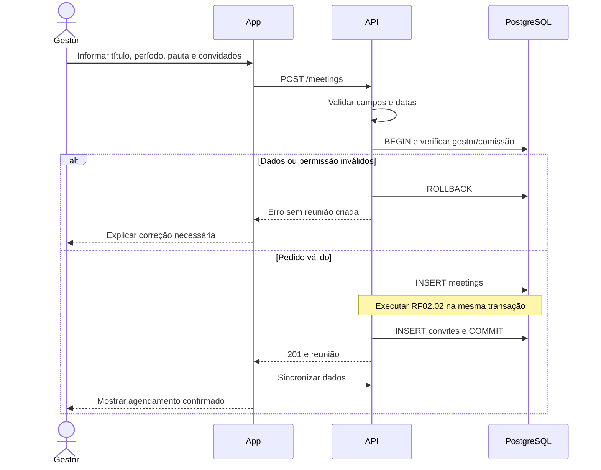

### SD02.02 — Convidar integrantes (RF02.02)

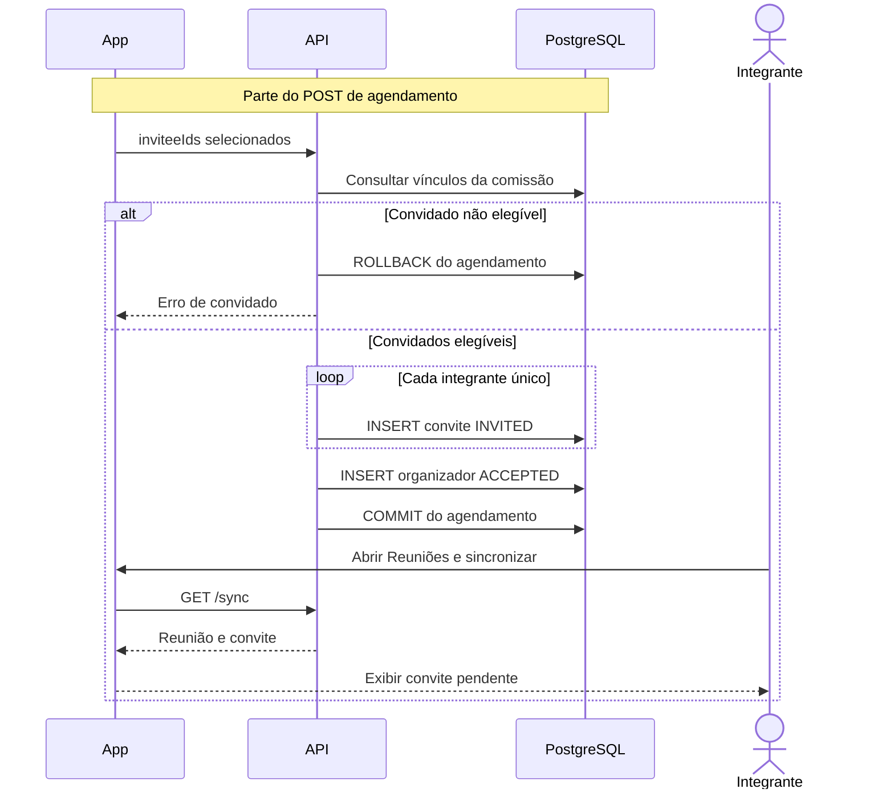

### SD02.03 — Responder convite (RF02.03)

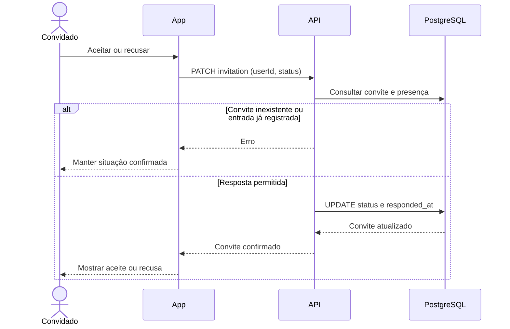

### SD02.04 — Registrar entrada (RF02.04)

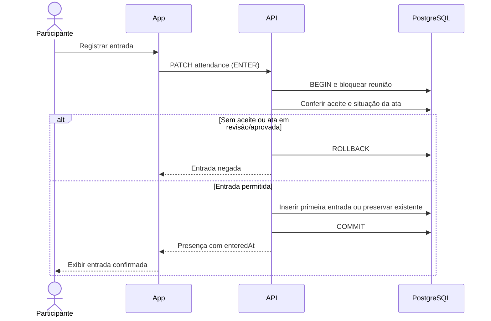

### SD02.05 — Registrar saída (RF02.05)

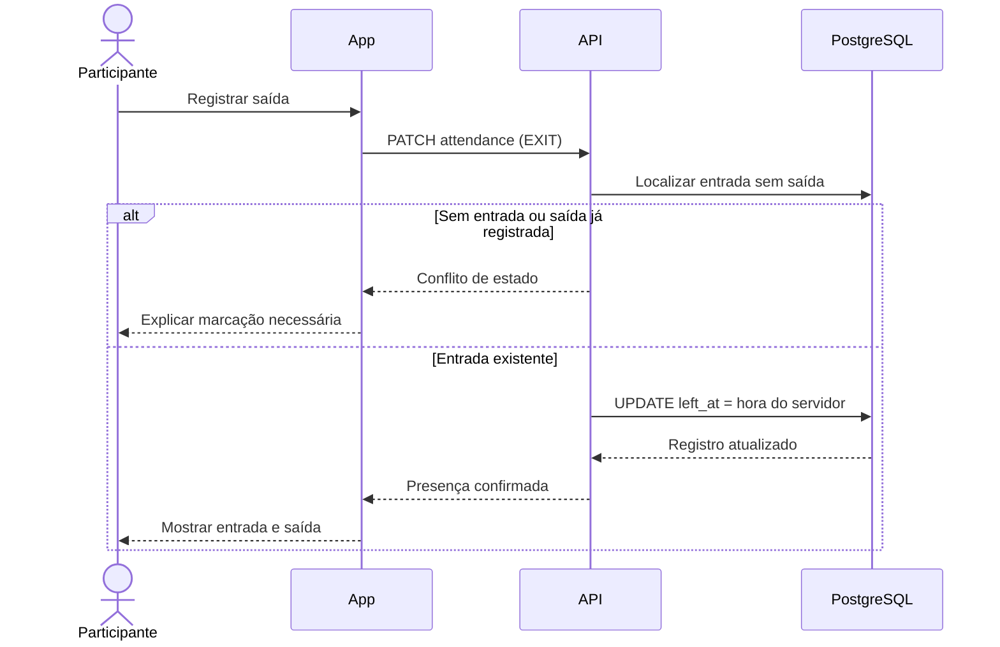

### SD02.06 — Gerar lista de presença (RF02.06)

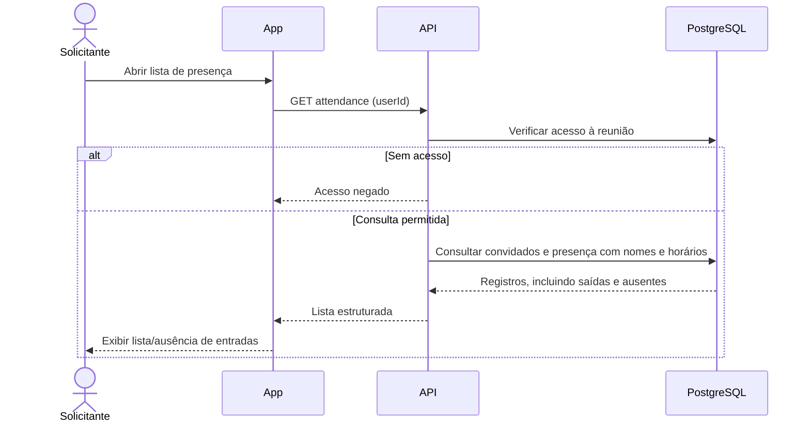

### SD02.07 — Criar ou corrigir ata (RF02.07)

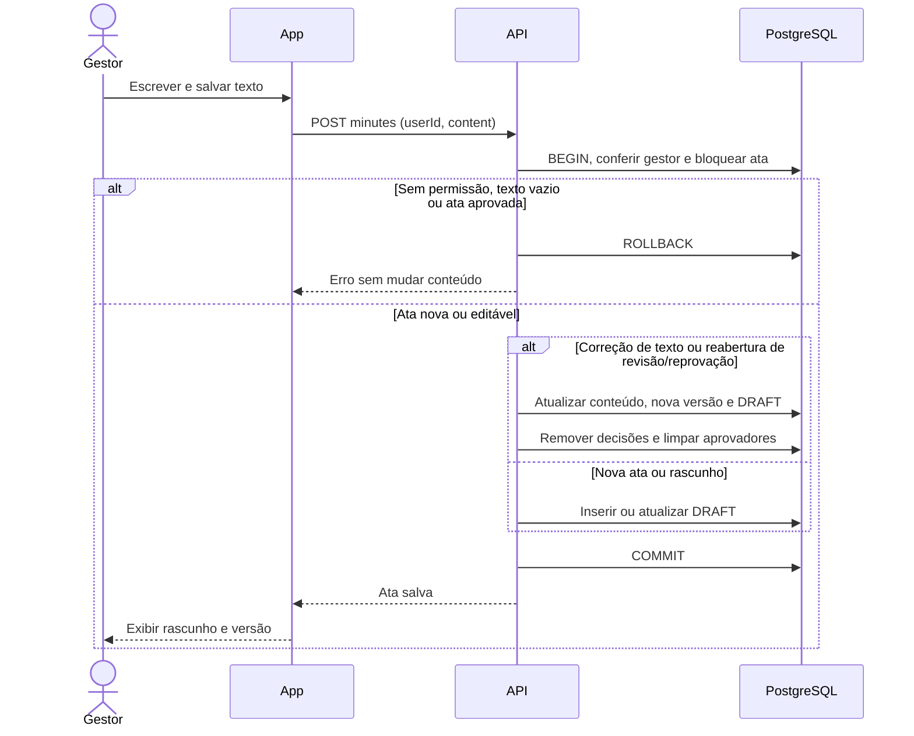

### SD02.08 — Submeter ata (RF02.08)

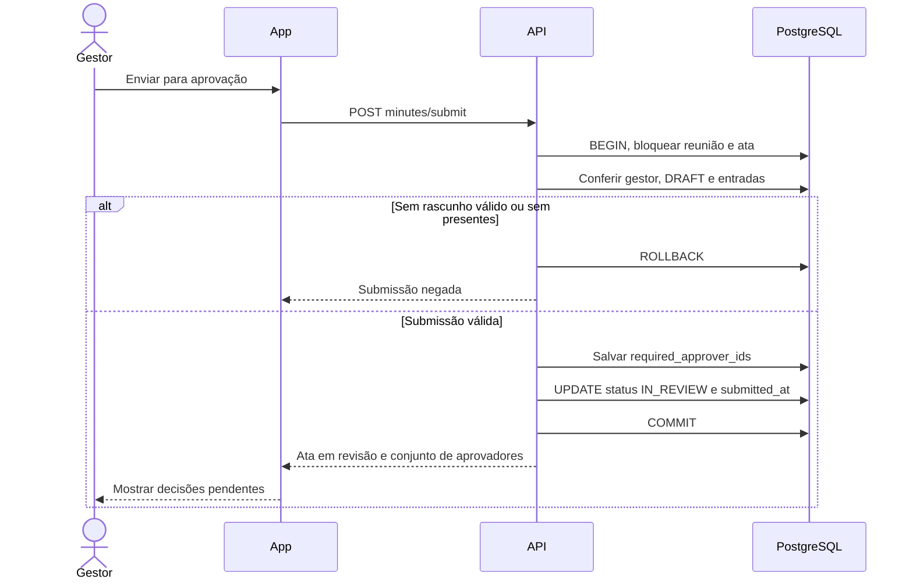

### SD02.09 — Aprovar ou solicitar correção (RF02.09)

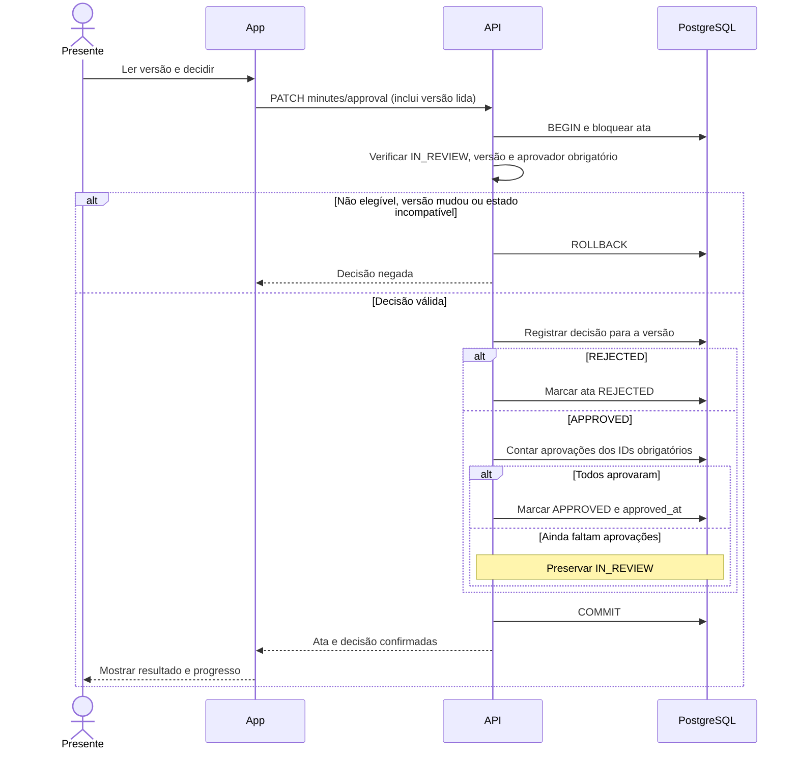

### SD02.10 — Gerar ata em PDF (RF02.10)

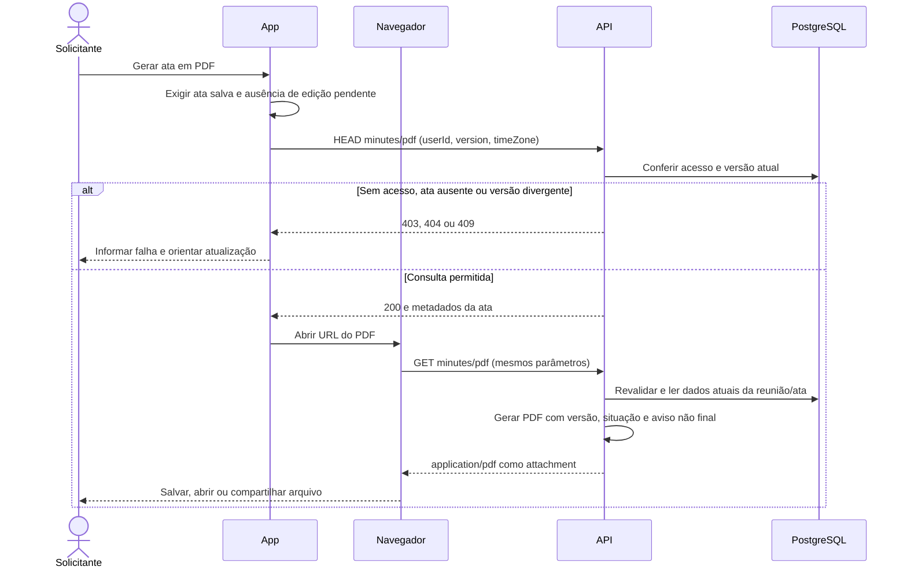

## 11. Matriz de rastreabilidade

| Fonte | Requisito/caso de uso | Regra principal | Dados | Sequência | Aceitação |
| --- | --- | --- | --- | --- | --- |
| Slide 5 | RF02.01 / UC02.01 | RN02.01–02 | meetings | SD02.01 | CA01–03 |
| Slides 5–6 | RF02.02 / UC02.02 | RN02.03–04 | meeting_invitations | SD02.02 | CA03–04 |
| Slide 6 | RF02.03 / UC02.03 | RN02.04–05 | meeting_invitations | SD02.03 | CA04–05 |
| Slide 6 | RF02.04 / UC02.04 | RN02.05–06, 09 | meeting_attendance | SD02.04 | CA05–06, 10 |
| Slide 6 | RF02.05 / UC02.05 | RN02.06–07 | meeting_attendance | SD02.05 | CA06–07 |
| Slide 7 | RF02.06 / UC02.06 | RN02.07 | meeting_attendance + users | SD02.06 | CA07 |
| Slide 7 | RF02.07 / UC02.07 | RN02.08, 11 | meeting_minutes | SD02.07 | CA08, 11–12 |
| Slide 7 + confirmação do usuário | RF02.08 / UC02.08 | RN02.09–11 | meeting_minutes + meeting_attendance | SD02.08 | CA09–11 |
| Slide 7 + confirmação do usuário | RF02.09 / UC02.09 | RN02.09–13 | meeting_minutes_approvals + meeting_minutes | SD02.09 | CA10–12, CA15 |
| Solicitação do usuário, 22/10/2026 | RF02.10 / UC02.10 | RN02.13, RN02.15; RNF02.11–12 | Dados atuais de ata, reunião, presença e decisões, sem tabela nova | SD02.10 | CA17–20 |
| Slide 8 | Compatibilidade e execução | RNF02.04–05 | App Android/iOS | Todos os fluxos | CA13–14 |
| Slide 10 + extensão solicitada | Artefatos documentais | Seções 3–10 deste documento | Classes e esquema | SD02.01–10 | Conferência documental |

Pontos de implementação: [tela de reuniões](../mobile/src/screens/MeetingsScreen.js), [cliente da API](../mobile/src/services/api.js), [integração principal do app](../mobile/App.js), [rotas de reuniões](../backend/src/routes/meetings.js), [sincronização](../backend/src/routes/sync.js) e [esquema](../backend/src/db/schema.sql).

## 12. Critérios e roteiro de aceitação

Estes cenários são o roteiro a executar. Não substituem o registro de resultados de testes. Use uma comissão com presidente P e integrantes A, B e C, todos com contas distintas. O proprietário pode ser P; se for outra pessoa e participar, sua entrada também o inclui na aprovação.

Os resultados automatizados e os limites da verificação estão registrados em [VERIFICACAO_INCREMENTO_2.md](VERIFICACAO_INCREMENTO_2.md).

| ID | Ação/cenário | Resultado esperado |
| --- | --- | --- |
| CA01 | P agenda com título, início, término posterior e pauta. | Reunião é gravada e aparece após sincronização/reabertura. |
| CA02 | Integrante A tenta agendar; ou P envia datas inválidas/término anterior. | API rejeita; não cria reunião/convites parciais. |
| CA03 | P convida A e B; envia também C de outra comissão numa chamada inválida de verificação. | Pedido com estranho é rejeitado. No pedido válido, um convite por integrante e um aceite para P. |
| CA04 | A aceita e B recusa. | Situações e horários da resposta são persistidos; aceite não conta presença. |
| CA05 | B tenta entrada sem aceitar; A registra entrada; A tenta recusar depois. | Entrada de B é negada; entrada de A funciona; recusa após entrada é bloqueada. |
| CA06 | P e A entram; repetir entrada; registrar saída; tentar saída sem entrada ou duas vezes. | Primeira entrada é preservada; saída exige entrada e não substitui a primeira saída. |
| CA07 | Consultar lista com P/A tendo entrado e B sem entrada; A já saiu. | Lista contém P e A, com horários, e não contabiliza B como presente. |
| CA08 | A tenta escrever ata; P salva texto vazio e depois válido. | A é negado, vazio é rejeitado, texto válido fica DRAFT. |
| CA09 | Tentar submeter ata em reunião sem entradas; depois submeter com P/A presentes. | Sem entrada é negado; com entradas fixa exatamente P/A e fica IN_REVIEW. |
| CA10 | B tenta votar sem entrada; P aprova; A aprova. Tentar nova entrada durante a revisão. | B é negado; só P não conclui; após A fica APPROVED; nova entrada é bloqueada. |
| CA11 | Em outra reunião, A solicita correção; P corrige e reenvia. | Ata fica REJECTED, correção abre nova versão; decisões anteriores não aprovam a nova versão. |
| CA12 | Corrigir ata em revisão; tentar alterar aprovada; repetir voto; enviar votos concorrentes; votar numa tela que leu uma versão antiga. | Correção interrompe revisão e limpa votos; aprovada fica protegida; contagem não duplica; voto de tela antiga recebe 409; unanimidade da mesma versão é preservada. |
| CA13 | Reabrir app após gravações e consultar com outro aparelho/conta autorizada; interromper rede durante pedido. | Dados confirmados permanecem no servidor; falha não produz sucesso fictício. |
| CA14 | Executar CA01–CA13 e CA15–CA20 em Android e iOS. | Controles acessíveis com teclado/rolagem, horários legíveis e comportamento equivalente; registrar aparelho, SO, build e resultado. |
| CA15 | Submeter uma ata que exige a decisão de A; remover A da comissão e abrir o app como A. Repetir com um ex-presidente removido, sem propriedade da organização. | A continua vendo a comissão/reunião histórica por seu convite, consulta presença/ata e pode decidir sobre a versão em que é aprovador obrigatório. Remoção não o exclui da unanimidade nem concede gestão ao ex-presidente. |
| CA16 | Tentar excluir a conta de um aprovador obrigatório durante a revisão e depois da aprovação; concorrer exclusão e submissão. | O servidor retorna 409 quando necessário ao histórico, a interface mantém a conta e os registros de presença/voto são preservados. Nenhum snapshot referencia uma conta excluída durante a submissão. |
| CA17 | Salvar atas em `DRAFT`, `IN_REVIEW`, `REJECTED` e `APPROVED` e gerar o PDF de cada uma. | Arquivo válido com conteúdo, versão e situação; as três primeiras identificam documento não final; exportação não altera ata nem votos. |
| CA18 | Conferir reunião sem ata salva, editar texto sem salvar e pedir uma versão antiga diretamente à API. | Opção só aparece após salvar a primeira ata; edições pendentes desabilitam o botão; versão antiga retorna 409, exigindo atualizar e exportar a versão atual. |
| CA19 | Gerar como gestor, convidado atual e convidado histórico; tentar como usuário sem acesso e com parâmetros inválidos. | Gestor/convidados autorizados recebem PDF; usuário sem acesso recebe 403; fuso/versão inválidos recebem 400; ata ausente recebe 404. |
| CA20 | Exportar conteúdo longo em português com acentos, presença e decisões; abrir/baixar no Android, iOS e computador. | Texto segue em páginas legíveis com versão/situação e fuso; download/compartilhamento funciona no navegador. Registrar evidência em cada plataforma. |

Para uma entrega auditável, registrar por cenário: data, responsável, ambiente/build, dados de teste, resultado observado, evidência e correção necessária. A atribuição de um requisito a cada membro da equipe, exigida no slide 8, deve ser preenchida com os nomes reais da equipe; esses nomes não foram fornecidos.

## 13. Preparar e demonstrar o incremento

### Preparação do ambiente

1. Configure banco/API e mobile conforme o [guia geral](../GUIA_USO_E_INICIALIZACAO.md). Para backend local, execute `npm --prefix backend install` após atualizar o checkout, incluindo `pdfkit`. O Docker instala essa dependência ao reconstruir a imagem. O PDF não exige novo APK/dev client; recarregue o JavaScript do app no Expo/Metro.
2. Com PostgreSQL disponível, na raiz execute `npm run migrate` para aplicar o esquema sem recriar dados nem redefinir senhas. O backend também aplica o esquema idempotente na inicialização. Para PostgreSQL no Docker, aguarde o serviço ficar saudável antes de iniciar a API.
3. Reinicie/reconstrua o backend após atualizar o código. Com Docker Compose: `docker compose up -d --build`. Banco com volume já existente não executa novamente os scripts de inicialização do container; a aplicação da migração continua necessária.
4. Use `npm --prefix mobile run start:dev-client` na mesma rede, ou `npm run dev:tunnel` na raiz para redes diferentes. Mantenha o terminal aberto e use o QR da sessão atual.
5. Prepare organização aprovada, comissão, presidente e ao menos um integrante. Como proprietário, aprove o acesso das pessoas à organização, adicione-as à comissão e atribua o cargo de presidente. Os vínculos/cargos devem estar confirmados no servidor; apenas dados locais antigos não habilitam os convites. Para Google nativo, use o build do Synple; o fluxo de reuniões também pode ser demonstrado com contas de e-mail/senha.

Não use `init-db` como atualização rotineira de um banco com usuários reais: esse utilitário também prepara contas de demonstração e pode redefinir suas credenciais. `migrate` aplica somente o esquema.

### Demonstração no app

1. Entre como presidente/proprietário. Abra **Reuniões**, selecione a comissão e preencha título, início, término no formato **DD/MM/AAAA HH:mm** e pauta. Em **Membros convidados**, selecione os integrantes e toque em **Agendar e convidar**.
2. Entre como integrante. Na mesma comissão, aceite o convite. Mostre uma recusa com outra conta para diferenciar convite de presença.
3. Use **Registrar entrada** como presidente e como cada pessoa que participou. Use **Registrar saída** ao terminar; confira a lista e os horários. **Gerar / compartilhar lista de presença** permite compartilhar o texto pelo sistema do celular.
4. Como gestor, escreva em **Discussões e decisões**, toque em **Salvar rascunho da ata** e depois **Enviar ata para aprovação**. Confira que a quantidade de aprovadores corresponde a quem registrou entrada, inclusive quem já saiu.
5. Como cada presente, leia a versão e toque em **Aprovar ata**. Mostre que o primeiro voto não encerra a ata quando ainda falta outro, e que a última aprovação a conclui. **Compartilhar ata aprovada** disponibiliza o texto final.
6. Em uma segunda reunião de teste, use **Rejeitar ata** e, se necessário, **Comentário (opcional)**. Como gestor, corrija e use **Salvar correção da ata**; envie novamente e mostre a nova versão sem os votos antigos.
7. Na reunião com a ata salva, toque em **Gerar ata em PDF**. Mostre a versão e a situação no arquivo; gere também um rascunho para demonstrar a identificação de documento não final. Salve ou compartilhe pelo navegador conforme o [tutorial de PDF](../GUIA_USO_E_INICIALIZACAO.md#gerar-ata-em-pdf). Uma edição não salva deve desabilitar o botão até a confirmação do salvamento.
8. Reabra o app para demonstrar persistência e repita o fluxo em Android e iOS antes da apresentação.

Use **Atualizar reuniões e aprovações** para consultar as decisões de outras contas sem sair da tela.

Se uma pessoa sair da comissão depois de participar, ela ainda encontra em **Reuniões** as reuniões para as quais já tinha convite. Deve concluir a decisão sobre uma ata que já inclua seu ID entre os aprovadores; essa consulta histórica não permite agendar nem editar atas por um cargo que ela deixou de exercer.

### Correção de pré-requisito: vínculos e cargos da comissão

O fluxo já existente de membros/cargos precisava persistir os vínculos no PostgreSQL para que a API pudesse conferir convidados e presidentes. A correção integra esse pré-requisito ao incremento:

| Operação | Contrato e efeito |
| --- | --- |
| Adicionar integrante | `POST /api/commissions/:commissionId/members` com `{ actorId, userId, role }`; proprietário da organização adiciona uma pessoa com acesso aprovado à organização ou o próprio proprietário. Retorna membro e HTTP 201; vínculo duplicado retorna 409. |
| Alterar cargo | `PATCH /api/commissions/:commissionId/members/:userId` com `{ actorId, role }`; proprietário atribui MEMBER ou COORDINATOR e recebe membro atualizado, HTTP 200. |
| Remover integrante | `DELETE /api/commissions/:commissionId/members/:userId` com `{ actorId }`; proprietário remove o vínculo e recebe `{ success: true }`, HTTP 200. |

Rastreabilidade: pré-condição de RF02.01/RF02.02, regra RN02.01/RN02.03 e tabela `commission_members`. Não é um novo requisito da apresentação. Para verificar, altere um cargo, recarregue/sincronize com outra conta e confirme que a permissão de agendamento e a lista de convidados refletem o vínculo persistido. As mesmas limitações de identidade da seção 8 se aplicam ao `actorId`.

### Pendências externas ao código

- Confirmar com a comunidade os itens adicionais de reunião e as decisões operacionais adotadas na seção 1.
- Obter o formulário padrão institucional e transpor as fichas, se necessário.
- Definir nomes dos responsáveis pelos requisitos e registrar execução nos dois sistemas operacionais.
- Antes de uso público em produção, implementar sessão/autorização vinculada à identidade, filtrar a sincronização e definir retenção dos dados de presença/atas.
