# Diagramas do Synple — revisão de 06/11/2026

> Pacote vigente: [Entrega definitiva](ENTREGA_DEFINITIVA/README.md). Modelos antigos preservados em [Versões anteriores](VERSOES_ANTERIORES/README.md). Organização revisada em 12/11/2026.

Notação UML para casos de uso, classes, sequências e implantação. O modelo físico é relacional, com entidades/tabelas, e não é apresentado como UML. Fontes PlantUML versionadas em `ENTREGA_DEFINITIVA/fontes/`; SVGs renderizados localmente em `ENTREGA_DEFINITIVA/renderizados/`. Não dependem de servidor externo para abrir.

Atores estão fora da fronteira Synple. As associações ator/caso de uso são linhas; especializações usam triângulo vazio voltado ao ator geral. Autenticação é pré-condição de operações privadas; não foi inserido `include` de login em todos os casos. Os papéis de proprietário/coordenador são contextuais. Campos que não aparecem nos recortes de classes constam no dicionário físico completo.

[Especificação principal](../incremento-1-especificacao-completa.md) · [Dicionário físico](../dicionario-banco-dados.md) · [Dicionário de classes e operações](../dicionario-classes.md).

## uc-autenticacao

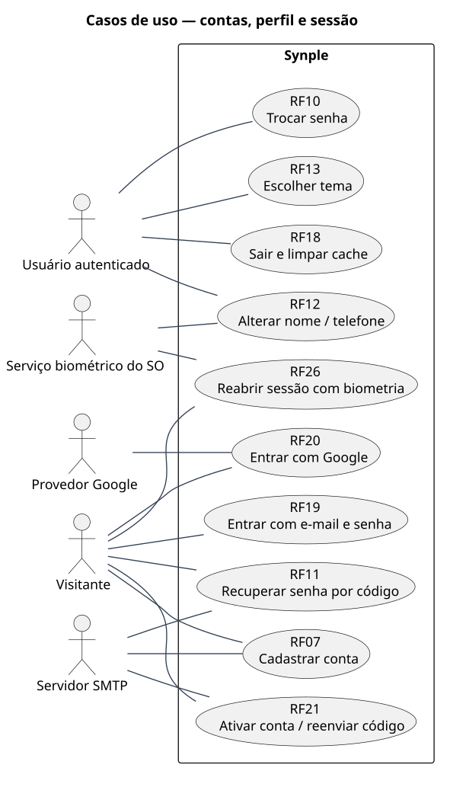

[Fonte editável](ENTREGA_DEFINITIVA/fontes/uc-autenticacao.puml) · [SVG](ENTREGA_DEFINITIVA/renderizados/uc-autenticacao.svg)

## uc-organizacoes

[Fonte editável](ENTREGA_DEFINITIVA/fontes/uc-organizacoes.puml) · [SVG](ENTREGA_DEFINITIVA/renderizados/uc-organizacoes.svg)

## uc-reunioes

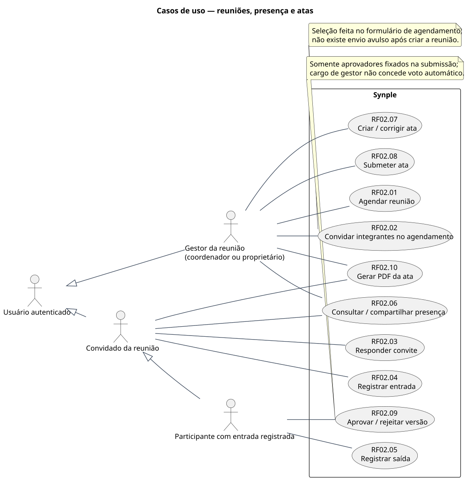

[Fonte editável](ENTREGA_DEFINITIVA/fontes/uc-reunioes.puml) · [SVG](ENTREGA_DEFINITIVA/renderizados/uc-reunioes.svg)

## uc-operacao

[Fonte editável](ENTREGA_DEFINITIVA/fontes/uc-operacao.puml) · [SVG](ENTREGA_DEFINITIVA/renderizados/uc-operacao.svg)

## classes-cadastro

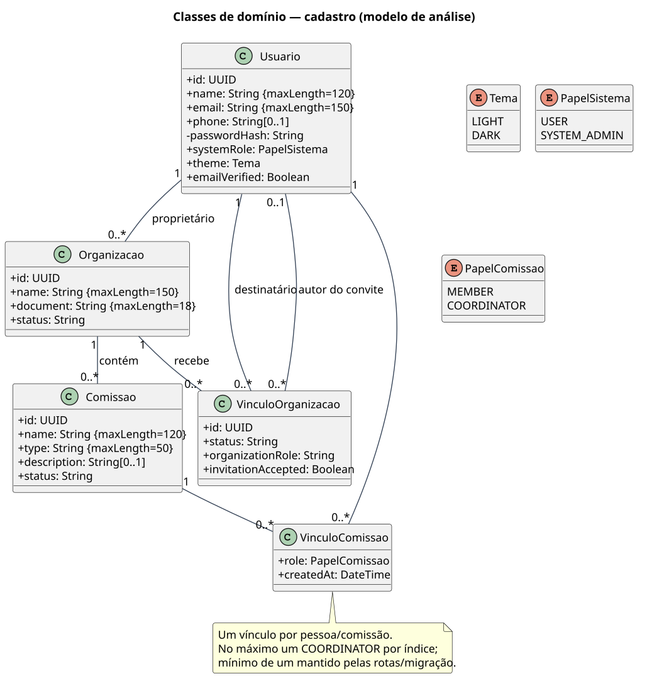

[Fonte editável](ENTREGA_DEFINITIVA/fontes/classes-cadastro.puml) · [SVG](ENTREGA_DEFINITIVA/renderizados/classes-cadastro.svg)

## classes-reunioes

[Fonte editável](ENTREGA_DEFINITIVA/fontes/classes-reunioes.puml) · [SVG](ENTREGA_DEFINITIVA/renderizados/classes-reunioes.svg)

## classes-servicos

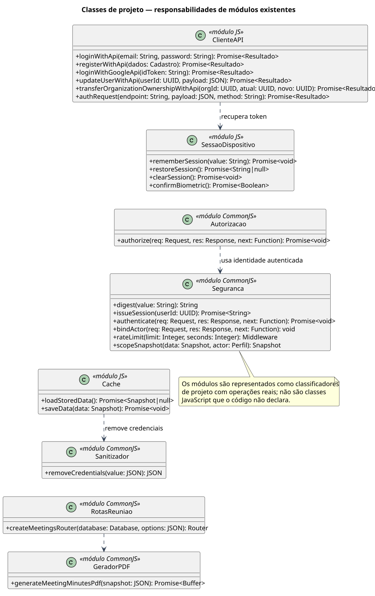

[Fonte editável](ENTREGA_DEFINITIVA/fontes/classes-servicos.puml) · [SVG](ENTREGA_DEFINITIVA/renderizados/classes-servicos.svg)

## relacional-cadastro

[Fonte editável](ENTREGA_DEFINITIVA/fontes/relacional-cadastro.puml) · [SVG](ENTREGA_DEFINITIVA/renderizados/relacional-cadastro.svg)

## relacional-reunioes

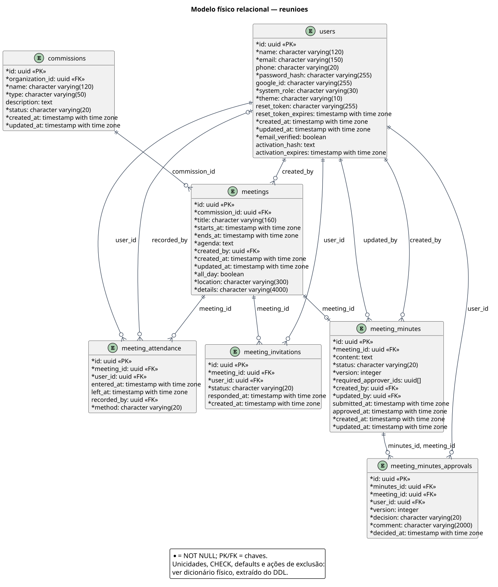

[Fonte editável](ENTREGA_DEFINITIVA/fontes/relacional-reunioes.puml) · [SVG](ENTREGA_DEFINITIVA/renderizados/relacional-reunioes.svg)

## relacional-seguranca

[Fonte editável](ENTREGA_DEFINITIVA/fontes/relacional-seguranca.puml) · [SVG](ENTREGA_DEFINITIVA/renderizados/relacional-seguranca.svg)

## relacional-incremento-3

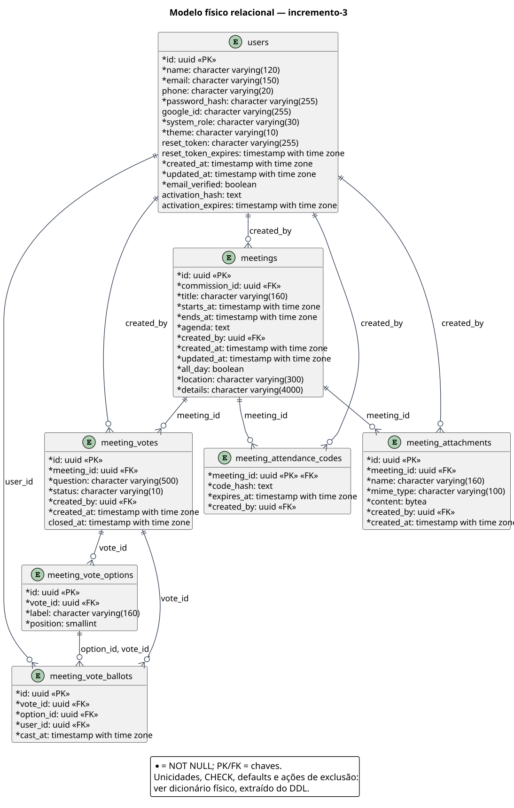

[Fonte editável](ENTREGA_DEFINITIVA/fontes/relacional-incremento-3.puml) · [SVG](ENTREGA_DEFINITIVA/renderizados/relacional-incremento-3.svg)

## seq-cadastro

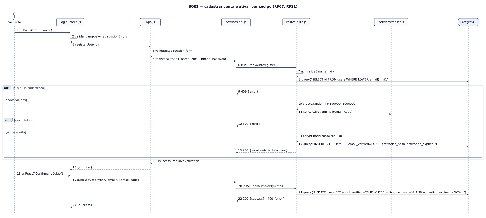

[Fonte editável](ENTREGA_DEFINITIVA/fontes/seq-cadastro.puml) · [SVG](ENTREGA_DEFINITIVA/renderizados/seq-cadastro.svg)

## seq-login

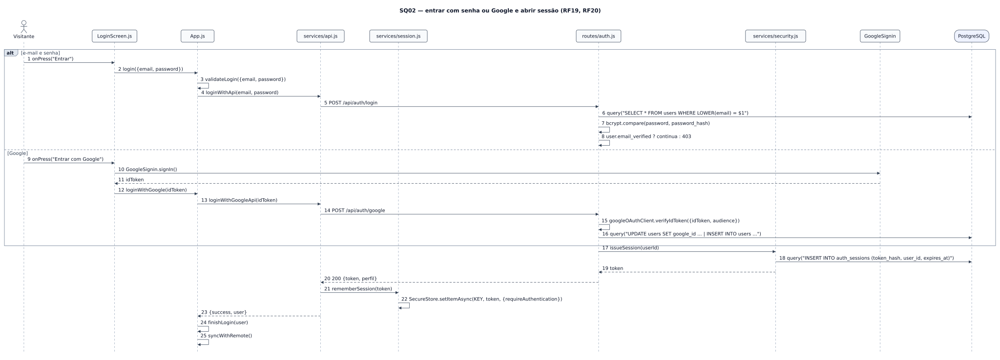

[Fonte editável](ENTREGA_DEFINITIVA/fontes/seq-login.puml) · [SVG](ENTREGA_DEFINITIVA/renderizados/seq-login.svg)

## seq-comando

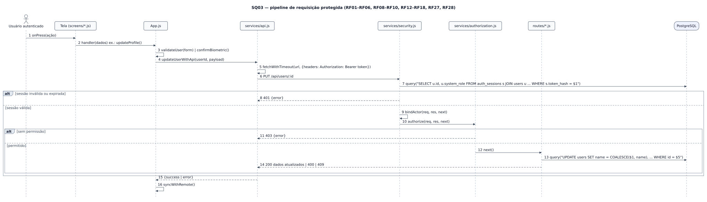

[Fonte editável](ENTREGA_DEFINITIVA/fontes/seq-comando.puml) · [SVG](ENTREGA_DEFINITIVA/renderizados/seq-comando.svg)

## seq-recuperacao

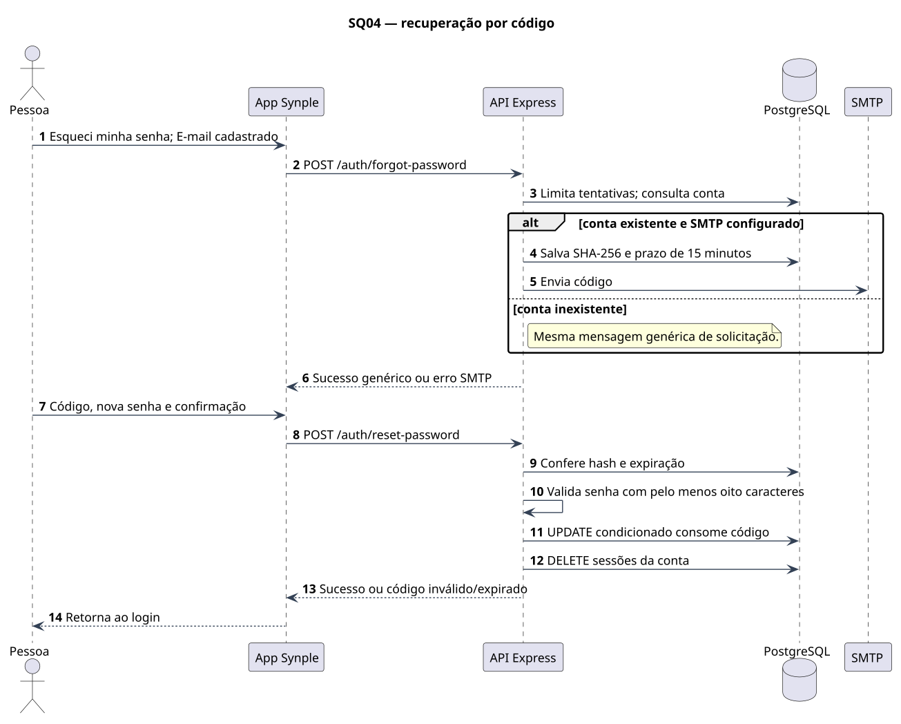

[Fonte editável](ENTREGA_DEFINITIVA/fontes/seq-recuperacao.puml) · [SVG](ENTREGA_DEFINITIVA/renderizados/seq-recuperacao.svg)

## seq-sincronizacao

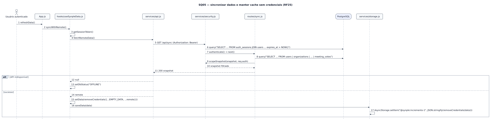

[Fonte editável](ENTREGA_DEFINITIVA/fontes/seq-sincronizacao.puml) · [SVG](ENTREGA_DEFINITIVA/renderizados/seq-sincronizacao.svg)

## seq-convite-org

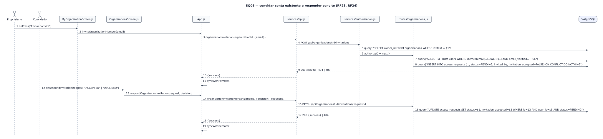

[Fonte editável](ENTREGA_DEFINITIVA/fontes/seq-convite-org.puml) · [SVG](ENTREGA_DEFINITIVA/renderizados/seq-convite-org.svg)

## seq-transferencia

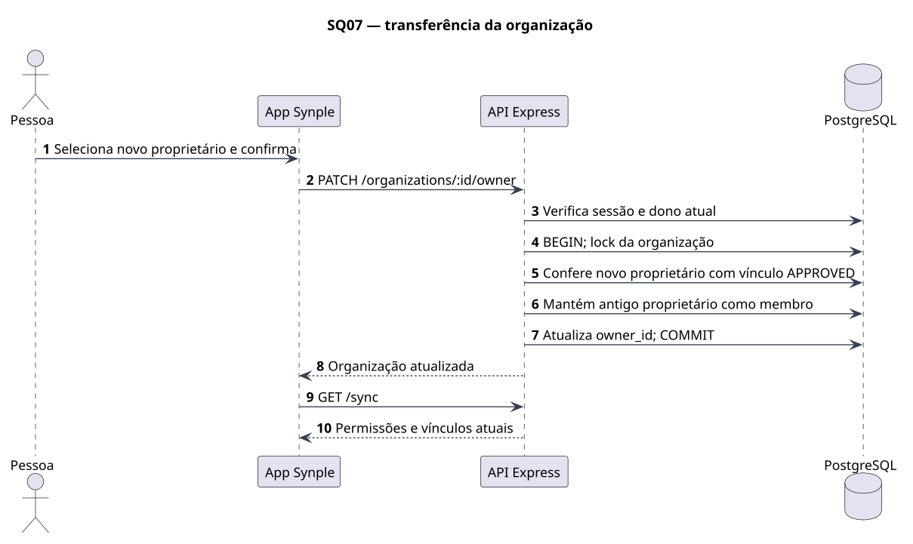

[Fonte editável](ENTREGA_DEFINITIVA/fontes/seq-transferencia.puml) · [SVG](ENTREGA_DEFINITIVA/renderizados/seq-transferencia.svg)

## seq-agendamento

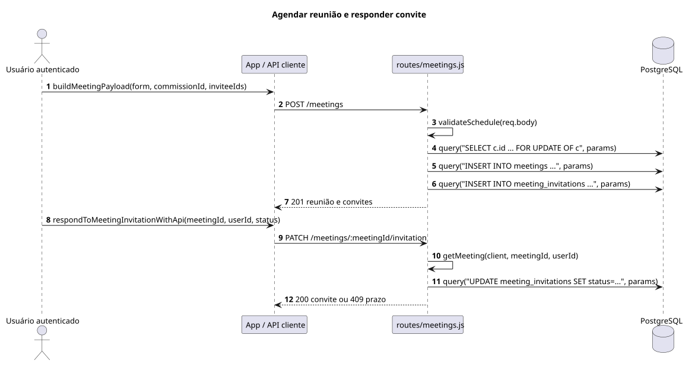

[Fonte editável](ENTREGA_DEFINITIVA/fontes/seq-agendamento.puml) · [SVG](ENTREGA_DEFINITIVA/renderizados/seq-agendamento.svg)

## seq-presenca

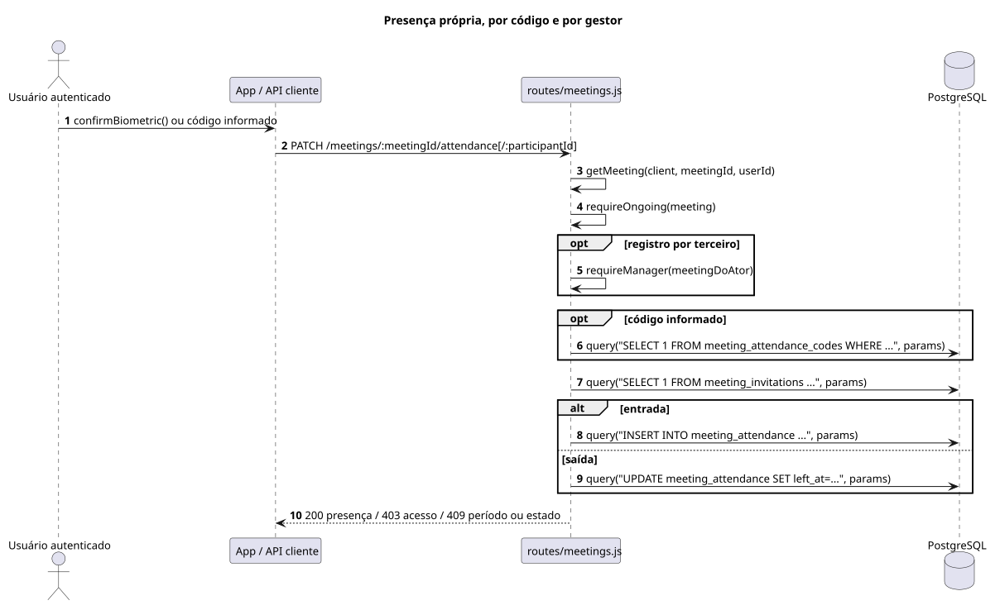

[Fonte editável](ENTREGA_DEFINITIVA/fontes/seq-presenca.puml) · [SVG](ENTREGA_DEFINITIVA/renderizados/seq-presenca.svg)

## seq-ata

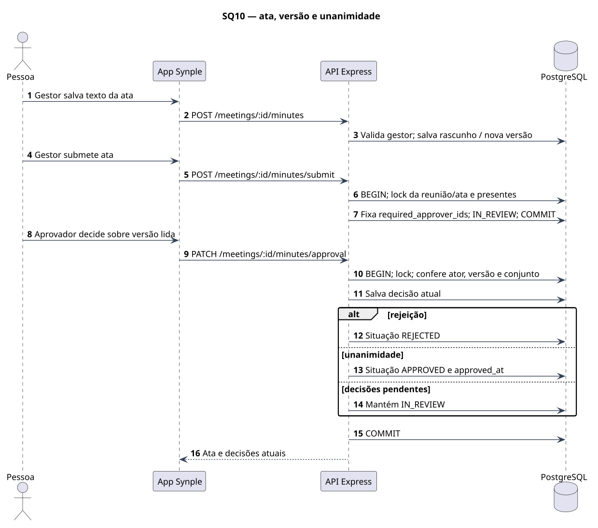

[Fonte editável](ENTREGA_DEFINITIVA/fontes/seq-ata.puml) · [SVG](ENTREGA_DEFINITIVA/renderizados/seq-ata.svg)

## seq-pdf

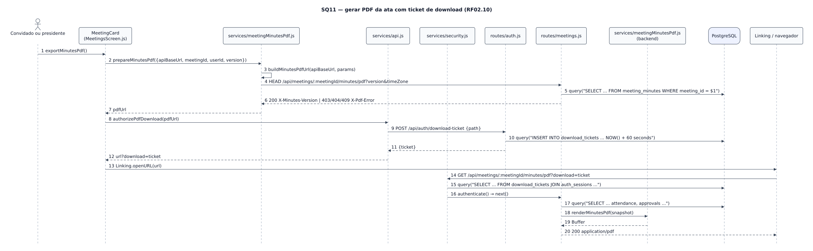

[Fonte editável](ENTREGA_DEFINITIVA/fontes/seq-pdf.puml) · [SVG](ENTREGA_DEFINITIVA/renderizados/seq-pdf.svg)

## seq-biometria

[Fonte editável](ENTREGA_DEFINITIVA/fontes/seq-biometria.puml) · [SVG](ENTREGA_DEFINITIVA/renderizados/seq-biometria.svg)

## seq-sistema

[Fonte editável](ENTREGA_DEFINITIVA/fontes/seq-sistema.puml) · [SVG](ENTREGA_DEFINITIVA/renderizados/seq-sistema.svg)

## implantacao

[Fonte editável](ENTREGA_DEFINITIVA/fontes/implantacao.puml) · [SVG](ENTREGA_DEFINITIVA/renderizados/implantacao.svg)

## uc-incremento-3

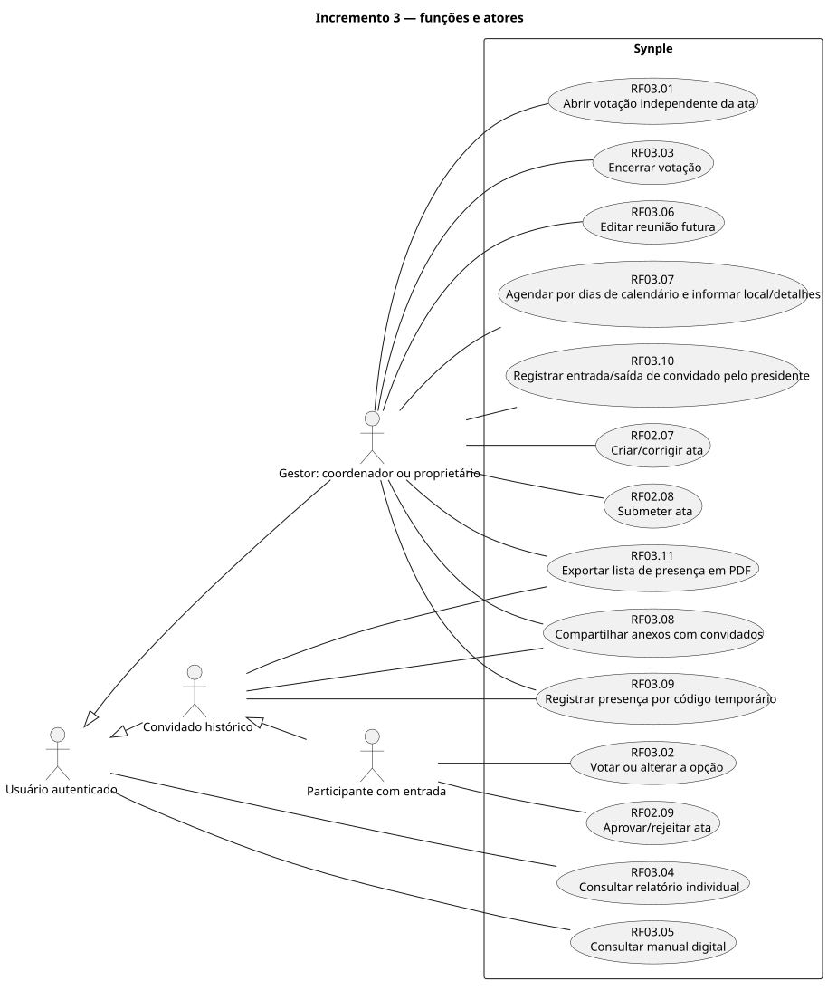

[Fonte editável](ENTREGA_DEFINITIVA/fontes/uc-incremento-3.puml) · [SVG](ENTREGA_DEFINITIVA/renderizados/uc-incremento-3.svg)

## classes-incremento-3

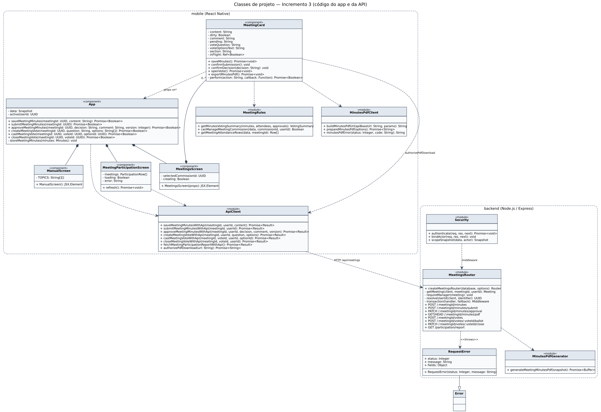

[Fonte editável](ENTREGA_DEFINITIVA/fontes/classes-incremento-3.puml) · [SVG](ENTREGA_DEFINITIVA/renderizados/classes-incremento-3.svg)

## seq-votacoes

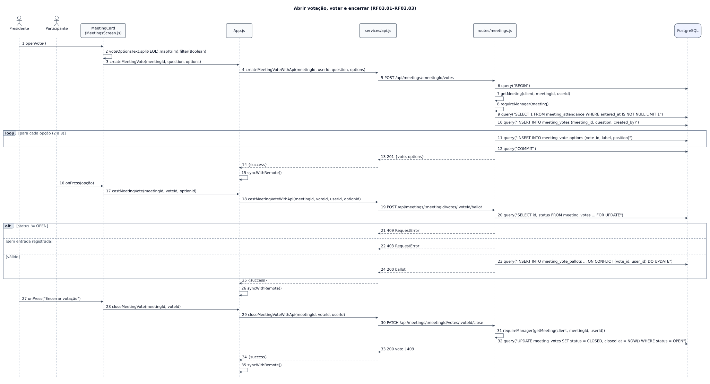

[Fonte editável](ENTREGA_DEFINITIVA/fontes/seq-votacoes.puml) · [SVG](ENTREGA_DEFINITIVA/renderizados/seq-votacoes.svg)

## seq-relatorio-participacao

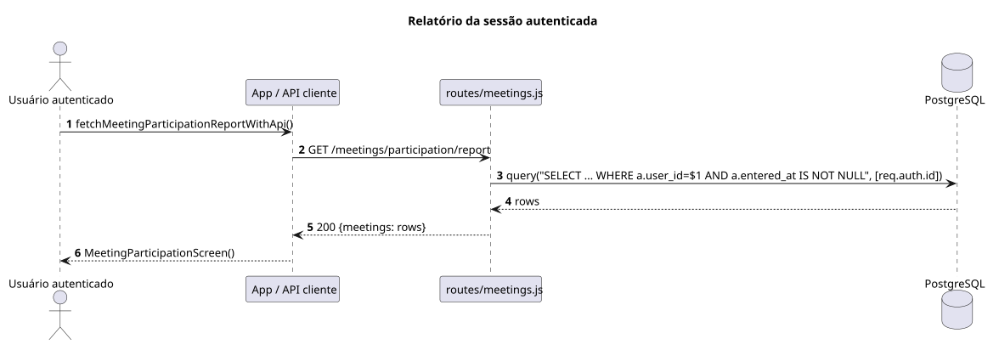

[Fonte editável](ENTREGA_DEFINITIVA/fontes/seq-relatorio-participacao.puml) · [SVG](ENTREGA_DEFINITIVA/renderizados/seq-relatorio-participacao.svg)

## seq-manual-consulta

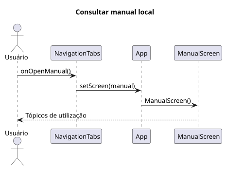

[Fonte editável](ENTREGA_DEFINITIVA/fontes/seq-manual-consulta.puml) · [SVG](ENTREGA_DEFINITIVA/renderizados/seq-manual-consulta.svg)

## seq-editar-reuniao

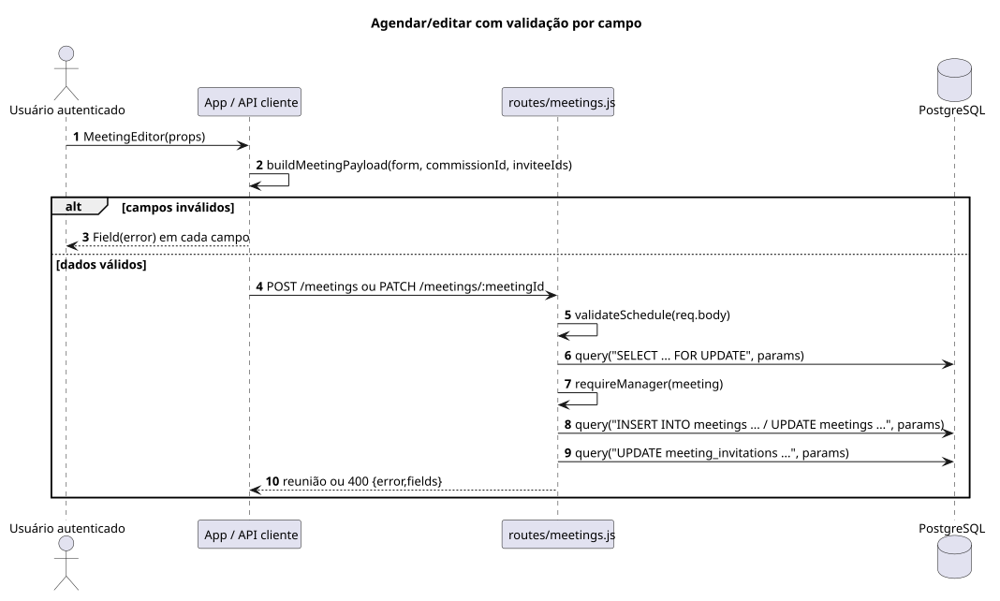

[Fonte editável](ENTREGA_DEFINITIVA/fontes/seq-editar-reuniao.puml) · [SVG](ENTREGA_DEFINITIVA/renderizados/seq-editar-reuniao.svg)

## seq-anexos

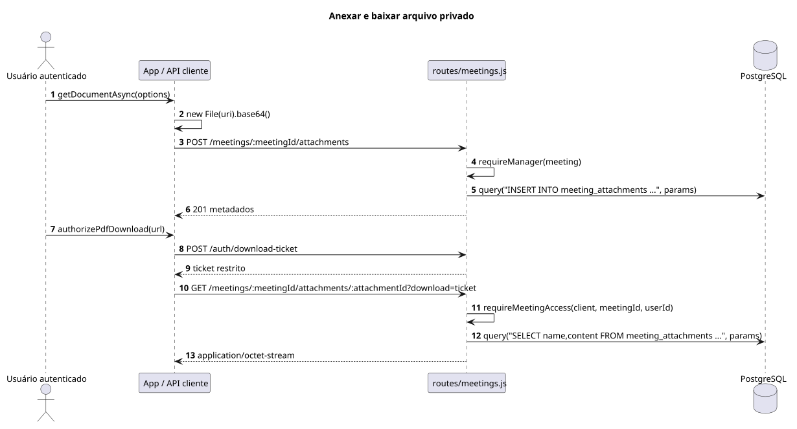

[Fonte editável](ENTREGA_DEFINITIVA/fontes/seq-anexos.puml) · [SVG](ENTREGA_DEFINITIVA/renderizados/seq-anexos.svg)

## seq-presenca-pdf

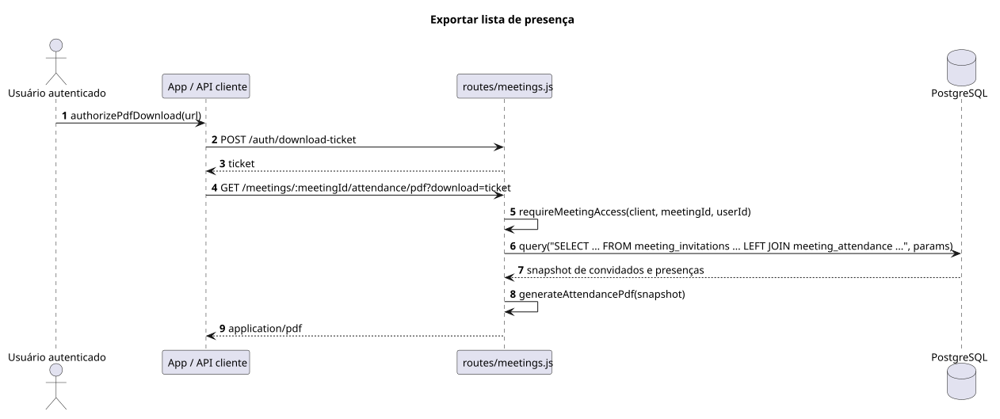

[Fonte editável](ENTREGA_DEFINITIVA/fontes/seq-presenca-pdf.puml) · [SVG](ENTREGA_DEFINITIVA/renderizados/seq-presenca-pdf.svg)

## Reprodução

Gerar fontes: `node Synple/scripts/generate-uml.cjs` após gerar o snapshot do DDL. Renderizar com Java e o PlantUML oficial: `java -jar plantuml.jar -tsvg -o ../renderizados docs/Diagramas/ENTREGA_DEFINITIVA/fontes/*.puml`. O JAR não é dependência do app nem foi incluído no repositório. Referências: [UML 2.5.1 — OMG](https://www.omg.org/spec/UML/2.5.1/About-UML), [casos de uso PlantUML](https://plantuml.com/use-case-diagram), [classes PlantUML](https://plantuml.com/class-diagram). Renderização sem erro comprova sintaxe; a conferência de atores, multiplicidades e comportamento exige confrontar o modelo com o código.
