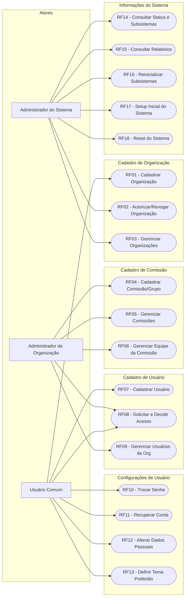
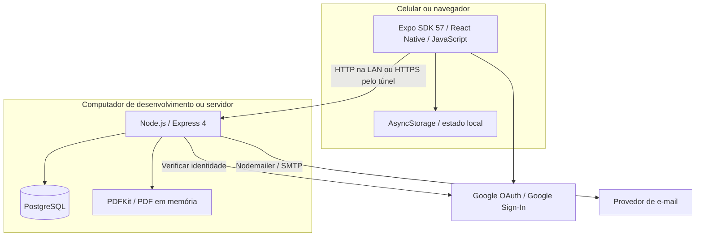
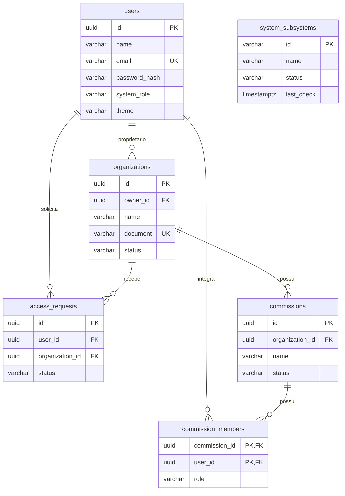

# Diagramas — Incremento 1

Atualizado em 23/10/2026. Organizações, usuários, comissões e administração.

[Índice dos diagramas](Diagramas_Casos_de_Uso.md) · [Especificação acadêmica](../incremento-1-especificacao-completa.md)

## Casos de uso

Os nós arredondados representam casos de uso; Mermaid não tem notação UML nativa para esse tipo de diagrama. RF16–RF18 correspondem a operações de demonstração no estado local do app; não reiniciam processos nem apagam o banco. RF14 consulta também métricas reais da API e do PostgreSQL. A recuperação RF11 envia código por SMTP e é iniciada no login.

## Implantação atual

Docker Compose executa API e PostgreSQL. Em outra rede, o script cria um Quick Tunnel Cloudflare para a API e um túnel Expo para o Metro. O development build é necessário para o login Google nativo. Não há chat, Redis, MinIO ou serviço de uploads na implementação.

## Modelo relacional do incremento 1

O modelo destaca os campos principais; a definição física completa está em [schema.sql](../../Synple/backend/src/db/schema.sql). As entidades de reuniões e atas estão no [incremento 2](Incremento_2.md). O painel administrativo consulta as métricas sem gravá-las em tabelas novas.
