# Diagramas — Incremento 2

Atualizado em 23/10/2026. Reuniões, convites, presença, atas, aprovação e PDF.

[Índice dos diagramas](Diagramas_Casos_de_Uso.md) · [Especificação completa e regras de acesso](../../Synple/docs/INCREMENTO_2.md)

O presidente da comissão ou proprietário gerencia reuniões e atas. Todos os convidados com entrada registrada até a submissão precisam aprovar a versão, inclusive o presidente quando presente. Convidados históricos preservam acesso e voto quando elegíveis. Gerar PDF não aprova a ata. Os diagramas de classes representam responsabilidades de domínio, sem exigir classes JavaScript formais.

## 3. Diagrama de casos de uso

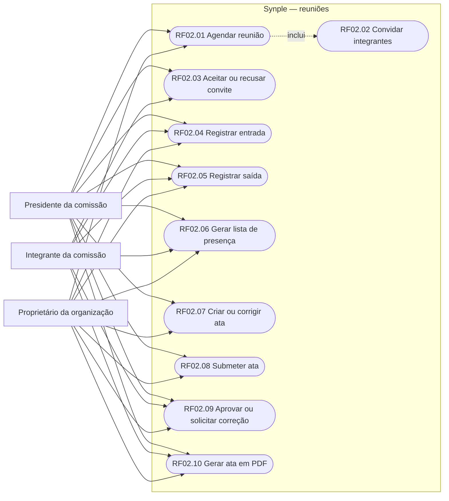

## 5. Regras de negócio

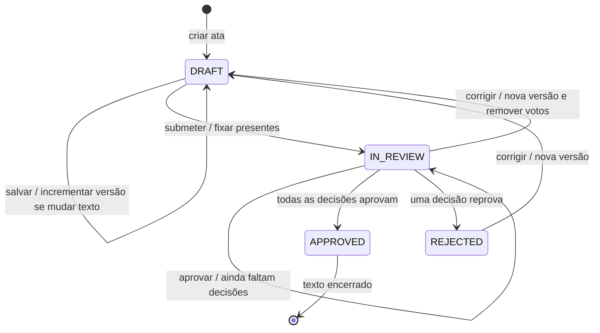

## 6. Diagrama de classes

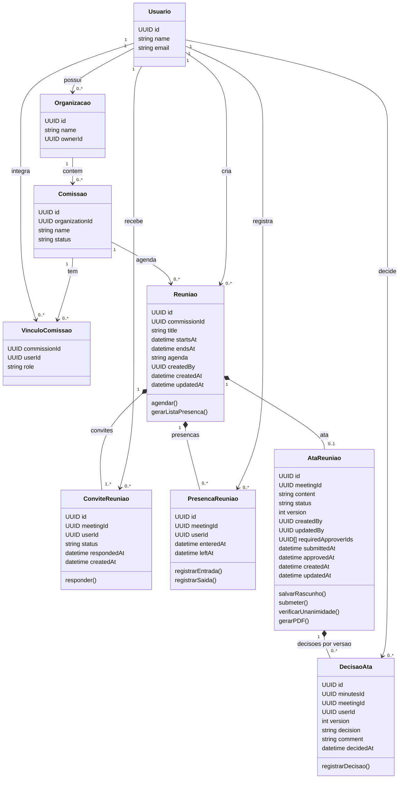

## 7. Diagrama relacional

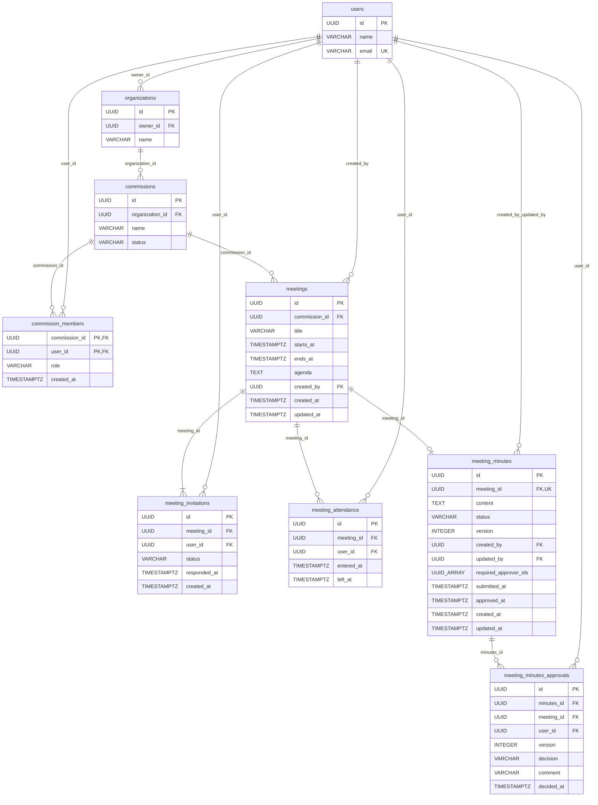

## SD02.01 — Agendar reunião (RF02.01)

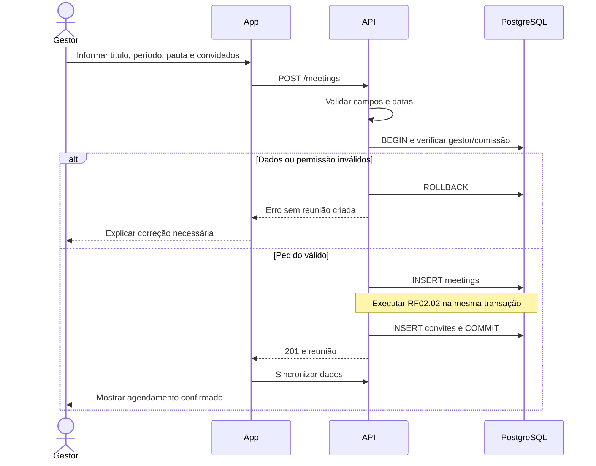

## SD02.02 — Convidar integrantes (RF02.02)

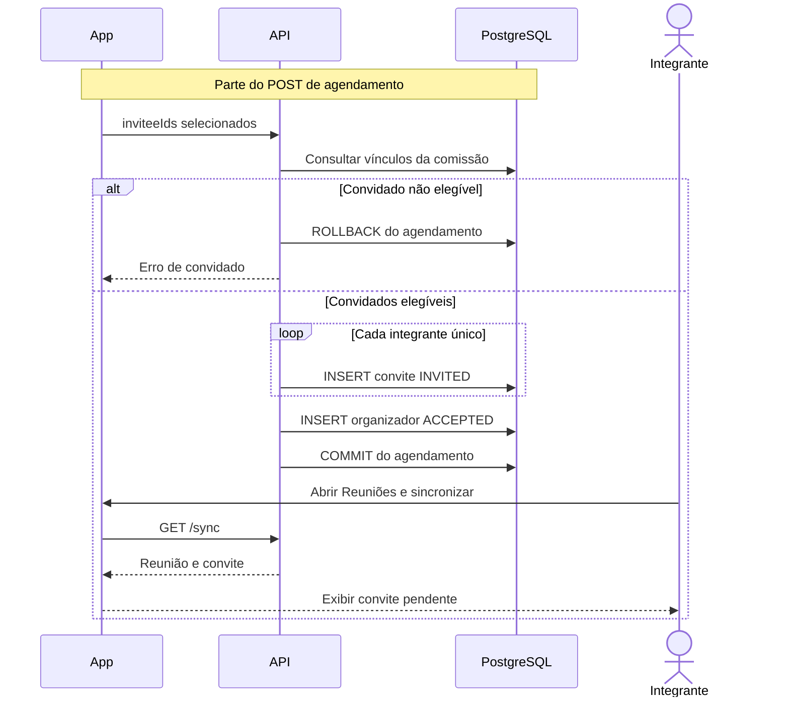

## SD02.03 — Responder convite (RF02.03)

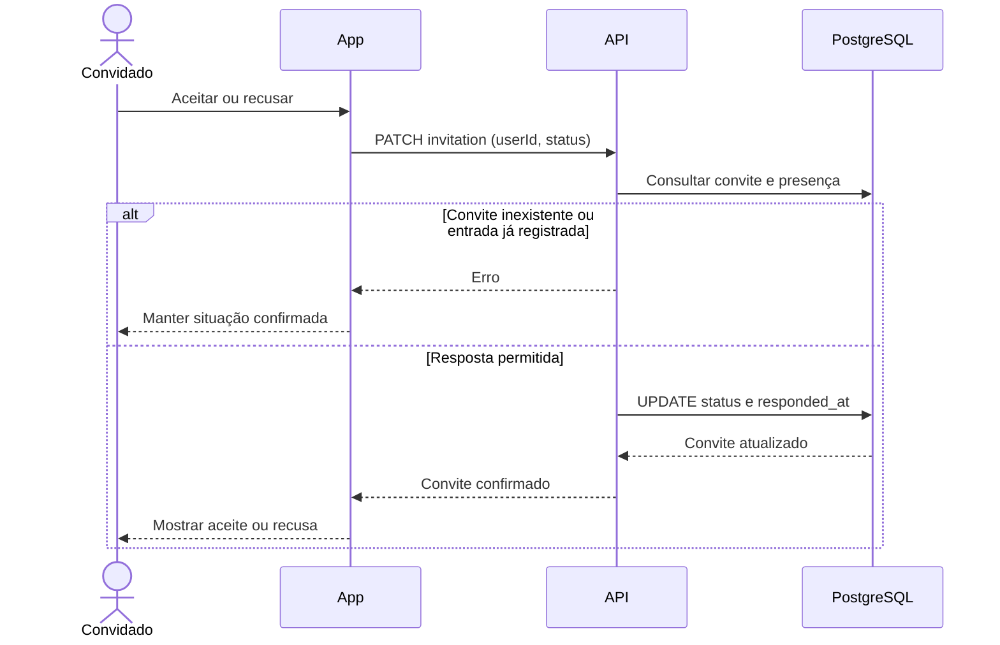

## SD02.04 — Registrar entrada (RF02.04)

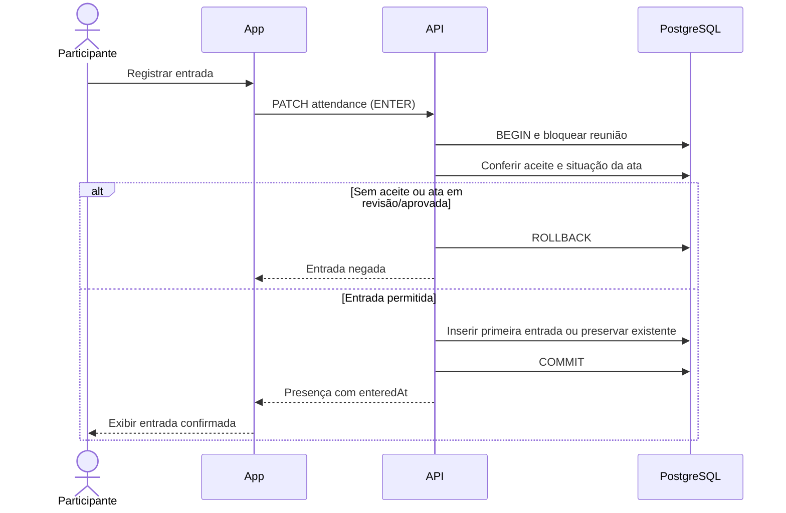

## SD02.05 — Registrar saída (RF02.05)

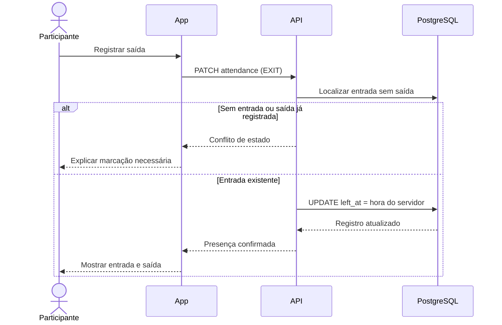

## SD02.06 — Gerar lista de presença (RF02.06)

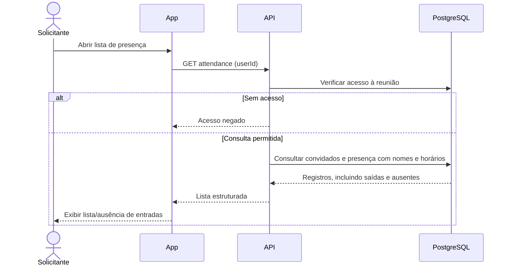

## SD02.07 — Criar ou corrigir ata (RF02.07)

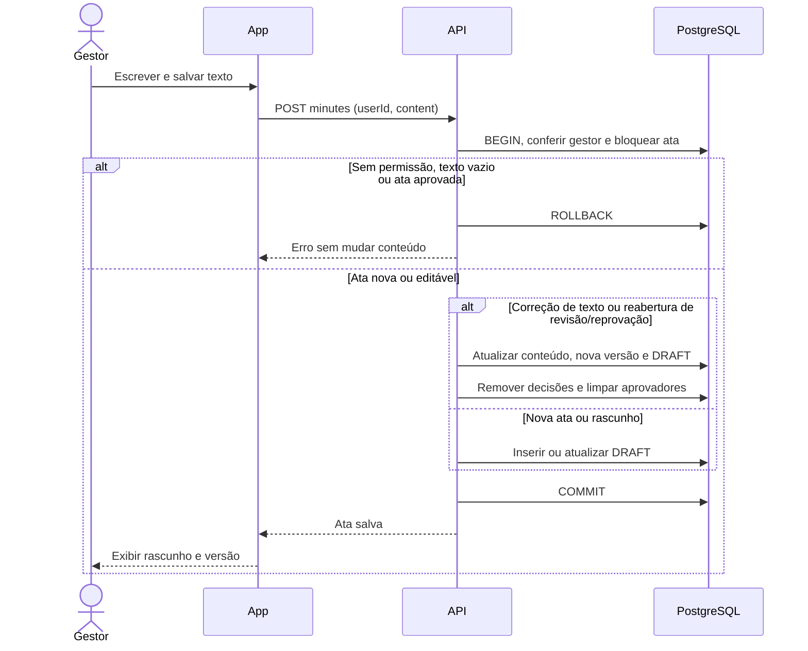

## SD02.08 — Submeter ata (RF02.08)

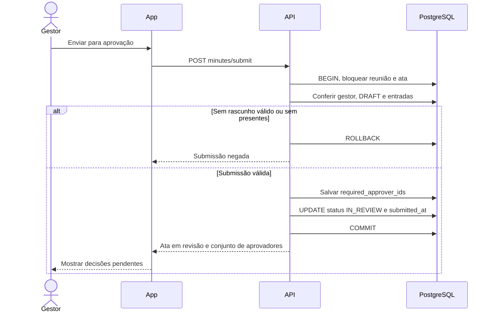

## SD02.09 — Aprovar ou solicitar correção (RF02.09)

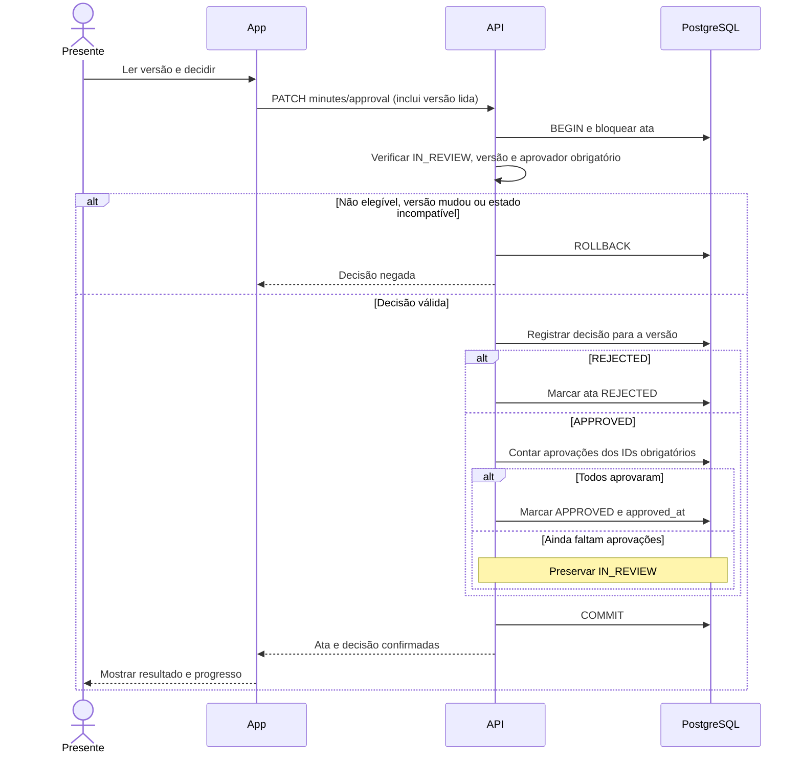

## SD02.10 — Gerar ata em PDF (RF02.10)

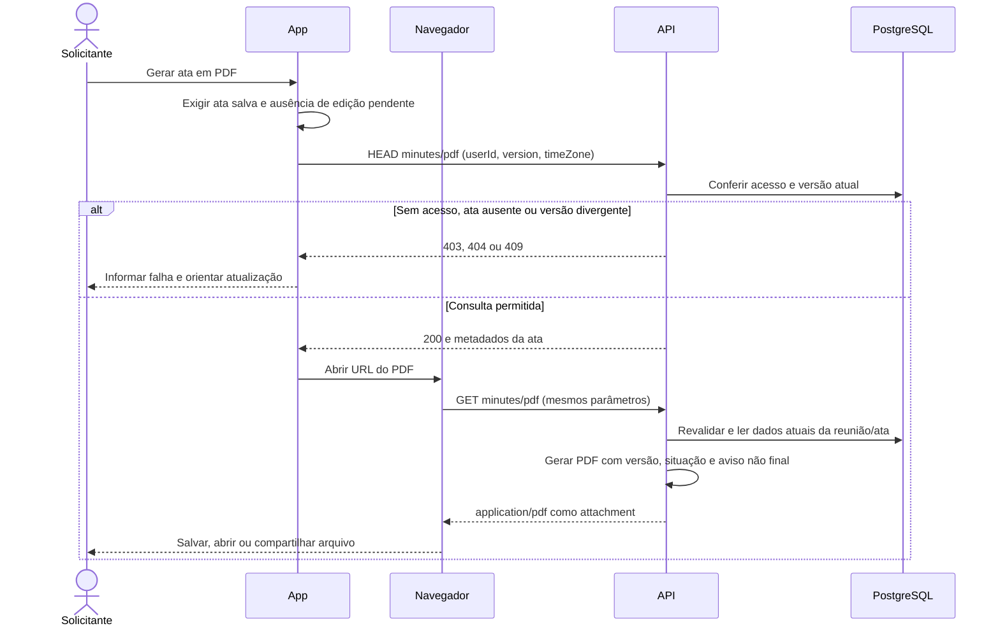
