# Especificação principal de engenharia de software — Synple

**Revisão:** 06/11/2026. **Escopo:** cadastro, organizações, comissões, contas, configuração, operação e incremento 2 (reuniões/atas). **Base:** código presente neste checkout, DDL e relatórios de teste identificados; não presume implantação em outro computador.

Esta revisão substitui integralmente a especificação anterior. Não descreve como implementados chat, calendário gráfico, disponibilidade, cancelamento de reunião, restauração de backup ou reinício de processos pelo celular. O levantamento de requisitos com a comunidade e os testes físicos ainda dependem de evidências externas.

## 1. Fontes, convenções e rastreabilidade

| Fonte | Uso nesta especificação |
| --- | --- |
| [App.js](../Synple/mobile/App.js), [telas](../Synple/mobile/src/screens) e [API cliente](../Synple/mobile/src/services/api.js) | Nomes de campos/ações, validações locais e tratamento de respostas |
| [Rotas Express](../Synple/backend/src/routes), [segurança](../Synple/backend/src/services/security.js) e [autorização](../Synple/backend/src/services/authorization.js) | Contrato HTTP, identidade, permissões e regras executadas |
| [DDL](../Synple/backend/src/db/schema.sql) | Estrutura física e restrições efetivamente existentes |
| [Versions](tecnologias-versoes.md) | Manifests e versões resolvidas no lockfile, incluindo dependências diretas |
| [Verificação das correções](VERIFICACAO_CORRECOES.md) | Execuções anteriores identificadas: 35 testes backend, 23 mobile e exportações; não são testes novos desta revisão documental |
| Enunciado do incremento 2, identificado na documentação anterior como slides 4–10 da apresentação f2b56f41bcb6-5d9f38abce32442c931a4ff49a379768.pptx | Origem declarada das funcionalidades de reunião; o arquivo original não está sendo apresentado como revalidado nesta revisão |

IDs RF01–RF18 foram preservados para rastrear a entrega anterior; RF16–RF18 agora descrevem o que existe no aplicativo, sem alegar reinício/setup/reset reais. RF19–RF28 explicitam contas/sessão/convites e gestão antes misturados a outros fluxos. RF02.01–RF02.10 pertencem ao incremento 2: o ponto faz parte do identificador e não os confunde com RF02.

Cada ficha registra ator, gatilho, pré/pós-condições, fluxo, exceções, dados e contrato. RF descreve comportamento; RNF descreve qualidade verificável. Contratos técnicos de serialização/colunas complementam o requisito, sem substituir o objetivo do usuário. Onde a implementação é incompleta, o limite fica escrito como tal, em vez de inventar uma garantia.

## 2. Arquitetura, versões e configurações

Cliente Expo SDK 58/React Native 0.88/React 19.3, JavaScript, componentes próprios; API Express 4/Node 22, SQL parametrizado com pg e PostgreSQL 16. Não há ORM Sequelize nem classes JavaScript de entidade declaradas. O modelo de classes abaixo é de análise/projeto; operações de módulos são identificadas separadamente. Requisitos e rastreabilidade do Incremento 3 estão em [documento complementar](INCREMENTO_3.md).

Android mínimo 7/API 24; iOS mínimo 16.4; Node mínimo 22.13. [Tabela completa de tecnologias](tecnologias-versoes.md). Faixa semver do manifest, versão do lockfile e versão do processo/imagem são coisas distintas; tags Docker e CLI latest não fixam patch. A compatibilidade declarada não comprova teste em todos os aparelhos.

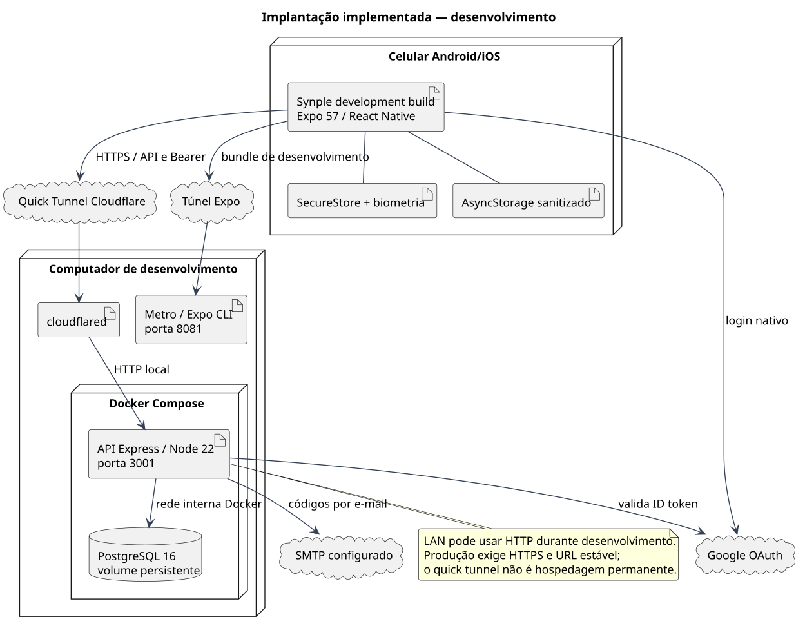

API: EXPO_PUBLIC_API_URL tem precedência; há fallback de endereço por ambiente em api.js/network.json e detecção do IP local. O túnel Expo expõe Metro, não a API. O script tunnel abre também Cloudflare para a API. Em produção exige-se HTTPS e endereço estável; quick tunnel muda ao reiniciar e depende do computador ligado.

| Configuração | Local/representação | Observação |
| --- | --- | --- |
| URL API | mobile/.env, EXPO_PUBLIC_API_URL | Pública; sem credencial secreta no cliente |
| OAuth mobile | EXPO_PUBLIC_GOOGLE_WEB_CLIENT_ID e ANDROID/IOS_CLIENT_ID | IDs reais correspondentes ao pacote/assinatura; não são Client Secrets |
| OAuth backend | GOOGLE_OAUTH_CLIENT_IDS, lista separada por vírgula | Públicos permitidos para validar o ID token |
| E-mail | backend/.env: SMTP_SERVICE/HOST/PORT/USER/PASS e EMAIL_FROM | Segredo SMTP somente no servidor; entrega real não foi testada aqui |
| Sessão | Bearer de 64 caracteres hex; banco guarda SHA-256 | Validade de sete dias; revogação por logout/troca/recuperação |
| Cache | AsyncStorage, chave @synple:incremento-1, JSON sanitizado | Não contém senha/token; não autoriza acesso |
| Sessão protegida | SecureStore, chave synple.session.v1, requireAuthentication | Condicionada a hardware, biometria cadastrada e módulo nativo; web usa memória |

Exemplo fictício de preferência em snapshot/cache: { "users": [{ "id": "uuid-da-pessoa", "theme": "DARK" }] }. Persistência oficial em users.theme; LIGHT/DARK, não L/D. A gravação usa JSON.stringify(removeCredentials(data)). Cache anterior é sanitizado e não é mesclado de volta como fonte de credenciais.

## 3. Atores e permissões

| Ator | Definição e alcance |
| --- | --- |
| Visitante | Pessoa sem sessão válida; pode cadastrar/ativar/recuperar conta ou iniciar login |
| Usuário autenticado | Identidade obtida da sessão validada; não do seletor de modo nem de userId no JSON |
| Administrador do sistema | system_role=SYSTEM_ADMIN, para gestão sistêmica e dados operacionais |
| Proprietário da organização | organizations.owner_id; papel contextual, transferível, não equivale a SYSTEM_ADMIN |
| Coordenador de comissão | commission_members.role=COORDINATOR; gestor contextual da reunião junto ao proprietário |
| Convidado de reunião | Pessoa em meeting_invitations; acesso histórico pode permanecer após remoção da comissão |
| Aprovador da ata | Pessoa com entrada até submissão, fixada em required_approver_ids; cargo não substitui presença/decisão |
| Google, SMTP e serviço biométrico do SO | Sistemas externos que apoiam autenticação/envio/confirmação local |

API pública: /health e rotas de login/cadastro/Google/recuperação/ativação/reenvio. Demais recursos exigem sessão. PDF em navegador aceita ticket vinculado à sessão e ao caminho. Autenticação é pré-condição de operações privadas, não um include artificial desenhado em cada caso de uso. Regras de situação e associação ainda têm diferenças entre interface e algumas rotas; consultar seção 11.

## 4. Diagramas de casos de uso UML

Os atores ficam fora da fronteira Synple. Linhas representam associações; triângulo vazio indica especialização contextual. Não foram usadas setas de fluxo de processo ou componentes técnicos como atores internos.

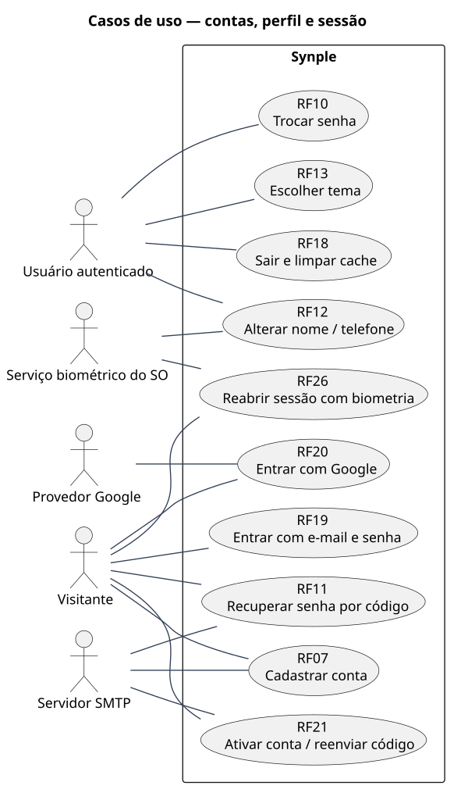

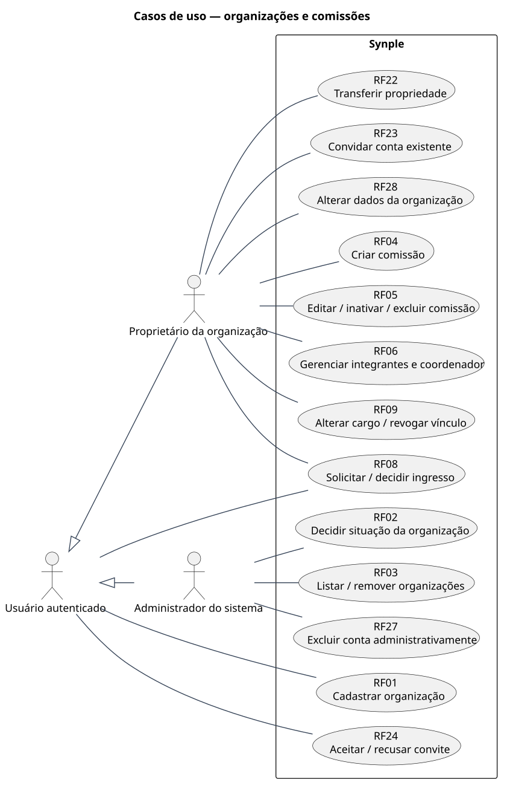

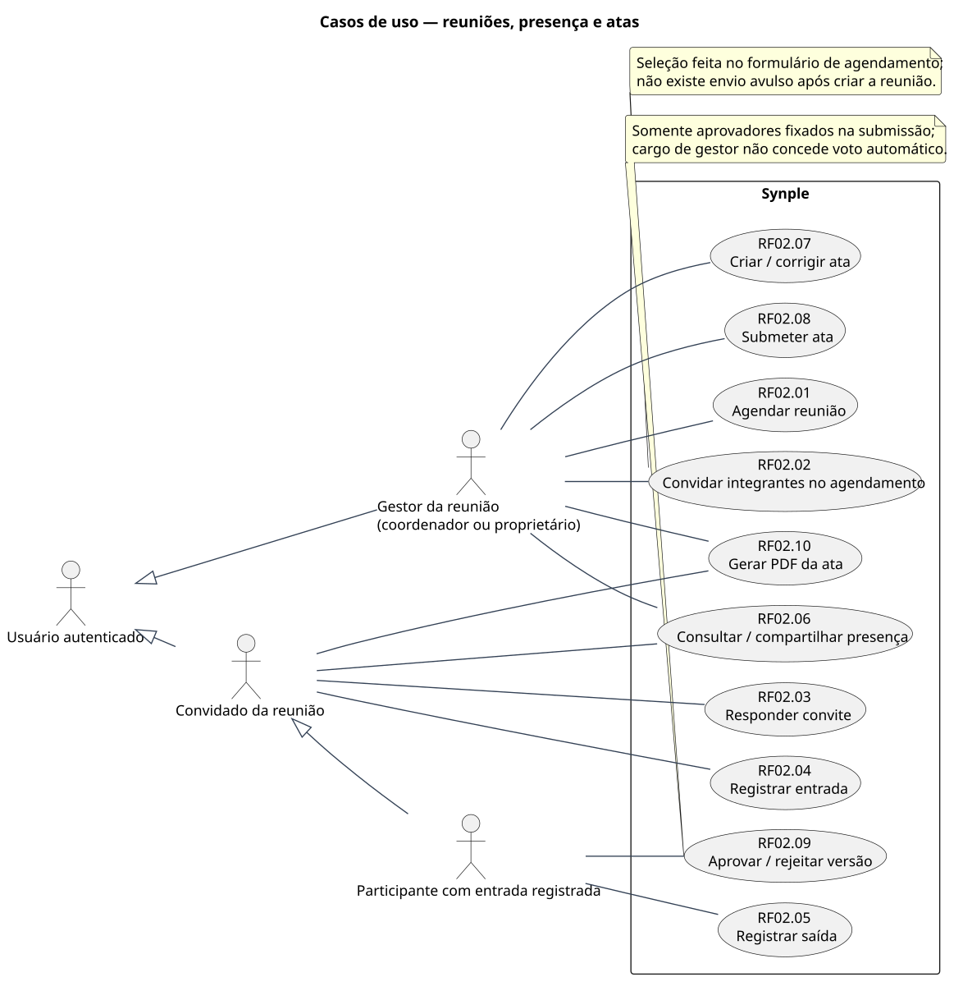

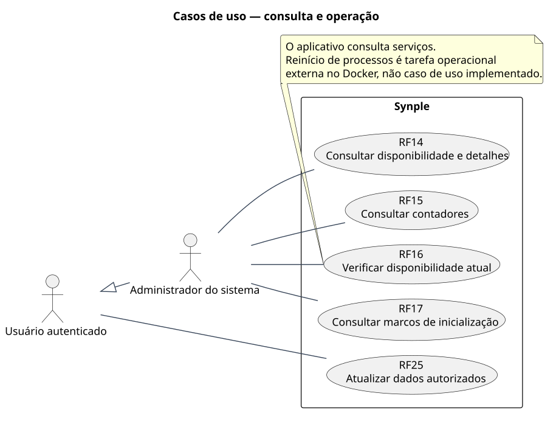

Fontes editáveis e todas as imagens: [catálogo dos diagramas](Diagramas/Diagramas_Casos_de_Uso.md). Referência normativa: [UML 2.5.1 — OMG](https://www.omg.org/spec/UML/2.5.1/About-UML).

## 5. Requisitos funcionais e fichas de casos de uso

| ID | Objetivo | Ator |
| --- | --- | --- |
| [RF01](#rf01) | Cadastrar organização | Usuário autenticado |
| [RF02](#rf02) | Decidir situação da organização | Administrador do sistema |
| [RF03](#rf03) | Listar e remover organizações | Administrador do sistema |
| [RF04](#rf04) | Criar comissão | Proprietário da organização |
| [RF05](#rf05) | Editar, ativar/inativar e excluir comissão | Proprietário da organização |
| [RF06](#rf06) | Gerenciar integrantes e transferir coordenação | Proprietário da organização |
| [RF07](#rf07) | Cadastrar conta local pendente de ativação | Visitante |
| [RF08](#rf08) | Solicitar e decidir ingresso na organização | Usuário autenticado / proprietário; administrador autorizado na API |
| [RF09](#rf09) | Alterar cargo e revogar vínculo organizacional | Proprietário da organização |
| [RF10](#rf10) | Trocar senha autenticada | Usuário autenticado |
| [RF11](#rf11) | Recuperar senha com código por e-mail | Visitante |
| [RF12](#rf12) | Alterar nome e telefone com confirmação biométrica local | Usuário autenticado |
| [RF13](#rf13) | Definir tema do perfil | Usuário autenticado |
| [RF14](#rf14) | Consultar informação operacional real | Administrador do sistema |
| [RF15](#rf15) | Consultar contadores administrativos | Administrador do sistema |
| [RF16](#rf16) | Verificar disponibilidade atual | Administrador do sistema |
| [RF17](#rf17) | Consultar marcos de inicialização | Administrador do sistema |
| [RF18](#rf18) | Sair e limpar o cache local | Usuário autenticado |
| [RF19](#rf19) | Entrar com e-mail e senha | Visitante |
| [RF20](#rf20) | Entrar/cadastrar com Google | Visitante |
| [RF21](#rf21) | Ativar conta local e reenviar código | Visitante |
| [RF22](#rf22) | Transferir propriedade da organização | Proprietário atual |
| [RF23](#rf23) | Convidar conta existente para organização | Proprietário da organização |
| [RF24](#rf24) | Aceitar/recusar convite de organização | Destinatário autenticado |
| [RF25](#rf25) | Sincronizar snapshot autorizado e manter cache sanitizado | Usuário autenticado |
| [RF26](#rf26) | Reabrir sessão com biometria | Pessoa com sessão previamente guardada |
| [RF27](#rf27) | Excluir conta administrativamente | Administrador do sistema |
| [RF28](#rf28) | Alterar nome/CNPJ da organização | Proprietário da organização |
| [RF02.01](#rf0201) | Agendar reunião da comissão | Coordenador atual ou proprietário |
| [RF02.02](#rf0202) | Selecionar e convidar integrantes no agendamento | Gestor da reunião |
| [RF02.03](#rf0203) | Responder convite de reunião | Convidado autenticado |
| [RF02.04](#rf0204) | Registrar entrada | Convidado com convite aceito |
| [RF02.05](#rf0205) | Registrar saída | Participante com entrada registrada |
| [RF02.06](#rf0206) | Consultar e compartilhar lista de presença | Gestor atual ou convidado histórico |
| [RF02.07](#rf0207) | Criar ou corrigir ata | Gestor atual |
| [RF02.08](#rf0208) | Submeter ata para aprovação | Gestor atual |
| [RF02.09](#rf0209) | Aprovar ou solicitar correção da versão da ata | Aprovador fixado na submissão |
| [RF02.10](#rf0210) | Gerar PDF da ata salva | Gestor atual ou convidado histórico |
| [RF03.01](#rf0301) | Abrir votação independente da ata | Coordenador ou proprietário |
| [RF03.02](#rf0302) | Votar ou alterar a opção | Participante com entrada registrada |
| [RF03.03](#rf0303) | Encerrar votação | Coordenador ou proprietário |
| [RF03.04](#rf0304) | Consultar relatório individual | Usuário autenticado |
| [RF03.05](#rf0305) | Consultar manual digital | Usuário autenticado |
| [RF03.06](#rf0306) | Editar reunião futura | Coordenador ou proprietário |
| [RF03.07](#rf0307) | Agendar por dias de calendário e informar local/detalhes | Coordenador ou proprietário |
| [RF03.08](#rf0308) | Compartilhar anexos com convidados | Gestor envia; convidados e gestor consultam |
| [RF03.09](#rf0309) | Registrar presença por código temporário | Gestor emite; convidado aceito utiliza |
| [RF03.10](#rf0310) | Registrar entrada/saída de convidado pelo presidente | Coordenador ou proprietário |
| [RF03.11](#rf0311) | Exportar lista de presença em PDF | Convidado histórico ou gestor |

## Requisitos funcionais declarativos

| ID | Requisito |
| --- | --- |
| RF01 | O sistema deve oferecer a função cadastrar organização ao ator usuário autenticado, respeitando as condições e resultados da ficha correspondente. |
| RF02 | O sistema deve oferecer a função decidir situação da organização ao ator administrador do sistema, respeitando as condições e resultados da ficha correspondente. |
| RF03 | O sistema deve oferecer a função listar e remover organizações ao ator administrador do sistema, respeitando as condições e resultados da ficha correspondente. |
| RF04 | O sistema deve oferecer a função criar comissão ao ator proprietário da organização, respeitando as condições e resultados da ficha correspondente. |
| RF05 | O sistema deve oferecer a função editar, ativar/inativar e excluir comissão ao ator proprietário da organização, respeitando as condições e resultados da ficha correspondente. |
| RF06 | O sistema deve oferecer a função gerenciar integrantes e transferir coordenação ao ator proprietário da organização, respeitando as condições e resultados da ficha correspondente. |
| RF07 | O sistema deve oferecer a função cadastrar conta local pendente de ativação ao ator visitante, respeitando as condições e resultados da ficha correspondente. |
| RF08 | O sistema deve oferecer a função solicitar e decidir ingresso na organização ao ator usuário autenticado / proprietário; administrador autorizado na api, respeitando as condições e resultados da ficha correspondente. |
| RF09 | O sistema deve oferecer a função alterar cargo e revogar vínculo organizacional ao ator proprietário da organização, respeitando as condições e resultados da ficha correspondente. |
| RF10 | O sistema deve oferecer a função trocar senha autenticada ao ator usuário autenticado, respeitando as condições e resultados da ficha correspondente. |
| RF11 | O sistema deve oferecer a função recuperar senha com código por e-mail ao ator visitante, respeitando as condições e resultados da ficha correspondente. |
| RF12 | O sistema deve oferecer a função alterar nome e telefone com confirmação biométrica local ao ator usuário autenticado, respeitando as condições e resultados da ficha correspondente. |
| RF13 | O sistema deve oferecer a função definir tema do perfil ao ator usuário autenticado, respeitando as condições e resultados da ficha correspondente. |
| RF14 | O sistema deve oferecer a função consultar informação operacional real ao ator administrador do sistema, respeitando as condições e resultados da ficha correspondente. |
| RF15 | O sistema deve oferecer a função consultar contadores administrativos ao ator administrador do sistema, respeitando as condições e resultados da ficha correspondente. |
| RF16 | O sistema deve oferecer a função verificar disponibilidade atual ao ator administrador do sistema, respeitando as condições e resultados da ficha correspondente. |
| RF17 | O sistema deve oferecer a função consultar marcos de inicialização ao ator administrador do sistema, respeitando as condições e resultados da ficha correspondente. |
| RF18 | O sistema deve oferecer a função sair e limpar o cache local ao ator usuário autenticado, respeitando as condições e resultados da ficha correspondente. |
| RF19 | O sistema deve oferecer a função entrar com e-mail e senha ao ator visitante, respeitando as condições e resultados da ficha correspondente. |
| RF20 | O sistema deve oferecer a função entrar/cadastrar com google ao ator visitante, respeitando as condições e resultados da ficha correspondente. |
| RF21 | O sistema deve oferecer a função ativar conta local e reenviar código ao ator visitante, respeitando as condições e resultados da ficha correspondente. |
| RF22 | O sistema deve oferecer a função transferir propriedade da organização ao ator proprietário atual, respeitando as condições e resultados da ficha correspondente. |
| RF23 | O sistema deve oferecer a função convidar conta existente para organização ao ator proprietário da organização, respeitando as condições e resultados da ficha correspondente. |
| RF24 | O sistema deve oferecer a função aceitar/recusar convite de organização ao ator destinatário autenticado, respeitando as condições e resultados da ficha correspondente. |
| RF25 | O sistema deve oferecer a função sincronizar snapshot autorizado e manter cache sanitizado ao ator usuário autenticado, respeitando as condições e resultados da ficha correspondente. |
| RF26 | O sistema deve oferecer a função reabrir sessão com biometria ao ator pessoa com sessão previamente guardada, respeitando as condições e resultados da ficha correspondente. |
| RF27 | O sistema deve oferecer a função excluir conta administrativamente ao ator administrador do sistema, respeitando as condições e resultados da ficha correspondente. |
| RF28 | O sistema deve oferecer a função alterar nome/cnpj da organização ao ator proprietário da organização, respeitando as condições e resultados da ficha correspondente. |
| RF02.01 | O sistema deve oferecer a função agendar reunião da comissão ao ator coordenador atual ou proprietário, respeitando as condições e resultados da ficha correspondente. |
| RF02.02 | O sistema deve oferecer a função selecionar e convidar integrantes no agendamento ao ator gestor da reunião, respeitando as condições e resultados da ficha correspondente. |
| RF02.03 | O sistema deve oferecer a função responder convite de reunião ao ator convidado autenticado, respeitando as condições e resultados da ficha correspondente. |
| RF02.04 | O sistema deve oferecer a função registrar entrada ao ator convidado com convite aceito, respeitando as condições e resultados da ficha correspondente. |
| RF02.05 | O sistema deve oferecer a função registrar saída ao ator participante com entrada registrada, respeitando as condições e resultados da ficha correspondente. |
| RF02.06 | O sistema deve oferecer a função consultar e compartilhar lista de presença ao ator gestor atual ou convidado histórico, respeitando as condições e resultados da ficha correspondente. |
| RF02.07 | O sistema deve oferecer a função criar ou corrigir ata ao ator gestor atual, respeitando as condições e resultados da ficha correspondente. |
| RF02.08 | O sistema deve oferecer a função submeter ata para aprovação ao ator gestor atual, respeitando as condições e resultados da ficha correspondente. |
| RF02.09 | O sistema deve oferecer a função aprovar ou solicitar correção da versão da ata ao ator aprovador fixado na submissão, respeitando as condições e resultados da ficha correspondente. |
| RF02.10 | O sistema deve oferecer a função gerar pdf da ata salva ao ator gestor atual ou convidado histórico, respeitando as condições e resultados da ficha correspondente. |
| RF03.01 | O sistema deve oferecer a função abrir votação independente da ata ao ator coordenador ou proprietário, respeitando as condições e resultados da ficha correspondente. |
| RF03.02 | O sistema deve oferecer a função votar ou alterar a opção ao ator participante com entrada registrada, respeitando as condições e resultados da ficha correspondente. |
| RF03.03 | O sistema deve oferecer a função encerrar votação ao ator coordenador ou proprietário, respeitando as condições e resultados da ficha correspondente. |
| RF03.04 | O sistema deve oferecer a função consultar relatório individual ao ator usuário autenticado, respeitando as condições e resultados da ficha correspondente. |
| RF03.05 | O sistema deve oferecer a função consultar manual digital ao ator usuário autenticado, respeitando as condições e resultados da ficha correspondente. |
| RF03.06 | O sistema deve oferecer a função editar reunião futura ao ator coordenador ou proprietário, respeitando as condições e resultados da ficha correspondente. |
| RF03.07 | O sistema deve oferecer a função agendar por dias de calendário e informar local/detalhes ao ator coordenador ou proprietário, respeitando as condições e resultados da ficha correspondente. |
| RF03.08 | O sistema deve oferecer a função compartilhar anexos com convidados ao ator gestor envia; convidados e gestor consultam, respeitando as condições e resultados da ficha correspondente. |
| RF03.09 | O sistema deve oferecer a função registrar presença por código temporário ao ator gestor emite; convidado aceito utiliza, respeitando as condições e resultados da ficha correspondente. |
| RF03.10 | O sistema deve oferecer a função registrar entrada/saída de convidado pelo presidente ao ator coordenador ou proprietário, respeitando as condições e resultados da ficha correspondente. |
| RF03.11 | O sistema deve oferecer a função exportar lista de presença em pdf ao ator convidado histórico ou gestor, respeitando as condições e resultados da ficha correspondente. |

### RF01 — Cadastrar organização

| Campo | Especificação |
| --- | --- |
| Ator | Usuário autenticado |
| Tela e gatilho | Minha organização → formulário Nome da organização/CNPJ → botão Enviar cadastro |
| Pré-condições | Sessão válida. |
| Entradas e contrato | POST /organizations; prefixo /api em todas as rotas |
| Dados/pós-condição de sucesso | organizations: name, document, owner_id, status=PENDING. Índices normalizados protegem concorrência. |
| Sequência UML | [seq-comando](Diagramas/ENTREGA_DEFINITIVA/renderizados/seq-comando.svg) |

**Fluxo principal**

1. Preencher nome e CNPJ; a interface aplica máscara e verifica 14 dígitos.
2. Confirmar o cadastro no diálogo. A interface bloqueia envio repetido durante a operação.
3. A API usa o proprietário da sessão, remove a pontuação do CNPJ e verifica nome/CNPJ duplicados.
4. Inserir com status PENDING e retornar a organização; atualizar a lista somente após confirmação.

**Alternativas, exceções e limites:** Campos ausentes/incompletos bloqueiam o envio; conflito de nome/CNPJ retorna 409. Falha/timeout não cria organização local. A validação é de quantidade de dígitos, não de dígitos verificadores do CNPJ.

**Critério de aceite:** executar o fluxo principal com as pré-condições indicadas, conferir os dados/pós-condição no servidor e repetir as exceções descritas. Aprovar somente se a interface e a resposta HTTP coincidirem com os resultados registrados. A existência desta ficha não é evidência de execução.

### RF02 — Decidir situação da organização

| Campo | Especificação |
| --- | --- |
| Ator | Administrador do sistema |
| Tela e gatilho | Gestão → organização → Aprovar/Recusar ou comando de situação |
| Pré-condições | Sessão SYSTEM_ADMIN e organização existente. |
| Entradas e contrato | PATCH /organizations/:id/status; prefixo /api em todas as rotas |
| Dados/pós-condição de sucesso | organizations.status e updated_at. |
| Sequência UML | [seq-comando](Diagramas/ENTREGA_DEFINITIVA/renderizados/seq-comando.svg) |

**Fluxo principal**

1. Selecionar organização e situação.
2. Confirmar o diálogo.
3. A API autoriza SYSTEM_ADMIN e aceita APPROVED, PENDING ou REJECTED.
4. Atualizar status e sincronizar após resposta positiva.

**Alternativas, exceções e limites:** Usuário comum recebe 403; situação inválida recebe 400; organização ausente recebe 404. As permissões de proprietário na interface dependem de organização aprovada; nem toda rota interna repete essa verificação de situação.

**Critério de aceite:** executar o fluxo principal com as pré-condições indicadas, conferir os dados/pós-condição no servidor e repetir as exceções descritas. Aprovar somente se a interface e a resposta HTTP coincidirem com os resultados registrados. A existência desta ficha não é evidência de execução.

### RF03 — Listar e remover organizações

| Campo | Especificação |
| --- | --- |
| Ator | Administrador do sistema |
| Tela e gatilho | Gestão → organização → Remover → confirmação |
| Pré-condições | Sessão administrativa; organização existente. |
| Entradas e contrato | GET /organizations; DELETE /organizations/:id; prefixo /api em todas as rotas |
| Dados/pós-condição de sucesso | DELETE organizations; efeitos das FKs listados no dicionário físico. |
| Sequência UML | [seq-comando](Diagramas/ENTREGA_DEFINITIVA/renderizados/seq-comando.svg) |

**Fluxo principal**

1. Consultar organizações pelo snapshot autorizado ou listagem.
2. Acionar Remover e confirmar a exclusão.
3. A API exclui a organização, obedecendo às FKs do DDL.
4. Confirmar exclusão somente após sucesso e atualizar os dados.

**Alternativas, exceções e limites:** Cancelamento não envia escrita. Existem cascatas para comissões/vínculos e, por consequência, reuniões. FKs sem cascata podem impedir exclusões. Não existe proteção geral de histórico nessa rota; a documentação não promete preservação automática de todas as atas.

**Critério de aceite:** executar o fluxo principal com as pré-condições indicadas, conferir os dados/pós-condição no servidor e repetir as exceções descritas. Aprovar somente se a interface e a resposta HTTP coincidirem com os resultados registrados. A existência desta ficha não é evidência de execução.

### RF04 — Criar comissão

| Campo | Especificação |
| --- | --- |
| Ator | Proprietário da organização |
| Tela e gatilho | Comissões → Nome da comissão ou grupo/Tipo/Descrição / Objetivo → botão Cadastrar comissão |
| Pré-condições | Organização aprovada; proprietário autenticado. |
| Entradas e contrato | POST /commissions; prefixo /api em todas as rotas |
| Dados/pós-condição de sucesso | commissions e commission_members na mesma transação. |
| Sequência UML | [seq-comando](Diagramas/ENTREGA_DEFINITIVA/renderizados/seq-comando.svg) |

**Fluxo principal**

1. Preencher nome, tipo e descrição opcional.
2. A interface verifica nome vazio e repetição na organização.
3. A API abre transação, verifica propriedade, cria comissão e valida elegibilidade dos integrantes.
4. Incluir coordenador: primeiro integrante enviado; na ausência de lista, o próprio ator.
5. Confirmar transação e sincronizar; selecionar a comissão criada.

**Alternativas, exceções e limites:** Integrante inexistente/sem acesso aprovado aborta a transação. O nome não tem UNIQUE SQL por organização; verificação local não garante concorrência. Erro da API não vira comissão offline.

**Critério de aceite:** executar o fluxo principal com as pré-condições indicadas, conferir os dados/pós-condição no servidor e repetir as exceções descritas. Aprovar somente se a interface e a resposta HTTP coincidirem com os resultados registrados. A existência desta ficha não é evidência de execução.

### RF05 — Editar, ativar/inativar e excluir comissão

| Campo | Especificação |
| --- | --- |
| Ator | Proprietário da organização |
| Tela e gatilho | Comissões → editar dados, alterar situação ou excluir |
| Pré-condições | Sessão do proprietário; comissão existente. |
| Entradas e contrato | PATCH /commissions/:commissionId; DELETE /commissions/:commissionId; prefixo /api em todas as rotas |
| Dados/pós-condição de sucesso | commissions; exclusão remove vínculos por FK, mas a rota bloqueia comissão com reunião. |
| Sequência UML | [seq-comando](Diagramas/ENTREGA_DEFINITIVA/renderizados/seq-comando.svg) |

**Fluxo principal**

1. Editar nome/tipo/descrição/situação no formulário ou selecionar alteração de estado.
2. Enviar PATCH e aguardar confirmação antes de sincronizar.
3. Para excluir, confirmar o diálogo e enviar DELETE.
4. A exclusão só ocorre quando não há reunião vinculada; caso contrário usar inativação.

**Alternativas, exceções e limites:** Nome vazio/situação inválida retorna 400; falta de propriedade, 403; exclusão com reuniões retorna 409. Não há alteração local confirmada em caso de erro.

**Critério de aceite:** executar o fluxo principal com as pré-condições indicadas, conferir os dados/pós-condição no servidor e repetir as exceções descritas. Aprovar somente se a interface e a resposta HTTP coincidirem com os resultados registrados. A existência desta ficha não é evidência de execução.

### RF06 — Gerenciar integrantes e transferir coordenação

| Campo | Especificação |
| --- | --- |
| Ator | Proprietário da organização |
| Tela e gatilho | Comissões → integrantes → + Adicionar/Tornar coord./Tornar membro/Remover |
| Pré-condições | Integrante elegível: proprietário ou membro APPROVED da organização. |
| Entradas e contrato | POST /commissions/:commissionId/members; PATCH/DELETE /commissions/:commissionId/members/:userId; prefixo /api em todas as rotas |
| Dados/pós-condição de sucesso | commission_members; PK (commission_id,user_id) e índice parcial único de COORDINATOR. |
| Sequência UML | [seq-comando](Diagramas/ENTREGA_DEFINITIVA/renderizados/seq-comando.svg) |

**Fluxo principal**

1. Selecionar a comissão e pessoa alvo.
2. Enviar inclusão, mudança de papel ou remoção; a API obtém actorId da sessão.
3. A API bloqueia a comissão em transação. Ao promover, rebaixa o coordenador anterior e promove o novo.
4. Confirmar no servidor e sincronizar a equipe.

**Alternativas, exceções e limites:** Papel deve ser MEMBER/COORDINATOR. Não se remove nem rebaixa o único coordenador antes de escolher sucessor: 409. Inserção duplicada recebe 409. SQL protege no máximo um; mínimo de um depende das rotas/migração. Regra deve ser validada com a comunidade.

**Critério de aceite:** executar o fluxo principal com as pré-condições indicadas, conferir os dados/pós-condição no servidor e repetir as exceções descritas. Aprovar somente se a interface e a resposta HTTP coincidirem com os resultados registrados. A existência desta ficha não é evidência de execução.

### RF07 — Cadastrar conta local pendente de ativação

| Campo | Especificação |
| --- | --- |
| Ator | Visitante |
| Tela e gatilho | Login → Criar conta → Nome completo/E-mail/Telefone/Senha/Confirmar senha → Criar conta |
| Pré-condições | API e SMTP configurados; e-mail ainda não cadastrado. |
| Entradas e contrato | POST /auth/register; prefixo /api em todas as rotas |
| Dados/pós-condição de sucesso | users: email_verified=FALSE, activation_hash=SHA-256(código), activation_expires; password_hash=bcrypt fator 10. |
| Sequência UML | [seq-cadastro](Diagramas/ENTREGA_DEFINITIVA/renderizados/seq-cadastro.svg) |

**Fluxo principal**

1. Digitar os campos; telefone é opcional.
2. A interface valida nome, e-mail, telefone preenchido, senha de oito caracteres e confirmação igual.
3. A API valida os campos, normaliza e-mail e consulta duplicidade.
4. Gerar código numérico de seis dígitos e enviar por SMTP.
5. Após envio aceito, persistir bcrypt e hash de ativação com prazo de 15 minutos; retornar requiresActivation=true.
6. Abrir a etapa Ativar conta; limpar as senhas do formulário. O cadastro não autentica automaticamente.

**Alternativas, exceções e limites:** E-mail duplicado: 409. Validação inválida: 400. SMTP indisponível: 503 e nenhuma conta criada. SMTP aceitar mensagem não comprova entrega à caixa de entrada. O envio precede o INSERT: falha de banco posterior pode deixar uma mensagem sem cadastro concluído.

**Critério de aceite:** executar o fluxo principal com as pré-condições indicadas, conferir os dados/pós-condição no servidor e repetir as exceções descritas. Aprovar somente se a interface e a resposta HTTP coincidirem com os resultados registrados. A existência desta ficha não é evidência de execução.

### RF08 — Solicitar e decidir ingresso na organização

| Campo | Especificação |
| --- | --- |
| Ator | Usuário autenticado / proprietário; administrador autorizado na API |
| Tela e gatilho | Organizações → Solicitar entrada; Minha organização → solicitações → Aprovar/Recusar |
| Pré-condições | Na interface, organização APPROVED e usuário sem vínculo PENDING/APPROVED. |
| Entradas e contrato | POST /organizations/:id/access-requests; PATCH /organizations/access-requests/:requestId; prefixo /api em todas as rotas |
| Dados/pós-condição de sucesso | access_requests, UNIQUE(organization_id,user_id). |
| Sequência UML | [seq-comando](Diagramas/ENTREGA_DEFINITIVA/renderizados/seq-comando.svg) |

**Fluxo principal**

1. Usuário solicita entrada na organização escolhida.
2. A API fixa userId como a pessoa da sessão; devolve vínculo existente ou cria PENDING/MEMBER.
3. Proprietário consulta as solicitações e decide a situação.
4. A API verifica proprietário/administrador e atualiza; a interface sincroniza após sucesso.

**Alternativas, exceções e limites:** A rota de solicitação não repete todos os filtros de situação da interface. Convite criado pelo proprietário não pode ser aprovado por esse fluxo sem aceite do destinatário. Um vínculo existente não é recriado nem reaberto automaticamente.

**Critério de aceite:** executar o fluxo principal com as pré-condições indicadas, conferir os dados/pós-condição no servidor e repetir as exceções descritas. Aprovar somente se a interface e a resposta HTTP coincidirem com os resultados registrados. A existência desta ficha não é evidência de execução.

### RF09 — Alterar cargo e revogar vínculo organizacional

| Campo | Especificação |
| --- | --- |
| Ator | Proprietário da organização |
| Tela e gatilho | Minha organização → membro aprovado → cargo ou Remover membro |
| Pré-condições | Membro e organização selecionados; interface exige proprietário e organização aprovada. |
| Entradas e contrato | PATCH /organizations/access-requests/:requestId; prefixo /api em todas as rotas |
| Dados/pós-condição de sucesso | access_requests.organization_role/status/updated_at. |
| Sequência UML | [seq-comando](Diagramas/ENTREGA_DEFINITIVA/renderizados/seq-comando.svg) |

**Fluxo principal**

1. Escolher cargo MEMBER/COORDINATOR ou confirmar remoção.
2. Enviar PATCH de vínculo; a API verifica proprietário/administrador.
3. Na revogação, negar se a pessoa coordena alguma comissão dessa organização.
4. Persistir novo papel/status e sincronizar.

**Alternativas, exceções e limites:** Papel de organização não substitui papel em commission_members. Revogação grava REVOKED, mas a rota atual não apaga automaticamente todos os vínculos de comissão; não prometer remoção em cascata da equipe. Resolver coordenação antes da revogação.

**Critério de aceite:** executar o fluxo principal com as pré-condições indicadas, conferir os dados/pós-condição no servidor e repetir as exceções descritas. Aprovar somente se a interface e a resposta HTTP coincidirem com os resultados registrados. A existência desta ficha não é evidência de execução.

### RF10 — Trocar senha autenticada

| Campo | Especificação |
| --- | --- |
| Ator | Usuário autenticado |
| Tela e gatilho | Perfil → Trocar senha → Senha atual/Nova senha/Confirmar nova senha → Atualizar senha |
| Pré-condições | Sessão válida; senha atual conhecida. |
| Entradas e contrato | POST /auth/change-password; prefixo /api em todas as rotas |
| Dados/pós-condição de sucesso | users.password_hash/updated_at; DELETE auth_sessions por user_id. |
| Sequência UML | [seq-comando](Diagramas/ENTREGA_DEFINITIVA/renderizados/seq-comando.svg) |

**Fluxo principal**

1. Preencher os três campos.
2. A interface exige atual, nova com oito caracteres e confirmação igual.
3. A API compara a senha atual com bcrypt e exige nova com pelo menos oito caracteres.
4. Atualizar hash, revogar todas as sessões da conta e pedir novo login.

**Alternativas, exceções e limites:** Senha atual incorreta: 400; sessão inválida: 401; excesso de tentativas: 429. Conta exclusivamente Google não conhece a senha aleatória inicialmente criada: pode definir uma senha local pelo fluxo de recuperação.

**Critério de aceite:** executar o fluxo principal com as pré-condições indicadas, conferir os dados/pós-condição no servidor e repetir as exceções descritas. Aprovar somente se a interface e a resposta HTTP coincidirem com os resultados registrados. A existência desta ficha não é evidência de execução.

### RF11 — Recuperar senha com código por e-mail

| Campo | Especificação |
| --- | --- |
| Ator | Visitante |
| Tela e gatilho | Login → Esqueci minha senha → E-mail cadastrado → botão Enviar código por e-mail |
| Pré-condições | SMTP e API disponíveis; não exige sessão. |
| Entradas e contrato | POST /auth/forgot-password; POST /auth/reset-password; prefixo /api em todas as rotas |
| Dados/pós-condição de sucesso | users.reset_token=SHA-256(código), reset_token_expires; novo password_hash; remoção de auth_sessions. O vínculo google_id permanece. |
| Sequência UML | [seq-recuperacao](Diagramas/ENTREGA_DEFINITIVA/renderizados/seq-recuperacao.svg) |

**Fluxo principal**

1. Preencher E-mail cadastrado e acionar o botão textual Enviar código por e-mail.
2. O app remove espaços externos e exige campo preenchido; essa etapa não executa validação completa de formato.
3. A API normaliza, aplica limites e consulta conta. Para conta existente, grava hash de código de seis dígitos e validade de 15 minutos, enviando por SMTP.
4. Exibir mensagem genérica, sem confirmar existência da conta; abrir etapa com Código, Nova senha e confirmação.
5. Enviar e-mail/código/nova senha; a API exige oito caracteres, confere hash/prazo e consome o código com UPDATE condicionado.
6. Revogar sessões da conta e retornar ao login.

**Alternativas, exceções e limites:** Sem SMTP: 503; falha de envio: 502 e código invalidado; código inválido/expirado/usado: 400; limite: 429. Há divergência local remanescente: resetPasswordFromLogin ainda usa mínimo seis, mas servidor exige oito. Não existe link simulado nem envio de link no fluxo atual.

**Critério de aceite:** executar o fluxo principal com as pré-condições indicadas, conferir os dados/pós-condição no servidor e repetir as exceções descritas. Aprovar somente se a interface e a resposta HTTP coincidirem com os resultados registrados. A existência desta ficha não é evidência de execução.

### RF12 — Alterar nome e telefone com confirmação biométrica local

| Campo | Especificação |
| --- | --- |
| Ator | Usuário autenticado |
| Tela e gatilho | Perfil → Dados pessoais → Nome/Telefone → Salvar dados |
| Pré-condições | Celular com biometria forte disponível e cadastrada; sessão válida. |
| Entradas e contrato | PUT /users/:id; prefixo /api em todas as rotas |
| Dados/pós-condição de sucesso | users.name/phone/updated_at; não altera email, system_role ou password_hash. |
| Sequência UML | [seq-biometria](Diagramas/ENTREGA_DEFINITIVA/renderizados/seq-biometria.svg) |

**Fluxo principal**

1. Abrir Perfil; o formulário recebe nome/e-mail/telefone da conta ativa.
2. Editar nome e/ou telefone. E-mail verificado permanece somente leitura.
3. Acionar Salvar dados; validar nome/e-mail do perfil e confirmar que e-mail não mudou.
4. Solicitar biometria com fallback para senha do aparelho desabilitado.
5. Se autorizada, enviar PUT do próprio usuário; sincronizar e mostrar sucesso somente após confirmação.

**Alternativas, exceções e limites:** Biometria cancelada/ausente, inclusive web, impede envio nesse formulário. A biometria é verificação local; não há prova biométrica transmitida/validada pelo backend. A API protege a conta pela sessão. Trocar e-mail não é implementado.

**Critério de aceite:** executar o fluxo principal com as pré-condições indicadas, conferir os dados/pós-condição no servidor e repetir as exceções descritas. Aprovar somente se a interface e a resposta HTTP coincidirem com os resultados registrados. A existência desta ficha não é evidência de execução.

### RF13 — Definir tema do perfil

| Campo | Especificação |
| --- | --- |
| Ator | Usuário autenticado |
| Tela e gatilho | Perfil → Tema preferido → botões Claro/Escuro |
| Pré-condições | Sessão válida. |
| Entradas e contrato | PUT /users/:id com {theme}; GET /sync; prefixo /api em todas as rotas |
| Dados/pós-condição de sucesso | users.theme; cache JSON na chave @synple:incremento-1, coleção users, atributo theme. Token não fica nesse JSON. |
| Sequência UML | [seq-comando](Diagramas/ENTREGA_DEFINITIVA/renderizados/seq-comando.svg) |

**Fluxo principal**

1. Acionar Claro ou Escuro.
2. Enviar theme=LIGHT ou theme=DARK ao servidor.
3. A API valida o domínio e atualiza users.theme.
4. Após sucesso, sincronizar e recalcular getThemeStyles pelo ThemeContext.
5. Cachear o snapshot sanitizado em AsyncStorage; no login sem sessão a aparência acompanha o SO.

**Alternativas, exceções e limites:** Falha de rede não confirma preferência salva. Não são usados L/D. Tema selecionável é requisito funcional; contraste e legibilidade são RNFs separados.

**Critério de aceite:** executar o fluxo principal com as pré-condições indicadas, conferir os dados/pós-condição no servidor e repetir as exceções descritas. Aprovar somente se a interface e a resposta HTTP coincidirem com os resultados registrados. A existência desta ficha não é evidência de execução.

### RF14 — Consultar informação operacional real

| Campo | Especificação |
| --- | --- |
| Ator | Administrador do sistema |
| Tela e gatilho | Sistema → Status do sistema |
| Pré-condições | Sessão SYSTEM_ADMIN; API alcançável. |
| Entradas e contrato | GET /system; GET /health público; prefixo /api em todas as rotas |
| Dados/pós-condição de sucesso | Consulta system_metadata e funções SQL; uptime não é persistido. system_subsystems é tabela legada, não monitor real. |
| Sequência UML | [seq-sistema](Diagramas/ENTREGA_DEFINITIVA/renderizados/seq-sistema.svg) |

**Fluxo principal**

1. Abrir Sistema.
2. Consultar GET /system com sessão.
3. A API consulta relógio/versão do PostgreSQL e marco de instalação, calculando uptime e latência.
4. Exibir versão da API/Node, versão do banco, horário e disponibilidade; se falhar, exibir falha da consulta.

**Alternativas, exceções e limites:** Usuário comum recebe 403; erro de banco não deve ser apresentado como disponibilidade comprovada. /health é público e mínimo, sem os detalhes administrativos.

**Critério de aceite:** executar o fluxo principal com as pré-condições indicadas, conferir os dados/pós-condição no servidor e repetir as exceções descritas. Aprovar somente se a interface e a resposta HTTP coincidirem com os resultados registrados. A existência desta ficha não é evidência de execução.

### RF15 — Consultar contadores administrativos

| Campo | Especificação |
| --- | --- |
| Ator | Administrador do sistema |
| Tela e gatilho | Sistema → Relatório resumido |
| Pré-condições | Snapshot autorizado já carregado. |
| Entradas e contrato | GET /sync; prefixo /api em todas as rotas |
| Dados/pós-condição de sucesso | Sem tabela própria de relatório; coleções de GET /sync. |
| Sequência UML | [seq-sincronizacao](Diagramas/ENTREGA_DEFINITIVA/renderizados/seq-sincronizacao.svg) |

**Fluxo principal**

1. Abrir o relatório.
2. Calcular totais de usuários, organizações, comissões e acessos pendentes a partir das coleções do snapshot.
3. Atualizar dados para obter nova contagem.

**Alternativas, exceções e limites:** Contadores representam o último snapshot; não há push nem atualização em tempo real garantida. Snapshot de usuário comum é filtrado e não equivale aos totais administrativos.

**Critério de aceite:** executar o fluxo principal com as pré-condições indicadas, conferir os dados/pós-condição no servidor e repetir as exceções descritas. Aprovar somente se a interface e a resposta HTTP coincidirem com os resultados registrados. A existência desta ficha não é evidência de execução.

### RF16 — Verificar disponibilidade atual

| Campo | Especificação |
| --- | --- |
| Ator | Administrador do sistema |
| Tela e gatilho | Sistema → botão Verificar de um subsistema |
| Pré-condições | Sessão administrativa. |
| Entradas e contrato | GET /system; GET /sync; prefixo /api em todas as rotas |
| Dados/pós-condição de sucesso | Nenhuma mudança de estado de serviço; consultas. |
| Sequência UML | [seq-sistema](Diagramas/ENTREGA_DEFINITIVA/renderizados/seq-sistema.svg) |

**Fluxo principal**

1. Acionar Verificar.
2. Consultar estado real da API/banco por GET /system.
3. Apresentar uptime/estado e atualizar snapshot.

**Alternativas, exceções e limites:** Apesar do nome interno restartSubsystem, a função atual consulta disponibilidade. Não envia comando Docker, não reinicia serviço e não usa temporizador para fingir sucesso. Reinício operacional não é funcionalidade implementada no app.

**Critério de aceite:** executar o fluxo principal com as pré-condições indicadas, conferir os dados/pós-condição no servidor e repetir as exceções descritas. Aprovar somente se a interface e a resposta HTTP coincidirem com os resultados registrados. A existência desta ficha não é evidência de execução.

### RF17 — Consultar marcos de inicialização

| Campo | Especificação |
| --- | --- |
| Ator | Administrador do sistema |
| Tela e gatilho | Sistema → Inicializado em / Servidor iniciado em / Consultar disponibilidade real |
| Pré-condições | Instalação migrada. |
| Entradas e contrato | GET /sync; GET /system; prefixo /api em todas as rotas |
| Dados/pós-condição de sucesso | system_metadata.initialized_at; startedAt derivado de process.uptime(). |
| Sequência UML | [seq-sistema](Diagramas/ENTREGA_DEFINITIVA/renderizados/seq-sistema.svg) |

**Fluxo principal**

1. Abrir Sistema e consultar o snapshot e os detalhes.
2. Exibir initializedAt persistido e startedAt do processo como informações distintas.
3. Repetir consulta sem substituir a data persistida pela hora da sincronização.

**Alternativas, exceções e limites:** Em instalação antiga, initialized_at representa a primeira aplicação da migração, não uma data histórica recuperada. O botão não executa setup de banco pelo celular. Inicialização/migração é operação externa do servidor.

**Critério de aceite:** executar o fluxo principal com as pré-condições indicadas, conferir os dados/pós-condição no servidor e repetir as exceções descritas. Aprovar somente se a interface e a resposta HTTP coincidirem com os resultados registrados. A existência desta ficha não é evidência de execução.

### RF18 — Sair e limpar o cache local

| Campo | Especificação |
| --- | --- |
| Ator | Usuário autenticado |
| Tela e gatilho | Cabeçalho → Sair; administrador também tem Limpar cache e sair com confirmação |
| Pré-condições | Sessão local aberta; serviço remoto pode estar indisponível. |
| Entradas e contrato | POST /auth/logout; prefixo /api em todas as rotas |
| Dados/pós-condição de sucesso | DELETE auth_sessions quando alcançável; remoção de synple.session.v1 do SecureStore; JSON local vazio. |
| Sequência UML | [seq-sistema](Diagramas/ENTREGA_DEFINITIVA/renderizados/seq-sistema.svg) |

**Fluxo principal**

1. Acionar Sair ou confirmar Limpar cache e sair.
2. Solicitar revogação da sessão atual no servidor.
3. Apagar token da memória/SecureStore e substituir snapshot local por estrutura vazia.
4. Retornar ao login; registros do PostgreSQL permanecem.

**Alternativas, exceções e limites:** Cancelar a confirmação preserva sessão/cache. Se a API não for alcançada, a limpeza local ainda ocorre; revogação remota não é garantida e token expira no prazo original. Não se trata de restauração de backup nem reset do banco.

**Critério de aceite:** executar o fluxo principal com as pré-condições indicadas, conferir os dados/pós-condição no servidor e repetir as exceções descritas. Aprovar somente se a interface e a resposta HTTP coincidirem com os resultados registrados. A existência desta ficha não é evidência de execução.

### RF19 — Entrar com e-mail e senha

| Campo | Especificação |
| --- | --- |
| Ator | Visitante |
| Tela e gatilho | Login → E-mail/Senha → botão Entrar; perfil identificado pelo servidor |
| Pré-condições | Conta existente, ativa e API disponível. |
| Entradas e contrato | POST /auth/login; GET /sync; prefixo /api em todas as rotas |
| Dados/pós-condição de sucesso | auth_sessions.token_hash/user_id/expires_at. Token bruto não é guardado no banco ou AsyncStorage. |
| Sequência UML | [seq-login](Diagramas/ENTREGA_DEFINITIVA/renderizados/seq-login.svg) |

**Fluxo principal**

1. Preencher e-mail/senha; validar formato do e-mail e presença da senha no app.
2. Enviar e-mail e senha ao servidor; o perfil da conta define o papel administrativo.
3. A API normaliza dados, compara bcrypt, verifica ativação e aplica limites.
4. Emitir sessão opaca de sete dias; devolver perfil sem hash de senha.
5. Guardar token em memória e tentar armazenamento biométrico protegido; consultar snapshot e abrir área conforme systemRole real.

**Alternativas, exceções e limites:** Conta ausente/senha inválida: 401; conta pendente: 403; limite: 429. Não há autenticação por senha local nem senhas alternativas de demonstração.

**Critério de aceite:** executar o fluxo principal com as pré-condições indicadas, conferir os dados/pós-condição no servidor e repetir as exceções descritas. Aprovar somente se a interface e a resposta HTTP coincidirem com os resultados registrados. A existência desta ficha não é evidência de execução.

### RF20 — Entrar/cadastrar com Google

| Campo | Especificação |
| --- | --- |
| Ator | Visitante |
| Tela e gatilho | Login ou Criar conta → Continuar com Google |
| Pré-condições | Client IDs Web/plataforma e backend configurados; development build compatível no celular. |
| Entradas e contrato | POST /auth/google; prefixo /api em todas as rotas |
| Dados/pós-condição de sucesso | users.google_id/email_verified; senha aleatória com hash para nova conta Google; auth_sessions. |
| Sequência UML | [seq-login](Diagramas/ENTREGA_DEFINITIVA/renderizados/seq-login.svg) |

**Fluxo principal**

1. Acionar Continuar com Google e selecionar conta no provedor.
2. SDK nativo retorna ID token; app envia ao backend.
3. Backend verifica assinatura/audience e exige sub e e-mail verificado.
4. Vincular conta de mesmo e-mail quando compatível ou criar conta Google verificada.
5. Emitir sessão do Synple e consultar snapshot autorizado.

**Alternativas, exceções e limites:** Expo Go não contém o módulo nativo necessário. Credencial ausente: indisponibilidade/hint; Google incompatível: 401; vínculo Google conflitante: 409. Login web usa expo-auth-session. Alteração do PC não cria credenciais OAuth automaticamente.

**Critério de aceite:** executar o fluxo principal com as pré-condições indicadas, conferir os dados/pós-condição no servidor e repetir as exceções descritas. Aprovar somente se a interface e a resposta HTTP coincidirem com os resultados registrados. A existência desta ficha não é evidência de execução.

### RF21 — Ativar conta local e reenviar código

| Campo | Especificação |
| --- | --- |
| Ator | Visitante |
| Tela e gatilho | Etapa Ativar conta; também Login → Já tenho um código de ativação |
| Pré-condições | Cadastro local pendente; e-mail de ativação emitido. |
| Entradas e contrato | POST /auth/verify-email; POST /auth/resend-activation; prefixo /api em todas as rotas |
| Dados/pós-condição de sucesso | users.email_verified/activation_hash/activation_expires. |
| Sequência UML | [seq-cadastro](Diagramas/ENTREGA_DEFINITIVA/renderizados/seq-cadastro.svg) |

**Fluxo principal**

1. Informar E-mail e Código recebido por e-mail; campo do código limita digitação a seis caracteres.
2. Acionar Confirmar código.
3. API valida hash/prazo e, em uma atualização, marca email_verified=TRUE e apaga desafio.
4. Retornar ao login. Se necessário, Reenviar código emite novo desafio, invalidando o anterior após atualização.

**Alternativas, exceções e limites:** Código inválido, expirado ou consumido: 400; excesso: 429; reenvio sem SMTP: 503. Reenvio usa mensagem genérica para não confirmar cadastro. Não autentica automaticamente.

**Critério de aceite:** executar o fluxo principal com as pré-condições indicadas, conferir os dados/pós-condição no servidor e repetir as exceções descritas. Aprovar somente se a interface e a resposta HTTP coincidirem com os resultados registrados. A existência desta ficha não é evidência de execução.

### RF22 — Transferir propriedade da organização

| Campo | Especificação |
| --- | --- |
| Ator | Proprietário atual |
| Tela e gatilho | Minha organização → membro aprovado → comando de transferência → confirmação |
| Pré-condições | Novo proprietário distinto do atual e com acesso APPROVED. |
| Entradas e contrato | PATCH /organizations/:id/owner; prefixo /api em todas as rotas |
| Dados/pós-condição de sucesso | organizations.owner_id e access_requests do antigo dono. |
| Sequência UML | [seq-transferencia](Diagramas/ENTREGA_DEFINITIVA/renderizados/seq-transferencia.svg) |

**Fluxo principal**

1. Escolher membro e confirmar.
2. Enviar novo proprietário; API obtém proprietário atual pela sessão.
3. Abrir transação e bloquear organização; verificar proprietário e elegibilidade do sucessor.
4. Manter antigo proprietário como MEMBER aprovado e atualizar owner_id.
5. Confirmar transação e sincronizar permissões.

**Alternativas, exceções e limites:** Pessoa não aprovada/igual ao dono: 400; ator não proprietário: 403. Erro causa rollback. O novo proprietário não recebe automaticamente o papel global SYSTEM_ADMIN.

**Critério de aceite:** executar o fluxo principal com as pré-condições indicadas, conferir os dados/pós-condição no servidor e repetir as exceções descritas. Aprovar somente se a interface e a resposta HTTP coincidirem com os resultados registrados. A existência desta ficha não é evidência de execução.

### RF23 — Convidar conta existente para organização

| Campo | Especificação |
| --- | --- |
| Ator | Proprietário da organização |
| Tela e gatilho | Minha organização → campo de e-mail → Enviar convite |
| Pré-condições | Destinatário existente, verificado e diferente do proprietário. |
| Entradas e contrato | POST /organizations/:id/invitations; prefixo /api em todas as rotas |
| Dados/pós-condição de sucesso | access_requests; uma linha por organização/pessoa. |
| Sequência UML | [seq-convite-org](Diagramas/ENTREGA_DEFINITIVA/renderizados/seq-convite-org.svg) |

**Fluxo principal**

1. Preencher e-mail da conta e enviar.
2. API verifica propriedade e procura conta verificada.
3. Criar vínculo PENDING/MEMBER com invited_by e invitation_accepted=FALSE.
4. Destinatário recebe o convite ao atualizar a lista de organizações no app.

**Alternativas, exceções e limites:** Não há e-mail de convite nessa funcionalidade. Conta não encontrada: 404; vínculo existente de qualquer situação: 409. Não existe reabertura/reconvite automático para vínculo rejeitado.

**Critério de aceite:** executar o fluxo principal com as pré-condições indicadas, conferir os dados/pós-condição no servidor e repetir as exceções descritas. Aprovar somente se a interface e a resposta HTTP coincidirem com os resultados registrados. A existência desta ficha não é evidência de execução.

### RF24 — Aceitar/recusar convite de organização

| Campo | Especificação |
| --- | --- |
| Ator | Destinatário autenticado |
| Tela e gatilho | Organizações → convite recebido → Aceitar convite ou Recusar |
| Pré-condições | Convite PENDING recebido pela própria conta. |
| Entradas e contrato | PATCH /organizations/:id/invitations/:requestId; prefixo /api em todas as rotas |
| Dados/pós-condição de sucesso | access_requests.status/invitation_accepted/updated_at. |
| Sequência UML | [seq-convite-org](Diagramas/ENTREGA_DEFINITIVA/renderizados/seq-convite-org.svg) |

**Fluxo principal**

1. Atualizar a lista e localizar o convite.
2. Selecionar aceitar ou recusar.
3. API limita UPDATE ao user_id da sessão e à organização/solicitação informadas.
4. Aceite grava APPROVED/TRUE; recusa grava REJECTED/FALSE; sincronizar.

**Alternativas, exceções e limites:** Outro usuário ou convite não pendente não consegue responder: 404. Proprietário não pode aprovar o próprio convite em nome do destinatário pelo fluxo de solicitações.

**Critério de aceite:** executar o fluxo principal com as pré-condições indicadas, conferir os dados/pós-condição no servidor e repetir as exceções descritas. Aprovar somente se a interface e a resposta HTTP coincidirem com os resultados registrados. A existência desta ficha não é evidência de execução.

### RF25 — Sincronizar snapshot autorizado e manter cache sanitizado

| Campo | Especificação |
| --- | --- |
| Ator | Usuário autenticado |
| Tela e gatilho | Acesso após login ou ação Atualizar |
| Pré-condições | Sessão válida. |
| Entradas e contrato | GET /sync; prefixo /api em todas as rotas |
| Dados/pós-condição de sucesso | AsyncStorage @synple:incremento-1; não armazena senha/token. Sem fila automática de cadastros offline. |
| Sequência UML | [seq-sincronizacao](Diagramas/ENTREGA_DEFINITIVA/renderizados/seq-sincronizacao.svg) |

**Fluxo principal**

1. Enviar GET /sync com Bearer.
2. API consulta coleções e filtra por identidade/papel/vínculo/histórico.
3. Substituir snapshot anterior pela resposta; não mesclar novamente registros locais removidos no servidor.
4. Sanitizar campos de credenciais e serializar o snapshot no cache local.

**Alternativas, exceções e limites:** Sem API, manter leitura do último estado em memória durante a sessão aberta, sem confirmar novas escritas. A reabertura exige validar a sessão online. Cache antigo é sanitizado, mas não é usado como senha nem prova de acesso. O snapshot é formado por múltiplas consultas, sem transação de leitura única.

**Critério de aceite:** executar o fluxo principal com as pré-condições indicadas, conferir os dados/pós-condição no servidor e repetir as exceções descritas. Aprovar somente se a interface e a resposta HTTP coincidirem com os resultados registrados. A existência desta ficha não é evidência de execução.

### RF26 — Reabrir sessão com biometria

| Campo | Especificação |
| --- | --- |
| Ator | Pessoa com sessão previamente guardada |
| Tela e gatilho | Reabertura do aplicativo após autenticação anterior |
| Pré-condições | Celular com SecureStore/biometria disponíveis e token salvo. |
| Entradas e contrato | GET /auth/me; prefixo /api em todas as rotas |
| Dados/pós-condição de sucesso | SecureStore synple.session.v1 protegido; memória do app; auth_sessions no servidor. |
| Sequência UML | [seq-biometria](Diagramas/ENTREGA_DEFINITIVA/renderizados/seq-biometria.svg) |

**Fluxo principal**

1. Solicitar leitura de synple.session.v1 com requireAuthentication.
2. SO solicita confirmação para liberar o token; usuário pode cancelar.
3. Se token disponível, consultar /auth/me e validar sessão no servidor.
4. Abrir área autenticada somente após validação e atualizar dados.

**Alternativas, exceções e limites:** Token expirado/revogado ou falha de validação exige login; no fluxo atual também limpa a sessão local após falha. Sem hardware/enrollment, web ou falha ao gravar SecureStore, token fica só em memória. Não há garantia de entrada offline nem teste físico comprovado nesta revisão.

**Critério de aceite:** executar o fluxo principal com as pré-condições indicadas, conferir os dados/pós-condição no servidor e repetir as exceções descritas. Aprovar somente se a interface e a resposta HTTP coincidirem com os resultados registrados. A existência desta ficha não é evidência de execução.

### RF27 — Excluir conta administrativamente

| Campo | Especificação |
| --- | --- |
| Ator | Administrador do sistema |
| Tela e gatilho | Gestão → usuário → Remover → confirmação |
| Pré-condições | Conta alvo existente e diferente do administrador ativo; interface também restringe remoção de outro administrador. |
| Entradas e contrato | DELETE /users/:id; prefixo /api em todas as rotas |
| Dados/pós-condição de sucesso | users e cascatas/restrições reais das FKs; sessões são removidas por cascata. |
| Sequência UML | [seq-comando](Diagramas/ENTREGA_DEFINITIVA/renderizados/seq-comando.svg) |

**Fluxo principal**

1. Selecionar usuário e confirmar a exclusão.
2. API verifica SYSTEM_ADMIN e inicia transação.
3. Bloquear remoção do próprio administrador, de coordenador atual, de aprovador fixado em ata em revisão/aprovada e de usuário com voto registrado em votação.
4. Executar DELETE conforme FKs; em sucesso confirmar e remover dados locais correspondentes.

**Alternativas, exceções e limites:** É necessário transferir coordenação antes de remover coordenador. Referências históricas sem cascata podem impedir exclusão; conflitos retornam 409. A proteção contra excluir qualquer outro SYSTEM_ADMIN está na interface, não como regra equivalente em todas as ramificações do backend.

**Critério de aceite:** executar o fluxo principal com as pré-condições indicadas, conferir os dados/pós-condição no servidor e repetir as exceções descritas. Aprovar somente se a interface e a resposta HTTP coincidirem com os resultados registrados. A existência desta ficha não é evidência de execução.

### RF28 — Alterar nome/CNPJ da organização

| Campo | Especificação |
| --- | --- |
| Ator | Proprietário da organização |
| Tela e gatilho | Minha organização → Dados da organização → campos Nome/CNPJ → Salvar organização → confirmação |
| Pré-condições | Organização selecionada; sessão do proprietário. |
| Entradas e contrato | PATCH /organizations/:id; prefixo /api em todas as rotas |
| Dados/pós-condição de sucesso | organizations.name/document/updated_at; owner_id não muda nessa operação. |
| Sequência UML | [seq-comando](Diagramas/ENTREGA_DEFINITIVA/renderizados/seq-comando.svg) |

**Fluxo principal**

1. Editar nome e CNPJ no formulário.
2. Validar preenchimento no app e confirmar diálogo.
3. API confere proprietário, remove pontuação do documento e atualiza a linha.
4. Exibir alteração somente após resposta positiva e atualizar lista.

**Alternativas, exceções e limites:** Nome/CNPJ duplicados são impedidos pelos índices, mas a rota de edição transforma alguns conflitos SQL em HTTP 500 genérico. A validação explícita de 14 dígitos feita no cadastro não é repetida integralmente nessa rota de edição. Não documentar um tratamento 409 uniforme inexistente.

**Critério de aceite:** executar o fluxo principal com as pré-condições indicadas, conferir os dados/pós-condição no servidor e repetir as exceções descritas. Aprovar somente se a interface e a resposta HTTP coincidirem com os resultados registrados. A existência desta ficha não é evidência de execução.

### RF02.01 — Agendar reunião da comissão

| Campo | Especificação |
| --- | --- |
| Ator | Coordenador atual ou proprietário |
| Tela e gatilho | Reuniões → Nova reunião → Salvar reunião |
| Pré-condições | Comissão existente; gestor com sessão válida. |
| Entradas e contrato | POST /meetings; prefixo /api em todas as rotas |
| Dados/pós-condição de sucesso | meetings e meeting_invitations na mesma transação. |
| Sequência UML | [seq-agendamento](Diagramas/ENTREGA_DEFINITIVA/renderizados/seq-agendamento.svg) |

**Fluxo principal**

1. Preencher título até 160 caracteres, datas DD/MM/AAAA HH:mm e pauta.
2. Validar campos e converter datas para ISO com fuso.
3. API valida período, gestor e comissão em transação com lock.
4. Criar reunião e convites; organizador entra como ACCEPTED.
5. Confirmar reunião após commit.

**Alternativas, exceções e limites:** Início não futuro, término inválido e campos vazios: 400 com fields; não gestor: 403. Edição de reunião futura está em RF03.06.

**Critério de aceite:** executar o fluxo principal com as pré-condições indicadas, conferir os dados/pós-condição no servidor e repetir as exceções descritas. Aprovar somente se a interface e a resposta HTTP coincidirem com os resultados registrados. A existência desta ficha não é evidência de execução.

### RF02.02 — Selecionar e convidar integrantes no agendamento

| Campo | Especificação |
| --- | --- |
| Ator | Gestor da reunião |
| Tela e gatilho | Reuniões → Nova reunião → Convidados da comissão |
| Pré-condições | Mesmo contexto de RF02.01; integrantes pertencentes à comissão. |
| Entradas e contrato | POST /meetings, campo inviteeIds; prefixo /api em todas as rotas |
| Dados/pós-condição de sucesso | meeting_invitations, UNIQUE(meeting_id,user_id). |
| Sequência UML | [seq-agendamento](Diagramas/ENTREGA_DEFINITIVA/renderizados/seq-agendamento.svg) |

**Fluxo principal**

1. Selecionar integrantes; todos começam selecionados e o gestor pode retirar pessoas.
2. Enviar inviteeIds; validar elegibilidade e deduplicar no servidor.
3. Persistir convites e incluir organizador aceito.

**Alternativas, exceções e limites:** Não há endpoint/tela para convidar pessoas avulsas após criar a reunião. O proprietário pode ser organizador sem integrar a comissão; demais convidados precisam ser integrantes.

**Critério de aceite:** executar o fluxo principal com as pré-condições indicadas, conferir os dados/pós-condição no servidor e repetir as exceções descritas. Aprovar somente se a interface e a resposta HTTP coincidirem com os resultados registrados. A existência desta ficha não é evidência de execução.

### RF02.03 — Responder convite de reunião

| Campo | Especificação |
| --- | --- |
| Ator | Convidado autenticado |
| Tela e gatilho | Cartão da reunião → Aceitar convite / Recusar |
| Pré-condições | Convite da própria pessoa. |
| Entradas e contrato | PATCH /meetings/:meetingId/invitation; prefixo /api em todas as rotas |
| Dados/pós-condição de sucesso | meeting_invitations.status/responded_at. |
| Sequência UML | [seq-agendamento](Diagramas/ENTREGA_DEFINITIVA/renderizados/seq-agendamento.svg) |

**Fluxo principal**

1. Selecionar aceitar/recusar.
2. API usa identidade da sessão e valida estado enviado.
3. Atualizar status e responded_at pelo relógio do servidor.

**Alternativas, exceções e limites:** Após término, ou recusa após entrada, retorna 409. Usuário sem convite não responde por outro.

**Critério de aceite:** executar o fluxo principal com as pré-condições indicadas, conferir os dados/pós-condição no servidor e repetir as exceções descritas. Aprovar somente se a interface e a resposta HTTP coincidirem com os resultados registrados. A existência desta ficha não é evidência de execução.

### RF02.04 — Registrar entrada

| Campo | Especificação |
| --- | --- |
| Ator | Convidado com convite aceito |
| Tela e gatilho | Abrir reunião → Presença → Entrada/Saída com biometria, ou Arquivos → código |
| Pré-condições | Convite ACCEPTED e ausência de entrada anterior; ata ainda permite novas entradas. Reunião em andamento. |
| Entradas e contrato | PATCH /meetings/:meetingId/attendance com action=ENTER; prefixo /api em todas as rotas |
| Dados/pós-condição de sucesso | meeting_attendance, UNIQUE(meeting_id,user_id). |
| Sequência UML | [seq-presenca](Diagramas/ENTREGA_DEFINITIVA/renderizados/seq-presenca.svg) |

**Fluxo principal**

1. Confirmar biometria local, ou usar código temporário válido, ou solicitar registro ao gestor.
2. PATCH valida identidade, convite, período e estado de presença.
3. Gravar horários pelo servidor e confirmar resultado.

**Alternativas, exceções e limites:** Fora do período: 409; sem convite: 403; novas entradas bloqueadas durante revisão/aprovação da ata. Gestor pode atuar por convidado pela rota própria (RF03.10). Biometria é verificação local, sem atestado remoto.

**Critério de aceite:** executar o fluxo principal com as pré-condições indicadas, conferir os dados/pós-condição no servidor e repetir as exceções descritas. Aprovar somente se a interface e a resposta HTTP coincidirem com os resultados registrados. A existência desta ficha não é evidência de execução.

### RF02.05 — Registrar saída

| Campo | Especificação |
| --- | --- |
| Ator | Participante com entrada registrada |
| Tela e gatilho | Abrir reunião → Presença → Entrada/Saída com biometria, ou Arquivos → código |
| Pré-condições | Entrada existente e saída ainda não registrada. Reunião em andamento. |
| Entradas e contrato | PATCH /meetings/:meetingId/attendance com action=EXIT; prefixo /api em todas as rotas |
| Dados/pós-condição de sucesso | meeting_attendance.left_at. |
| Sequência UML | [seq-presenca](Diagramas/ENTREGA_DEFINITIVA/renderizados/seq-presenca.svg) |

**Fluxo principal**

1. Confirmar biometria local, ou usar código temporário válido, ou solicitar registro ao gestor.
2. PATCH valida identidade, convite, período e estado de presença.
3. Gravar horários pelo servidor e confirmar resultado.

**Alternativas, exceções e limites:** Fora do período: 409; sem convite: 403; novas entradas bloqueadas durante revisão/aprovação da ata. Gestor pode atuar por convidado pela rota própria (RF03.10). Biometria é verificação local, sem atestado remoto.

**Critério de aceite:** executar o fluxo principal com as pré-condições indicadas, conferir os dados/pós-condição no servidor e repetir as exceções descritas. Aprovar somente se a interface e a resposta HTTP coincidirem com os resultados registrados. A existência desta ficha não é evidência de execução.

### RF02.06 — Consultar e compartilhar lista de presença

| Campo | Especificação |
| --- | --- |
| Ator | Gestor atual ou convidado histórico |
| Tela e gatilho | Reuniões → lista e Gerar / compartilhar lista de presença |
| Pré-condições | Acesso à reunião por gestão ou convite, inclusive histórico. |
| Entradas e contrato | GET /meetings/:meetingId/attendance; prefixo /api em todas as rotas |
| Dados/pós-condição de sucesso | Leitura de meeting_invitations, meeting_attendance e users; sem nova tabela de relatório. |
| Sequência UML | [seq-presenca](Diagramas/ENTREGA_DEFINITIVA/renderizados/seq-presenca.svg) |

**Fluxo principal**

1. Consultar lista atualizada pela API.
2. Exibir convidados, situação do convite, entrada, saída e ausências.
3. Contar presentes apenas com entered_at registrado.
4. Gerar texto e abrir compartilhamento do SO ou prévia copiável.

**Alternativas, exceções e limites:** Convite aceito sozinho não significa presença. Falha de rede não é lista recém-confirmada. Compartilhar texto não cria assinatura digital.

**Critério de aceite:** executar o fluxo principal com as pré-condições indicadas, conferir os dados/pós-condição no servidor e repetir as exceções descritas. Aprovar somente se a interface e a resposta HTTP coincidirem com os resultados registrados. A existência desta ficha não é evidência de execução.

### RF02.07 — Criar ou corrigir ata

| Campo | Especificação |
| --- | --- |
| Ator | Gestor atual |
| Tela e gatilho | Reuniões → Discussões e decisões → Salvar rascunho da ata ou Salvar correção da ata |
| Pré-condições | Gestor autorizado; ata não aprovada. |
| Entradas e contrato | POST /meetings/:meetingId/minutes; prefixo /api em todas as rotas |
| Dados/pós-condição de sucesso | meeting_minutes e remoção das decisões substituídas em meeting_minutes_approvals. |
| Sequência UML | [seq-ata](Diagramas/ENTREGA_DEFINITIVA/renderizados/seq-ata.svg) |

**Fluxo principal**

1. Preencher texto não vazio até 50.000 caracteres.
2. Enviar salvamento.
3. API bloqueia reunião/ata e grava DRAFT.
4. Se corrigir revisão/rejeição, gerar nova versão, limpar decisões/conjunto de aprovadores e exigir nova submissão.

**Alternativas, exceções e limites:** APPROVED não pode ser alterada. Falha de envio preserva o texto local do formulário para nova tentativa, mas não o declara salvo no banco. Não há histórico completo dos conteúdos substituídos.

**Critério de aceite:** executar o fluxo principal com as pré-condições indicadas, conferir os dados/pós-condição no servidor e repetir as exceções descritas. Aprovar somente se a interface e a resposta HTTP coincidirem com os resultados registrados. A existência desta ficha não é evidência de execução.

### RF02.08 — Submeter ata para aprovação

| Campo | Especificação |
| --- | --- |
| Ator | Gestor atual |
| Tela e gatilho | Reuniões → botão Enviar ata para aprovação |
| Pré-condições | Ata DRAFT salva e pelo menos uma pessoa com entrada registrada. |
| Entradas e contrato | POST /meetings/:meetingId/minutes/submit; prefixo /api em todas as rotas |
| Dados/pós-condição de sucesso | meeting_minutes e conjunto UUID[]; sem tabela de snapshot completo de pessoas. |
| Sequência UML | [seq-ata](Diagramas/ENTREGA_DEFINITIVA/renderizados/seq-ata.svg) |

**Fluxo principal**

1. Enviar submissão.
2. API bloqueia reunião/ata e fixa o conjunto de pessoas com entered_at no instante do envio.
3. Gravar required_approver_ids, status=IN_REVIEW e submitted_at.
4. Exigir decisão de cada pessoa desse conjunto, inclusive gestor presente e quem já saiu.

**Alternativas, exceções e limites:** Sem presentes ou sem rascunho: 409. Não inclui ausentes. Novas entradas são bloqueadas durante revisão/após aprovação. Remover vínculo da comissão não remove a obrigação do aprovador fixado.

**Critério de aceite:** executar o fluxo principal com as pré-condições indicadas, conferir os dados/pós-condição no servidor e repetir as exceções descritas. Aprovar somente se a interface e a resposta HTTP coincidirem com os resultados registrados. A existência desta ficha não é evidência de execução.

### RF02.09 — Aprovar ou solicitar correção da versão da ata

| Campo | Especificação |
| --- | --- |
| Ator | Aprovador fixado na submissão |
| Tela e gatilho | Reuniões → leitura da versão → campo Comentário (opcional) → Aprovar ata / Rejeitar ata |
| Pré-condições | Ata IN_REVIEW e ator incluído em required_approver_ids. |
| Entradas e contrato | PATCH /meetings/:meetingId/minutes/approval; prefixo /api em todas as rotas |
| Dados/pós-condição de sucesso | meeting_minutes_approvals e meeting_minutes.status/approved_at. |
| Sequência UML | [seq-ata](Diagramas/ENTREGA_DEFINITIVA/renderizados/seq-ata.svg) |

**Fluxo principal**

1. Ler texto e versão atual; selecionar decisão.
2. Enviar version, decision e comentário quando rejeitar.
3. API bloqueia a reunião, verifica versão e elegibilidade e grava a decisão atual.
4. Rejeição muda para REJECTED; unanimidade APPROVED fixa approved_at; antes disso permanece em revisão.

**Alternativas, exceções e limites:** Versão antiga/estado incompatível: 409; pessoa não fixada: 403; rejeição sem comentário é inválida. Cargo de coordenador não equivale a aprovação automática. Uma decisão atual por usuário/ata, sem histórico completo dos votos substituídos.

**Critério de aceite:** executar o fluxo principal com as pré-condições indicadas, conferir os dados/pós-condição no servidor e repetir as exceções descritas. Aprovar somente se a interface e a resposta HTTP coincidirem com os resultados registrados. A existência desta ficha não é evidência de execução.

### RF02.10 — Gerar PDF da ata salva

| Campo | Especificação |
| --- | --- |
| Ator | Gestor atual ou convidado histórico |
| Tela e gatilho | Reuniões → Gerar ata em PDF |
| Pré-condições | Ata salva; formulário sem alterações locais pendentes; versão atual. |
| Entradas e contrato | HEAD/GET /meetings/:meetingId/minutes/pdf; POST /auth/download-ticket; prefixo /api em todas as rotas |
| Dados/pós-condição de sucesso | Leitura das tabelas de reunião/ata/presença/decisões; download_tickets para autorização temporária; PDF não é armazenado no banco. |
| Sequência UML | [seq-pdf](Diagramas/ENTREGA_DEFINITIVA/renderizados/seq-pdf.svg) |

**Fluxo principal**

1. Acionar exportação; app faz HEAD autenticado e confere MIME/versão.
2. Solicitar ticket de download limitado à rota/sessão por 60 segundos.
3. Abrir navegador com URL do PDF, versão, fuso e ticket.
4. API revalida sessão/acesso/versão e gera PDF em memória com dados atuais.
5. Exibir rascunho/revisão/rejeição como documento não final; ata aprovada é identificada como aprovada.

**Alternativas, exceções e limites:** Sem acesso: 403; sem ata: 404; versão antiga: 409; ticket inválido/expirado: 401. Ticket pode ser reutilizado na mesma rota até expirar; não é de uso único. PDF não altera votos/situação e não contém assinatura digital.

**Critério de aceite:** executar o fluxo principal com as pré-condições indicadas, conferir os dados/pós-condição no servidor e repetir as exceções descritas. Aprovar somente se a interface e a resposta HTTP coincidirem com os resultados registrados. A existência desta ficha não é evidência de execução.

### RF03.01 — Abrir votação independente da ata

| Campo | Especificação |
| --- | --- |
| Ator | Coordenador ou proprietário |
| Tela e gatilho | Reunião → Votações → Abrir votação |
| Pré-condições | Sessão válida, gestão da reunião e ao menos uma entrada registrada. |
| Entradas e contrato | POST /meetings/:meetingId/votes; prefixo /api em todas as rotas |
| Dados/pós-condição de sucesso | meeting_votes e meeting_vote_options; status OPEN. |
| Sequência UML | [seq-votacoes](Diagramas/ENTREGA_DEFINITIVA/renderizados/seq-votacoes.svg) |

**Fluxo principal**

1. Preencher pergunta e de duas a oito opções distintas.
2. POST cria votação e opções na mesma transação.
3. Atualizar a apuração pelo snapshot autorizado.

**Alternativas, exceções e limites:** Pergunta vazia, opção duplicada/inválida: 400; não gestor: 403; sem presentes: 409.

**Critério de aceite:** executar o fluxo principal com as pré-condições indicadas, conferir os dados/pós-condição no servidor e repetir as exceções descritas. Aprovar somente se a interface e a resposta HTTP coincidirem com os resultados registrados. A existência desta ficha não é evidência de execução.

### RF03.02 — Votar ou alterar a opção

| Campo | Especificação |
| --- | --- |
| Ator | Participante com entrada registrada |
| Tela e gatilho | Reunião → Votações → opção |
| Pré-condições | Votação OPEN e presença registrada. |
| Entradas e contrato | POST /meetings/:meetingId/votes/:voteId/ballot; prefixo /api em todas as rotas |
| Dados/pós-condição de sucesso | meeting_vote_ballots; UNIQUE(vote_id,user_id). |
| Sequência UML | [seq-votacoes](Diagramas/ENTREGA_DEFINITIVA/renderizados/seq-votacoes.svg) |

**Fluxo principal**

1. Selecionar uma opção.
2. Servidor usa a identidade da sessão e verifica a presença.
3. Inserir ou atualizar o voto único e sincronizar a contagem.

**Alternativas, exceções e limites:** Sem presença: 403; encerrada: 409; opção de outra votação: 400.

**Critério de aceite:** executar o fluxo principal com as pré-condições indicadas, conferir os dados/pós-condição no servidor e repetir as exceções descritas. Aprovar somente se a interface e a resposta HTTP coincidirem com os resultados registrados. A existência desta ficha não é evidência de execução.

### RF03.03 — Encerrar votação

| Campo | Especificação |
| --- | --- |
| Ator | Coordenador ou proprietário |
| Tela e gatilho | Reunião → Votações → Encerrar votação → confirmação |
| Pré-condições | Gestor autenticado e votação aberta. |
| Entradas e contrato | PATCH /meetings/:meetingId/votes/:voteId/close; prefixo /api em todas as rotas |
| Dados/pós-condição de sucesso | meeting_votes.status e closed_at; apuração fica imutável. |
| Sequência UML | [seq-votacoes](Diagramas/ENTREGA_DEFINITIVA/renderizados/seq-votacoes.svg) |

**Fluxo principal**

1. Confirmar encerramento.
2. Servidor bloqueia a reunião e grava CLOSED e closed_at.

**Alternativas, exceções e limites:** Não gestor: 403; já encerrada: 409.

**Critério de aceite:** executar o fluxo principal com as pré-condições indicadas, conferir os dados/pós-condição no servidor e repetir as exceções descritas. Aprovar somente se a interface e a resposta HTTP coincidirem com os resultados registrados. A existência desta ficha não é evidência de execução.

### RF03.04 — Consultar relatório individual

| Campo | Especificação |
| --- | --- |
| Ator | Usuário autenticado |
| Tela e gatilho | Meu relatório → Atualizar relatório |
| Pré-condições | Sessão válida. |
| Entradas e contrato | GET /meetings/participation/report; prefixo /api em todas as rotas |
| Dados/pós-condição de sucesso | Consulta de meeting_attendance, meetings, commissions, organizations e meeting_minutes. |
| Sequência UML | [seq-relatorio-participacao](Diagramas/ENTREGA_DEFINITIVA/renderizados/seq-relatorio-participacao.svg) |

**Fluxo principal**

1. Consultar o endpoint sem enviar outra identidade.
2. Filtrar attendance.user_id pela sessão e entered_at não nulo.
3. Exibir reuniões, organizações, comissões, presença e situação de ata.

**Alternativas, exceções e limites:** Sem sessão: 401; falha de rede exibida na tela; convite sem entrada não compõe relatório.

**Critério de aceite:** executar o fluxo principal com as pré-condições indicadas, conferir os dados/pós-condição no servidor e repetir as exceções descritas. Aprovar somente se a interface e a resposta HTTP coincidirem com os resultados registrados. A existência desta ficha não é evidência de execução.

### RF03.05 — Consultar manual digital

| Campo | Especificação |
| --- | --- |
| Ator | Usuário autenticado |
| Tela e gatilho | Manual na navegação |
| Pré-condições | Aplicativo aberto. |
| Entradas e contrato | Sem endpoint; ManualScreen(); prefixo /api em todas as rotas |
| Dados/pós-condição de sucesso | Conteúdo empacotado em ManualScreen.js. |
| Sequência UML | [seq-manual-consulta](Diagramas/ENTREGA_DEFINITIVA/renderizados/seq-manual-consulta.svg) |

**Fluxo principal**

1. Abrir Manual.
2. Renderizar instruções locais de acesso, organizações, comissão, reunião, presença, arquivos, votação, atas e relatório.

**Alternativas, exceções e limites:** Consulta do conteúdo não depende da API.

**Critério de aceite:** executar o fluxo principal com as pré-condições indicadas, conferir os dados/pós-condição no servidor e repetir as exceções descritas. Aprovar somente se a interface e a resposta HTTP coincidirem com os resultados registrados. A existência desta ficha não é evidência de execução.

### RF03.06 — Editar reunião futura

| Campo | Especificação |
| --- | --- |
| Ator | Coordenador ou proprietário |
| Tela e gatilho | Abrir reunião → Editar agendamento → Salvar reunião |
| Pré-condições | Reunião ainda não iniciada e sem presença. |
| Entradas e contrato | PATCH /meetings/:meetingId; prefixo /api em todas as rotas |
| Dados/pós-condição de sucesso | meetings atualizada; convites voltam a INVITED, mantendo organizador aceito. |
| Sequência UML | [seq-editar-reuniao](Diagramas/ENTREGA_DEFINITIVA/renderizados/seq-editar-reuniao.svg) |

**Fluxo principal**

1. Alterar título, período, pauta, local/detalhes e dia todo.
2. Validar todos os campos e exibir mensagens junto aos campos.
3. Atualizar a reunião em transação e solicitar nova confirmação aos convidados.

**Alternativas, exceções e limites:** Não gestor: 403; já iniciada/com presença: 409; datas inválidas/passadas: 400.

**Critério de aceite:** executar o fluxo principal com as pré-condições indicadas, conferir os dados/pós-condição no servidor e repetir as exceções descritas. Aprovar somente se a interface e a resposta HTTP coincidirem com os resultados registrados. A existência desta ficha não é evidência de execução.

### RF03.07 — Agendar por dias de calendário e informar local/detalhes

| Campo | Especificação |
| --- | --- |
| Ator | Coordenador ou proprietário |
| Tela e gatilho | Nova reunião → Dia todo, Início, Término, Local, Detalhes |
| Pré-condições | Mesmo acesso de agendamento. |
| Entradas e contrato | POST /meetings ou PATCH /meetings/:meetingId; prefixo /api em todas as rotas |
| Dados/pós-condição de sucesso | meetings.all_day, location, details e timestamps ISO. |
| Sequência UML | [seq-editar-reuniao](Diagramas/ENTREGA_DEFINITIVA/renderizados/seq-editar-reuniao.svg) |

**Fluxo principal**

1. Escolher primeiro/último dia e ativar Dia todo, ou informar horas.
2. Converter dias em intervalo com término exclusivo na meia-noite seguinte no fuso do aparelho.
3. Preencher local até 300 e detalhes até 4000 caracteres opcionais.

**Alternativas, exceções e limites:** Início passado e intervalo inválido recusados; dia todo atual já iniciado não é novo agendamento futuro.

**Critério de aceite:** executar o fluxo principal com as pré-condições indicadas, conferir os dados/pós-condição no servidor e repetir as exceções descritas. Aprovar somente se a interface e a resposta HTTP coincidirem com os resultados registrados. A existência desta ficha não é evidência de execução.

### RF03.08 — Compartilhar anexos com convidados

| Campo | Especificação |
| --- | --- |
| Ator | Gestor envia; convidados e gestor consultam |
| Tela e gatilho | Abrir reunião → Arquivos → Anexar / nome do arquivo |
| Pré-condições | Sessão válida e acesso à reunião. |
| Entradas e contrato | GET/POST /meetings/:meetingId/attachments; GET /meetings/:meetingId/attachments/:attachmentId; prefixo /api em todas as rotas |
| Dados/pós-condição de sucesso | meeting_attachments com BYTEA; conteúdo não compõe /sync. |
| Sequência UML | [seq-anexos](Diagramas/ENTREGA_DEFINITIVA/renderizados/seq-anexos.svg) |

**Fluxo principal**

1. Selecionar PDF, PNG, JPEG ou TXT.
2. Enviar base64; servidor verifica tamanho, tipo, autoria e limite por reunião.
3. Convidado consulta metadados e baixa via ticket curto vinculado à rota e sessão.

**Alternativas, exceções e limites:** Até 5 MB por arquivo e dez por reunião; outro usuário: 403; arquivo inválido: 400; ticket expirado: 401.

**Critério de aceite:** executar o fluxo principal com as pré-condições indicadas, conferir os dados/pós-condição no servidor e repetir as exceções descritas. Aprovar somente se a interface e a resposta HTTP coincidirem com os resultados registrados. A existência desta ficha não é evidência de execução.

### RF03.09 — Registrar presença por código temporário

| Campo | Especificação |
| --- | --- |
| Ator | Gestor emite; convidado aceito utiliza |
| Tela e gatilho | Arquivos → Gerar código / Entrada com código / Saída com código |
| Pré-condições | Reunião em andamento; convite aceito; primeira entrada/saída. |
| Entradas e contrato | POST /meetings/:meetingId/attendance-code; PATCH /meetings/:meetingId/attendance; prefixo /api em todas as rotas |
| Dados/pós-condição de sucesso | meeting_attendance_codes guarda SHA-256; meeting_attendance.method=CODE. |
| Sequência UML | [seq-presenca](Diagramas/ENTREGA_DEFINITIVA/renderizados/seq-presenca.svg) |

**Fluxo principal**

1. Gestor gera código de seis dígitos válido por até dez minutos e nunca além do término.
2. Participante informa o código com sessão própria.
3. Servidor compara hash/validade e registra horário e ator.

**Alternativas, exceções e limites:** Código inválido/expirado: 403; cinco tentativas por 15 minutos por endpoint/IP: 429; fora do período: 409.

**Critério de aceite:** executar o fluxo principal com as pré-condições indicadas, conferir os dados/pós-condição no servidor e repetir as exceções descritas. Aprovar somente se a interface e a resposta HTTP coincidirem com os resultados registrados. A existência desta ficha não é evidência de execução.

### RF03.10 — Registrar entrada/saída de convidado pelo presidente

| Campo | Especificação |
| --- | --- |
| Ator | Coordenador ou proprietário |
| Tela e gatilho | Presença → Registrar entrada/saída deste participante |
| Pré-condições | Gestor autenticado, convidado aceito e reunião em andamento. |
| Entradas e contrato | PATCH /meetings/:meetingId/attendance/:participantId; prefixo /api em todas as rotas |
| Dados/pós-condição de sucesso | meeting_attendance; recorded_by, method e horários do servidor. |
| Sequência UML | [seq-presenca](Diagramas/ENTREGA_DEFINITIVA/renderizados/seq-presenca.svg) |

**Fluxo principal**

1. Selecionar participante.
2. Servidor autoriza o gestor sem aceitar troca de identidade no JSON.
3. Registrar presença do alvo com recorded_by do gestor e method CHAIR.

**Alternativas, exceções e limites:** Não gestor: 403; convite não aceito: 403; fora do horário ou saída sem entrada: 409; ata em revisão bloqueia novas entradas.

**Critério de aceite:** executar o fluxo principal com as pré-condições indicadas, conferir os dados/pós-condição no servidor e repetir as exceções descritas. Aprovar somente se a interface e a resposta HTTP coincidirem com os resultados registrados. A existência desta ficha não é evidência de execução.

### RF03.11 — Exportar lista de presença em PDF

| Campo | Especificação |
| --- | --- |
| Ator | Convidado histórico ou gestor |
| Tela e gatilho | Arquivos → Baixar lista de presença em PDF |
| Pré-condições | Sessão e acesso à reunião; não exige ata. |
| Entradas e contrato | GET /meetings/:meetingId/attendance/pdf; POST /auth/download-ticket; prefixo /api em todas as rotas |
| Dados/pós-condição de sucesso | Consulta sem persistir PDF; fontes Unicode incorporadas. |
| Sequência UML | [seq-presenca-pdf](Diagramas/ENTREGA_DEFINITIVA/renderizados/seq-presenca-pdf.svg) |

**Fluxo principal**

1. Solicitar ticket de download.
2. Servidor confere novamente o acesso e consulta snapshot de convidados/presenças.
3. Gerar PDF com nomes, status, entradas, saídas e fuso.

**Alternativas, exceções e limites:** Sem acesso: 403; ticket expirado/rota diferente: 401; geração falha não indica sucesso.

**Critério de aceite:** executar o fluxo principal com as pré-condições indicadas, conferir os dados/pós-condição no servidor e repetir as exceções descritas. Aprovar somente se a interface e a resposta HTTP coincidirem com os resultados registrados. A existência desta ficha não é evidência de execução.

## 6. Modelo de classes e dicionário

Os classificadores de domínio representam responsabilidades/dados, não classes JavaScript inexistentes. Não foi atribuída a Usuario uma operação login que, no código, pertence ao módulo de API/rotas. Os módulos de projeto têm operações com parâmetros/retornos reais e dicionário próprio. Associação não implica exclusão em cascata; esta é especificada no modelo físico.

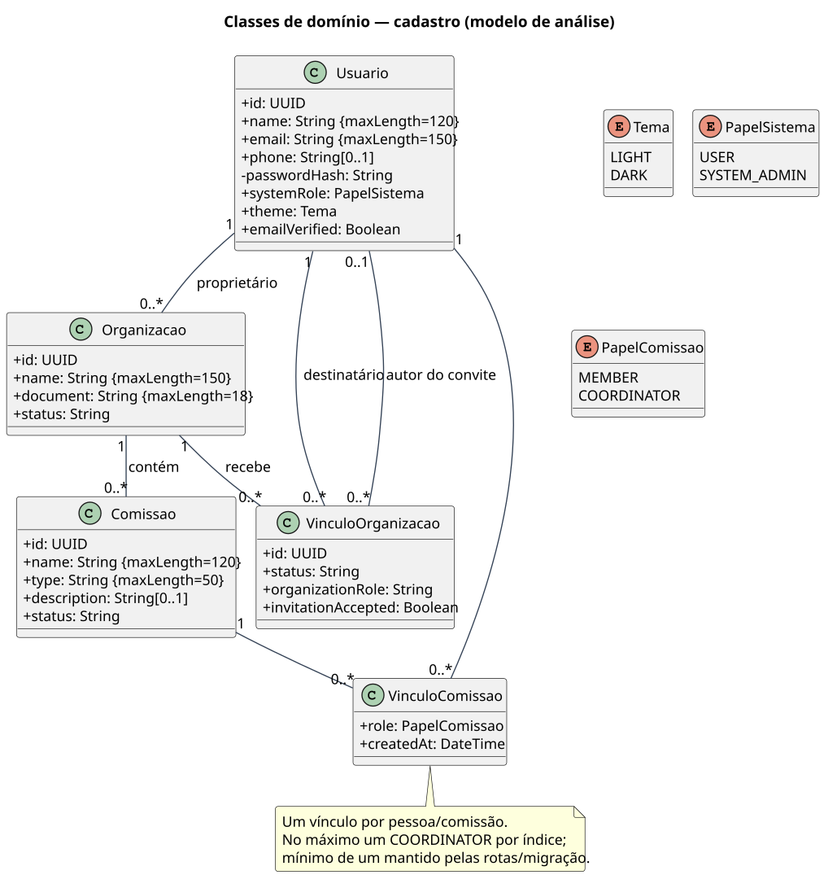

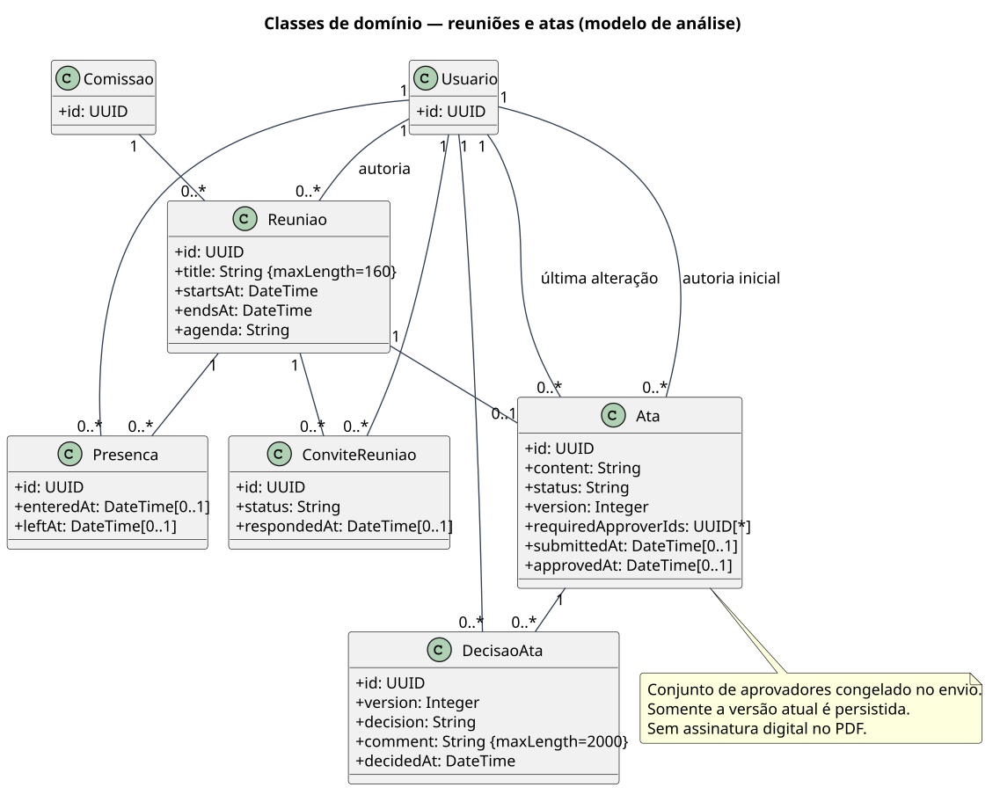

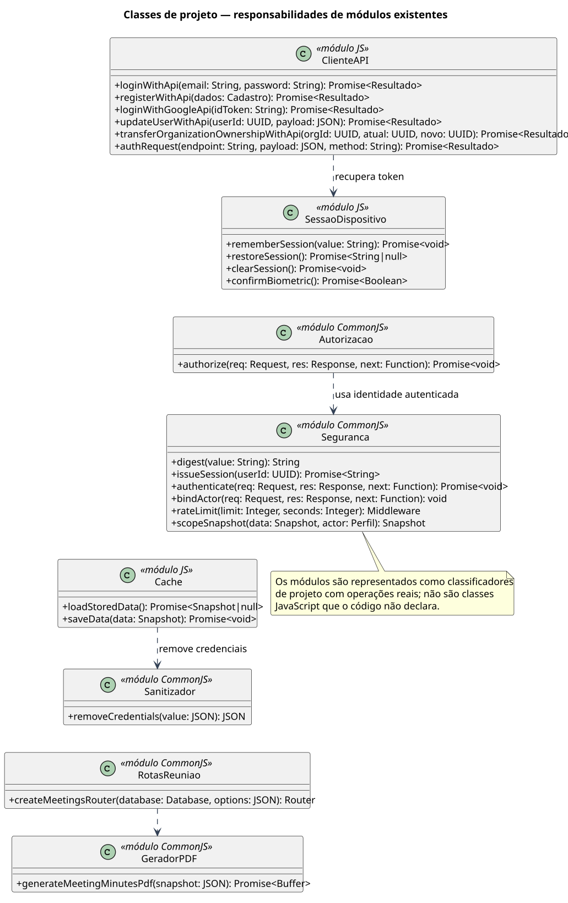

[Dicionário de classes, atributos e métodos](dicionario-classes.md). Atributos técnicos e nomes SQL completos estão no dicionário físico; os recortes visuais não substituem esses inventários.

## 7. Modelo relacional e dicionário físico

O modelo relacional representa tabelas, PKs, FKs e cardinalidades de referência. Não é chamado de diagrama UML. As multiplicidades relacionais indicam capacidade SQL, não pressupõem que cada organização já possua comissões ou cada reunião já possua uma ata.

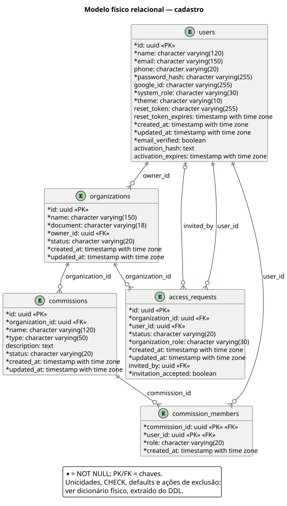

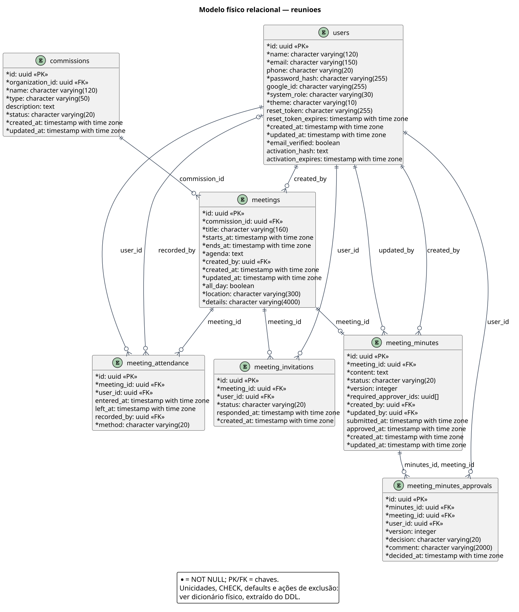

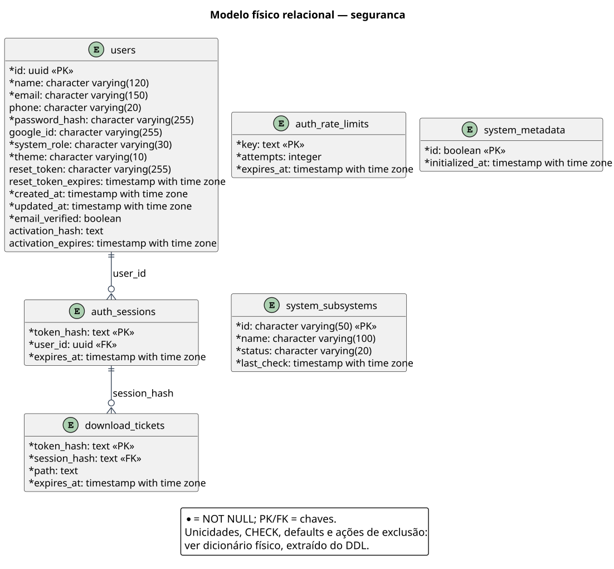

[Dicionário físico completo](dicionario-banco-dados.md): inventário de tabelas, colunas, restrições e índices extraído do DDL atual. Inclui tipos, nulabilidade, defaults, PK/FK/UNIQUE/CHECK, índices parciais/expressões e ações de exclusão. [Snapshot estruturado](modelo-fisico.snapshot.json) permite conferir o inventário.

**Distinção entre regra e garantia:** enums de tema/papel/situação em várias tabelas são validados por rotas, mas não têm CHECK SQL. Nome de comissão não tem UNIQUE SQL. E-mail tem unicidade textual, não índice de minúsculas. Ao contrário, nome/CNPJ de organização têm índices normalizados. Presença/voto/unanimidade e validade de credenciais exigem lógica de serviço e transações; não são garantidos apenas pela existência de uma tabela.

## 8. Requisitos não funcionais

Cada RNF contém condição, medida e método de avaliação. “Implementado” indica mecanismo observado no código; só evidência identificada permite declarar teste aprovado. Metas de desempenho/usabilidade ainda não medidas permanecem metas pendentes.

| ID / atributo | Critério verificável | Condições e medida | Evidência ou estado |
| --- | --- | --- | --- |
| RNF01 — Autenticação | Recurso privado sem token válido retorna 401 e não efetua escrita | Chamadas HTTP anônimas, expiradas/revogadas e com ator adulterado | security.test.js; mecanismos implantados no código |
| RNF02 — Autorização | Usuário não altera perfil de outra conta nem acessa /system sem papel administrativo | Duas contas distintas; comparar resposta e dados antes/depois | security.test.js |
| RNF03 — Credenciais locais | Serialização do cache não contém campos de senha, token ou segredo | Objeto com credenciais inclusive aninhadas; comparar JSON sanitizado | cacheSafety.test.js; sem comprovação de inspeção forense de aparelho |
| RNF04 — Sessão/expiração | Sessão expira em sete dias; código em 15 minutos; ticket em 60 segundos; troca/recuperação revoga sessões | Alterar timestamps em schema isolado e consultar endpoints | Validades no código; testes específicos de sessão/código e revogação. Não alegar cobertura de todos os cenários apenas por essa descrição |
| RNF05 — Limitação de tentativas | Login/Google/troca: 10, envio/reenvio: 3, código/reset: 5 por janela de 900 s | Por endpoint/IP e e-mail quando fornecido; excedente retorna 429 | UPSERT persistente; teste de limite de recuperação |
| RNF06 — Integridade transacional | Agendamento, criação de comissão, transferência e decisões não deixam escritas parciais em falha validada | Consultar tabelas após payload inválido/falha e após disputa concorrente | Suítes de segurança/reuniões/migração; não generalizar transação a toda rota |
| RNF07 — Concorrência de atas | Voto de versão antiga é negado; aprovação depende do conjunto fixado e unanimidade | Pedidos concorrentes em schema isolado; comparar versão/votos/status | meetings.test.js |
| RNF08 — Persistência confirmada | Escrita declarada confirmada continua disponível ao consultar a API após atualização | Fluxos com API disponível; em falha, interface não informa salvamento concluído | Mecanismos presentes; roteiro manual por operação ainda necessário |
| RNF09 — Recuperação de falha | Indisponibilidade não vira autenticação local nem cadastro offline | Desligar API/rede; verificar mensagem, cache e ausência de escrita | Roteiro em aparelho pendente. Reabertura offline não é suportada |
| RNF10 — Privacidade | Snapshot de conta sem vínculo não contém contas/atas/presenças de outra organização | Duas organizações e pessoas; manter acesso histórico permitido explicitamente | Filtro por sessão; teste de isolamento de contas. Diretório de organizações aprovadas é público entre usuários autenticados |
| RNF11 — Compatibilidade | Fluxos essenciais em Android 7+/API24 e iOS16.4+ no build configurado | Registrar dispositivo, SO, assinatura e versão; executar casos de aceite | Mínimos declarados; validação física pendente |
| RNF12 — Legibilidade/acessibilidade | Campo focado e ação permanecem utilizáveis com teclado, fonte ampliada e temas claro/escuro | Telas 360×640; fonte 200%; leitor de tela; contraste alvo WCAG AA: 4,5:1 em texto comum | Meta de aceite; medições e testes físicos pendentes. Tema/máscara não são RNFs |
| RNF13 — Desempenho | Abertura p95 ≤ 3 s; lista de 100 registros p95 ≤ 500 ms | Build release, aparelho intermediário identificado; 30 execuções; separar latência local/API; fixar rede e volume | Meta não medida; não prometer resposta universal abaixo de 100 ms |
| RNF14 — Operação | Consultas repetidas/reinício não alteram marco persistido nem hashes de senha | Comparar metadados antes/depois de migração e consultas | Testes de data estável e migração; restart do processo é operação externa |
| RNF15 — Comunicação | Produção usa HTTPS e URL estável; não transmitir senha/sessão em HTTP público | Inspecionar implantação e certificados; LAN HTTP é desenvolvimento | Requisito de implantação pendente de evidência; túnel de desenvolvimento não garante disponibilidade |
| RNF16 — Manutenção | Documento, contrato, DDL e testes usam mesmos IDs, domínios e versões | Regerar inventário/diagramas e revisar alterações de regra | Scripts documentais e checklist; sem promessa de sincronização automática de textos manuais |
| RNF17 — PDF | Português legível, texto longo paginado, versão/status/fuso identificados e aviso não final | Fixtures longas e estados de ata, mais download em aparelhos | Testes de geração registrados; download/compartilhamento físico pendentes |

## 9. Contratos de interface e serialização

Campos de entrada são componentes nativos não controlados por value; usam defaultValue e ref para sincronizar alterações externas/máscaras. A aplicação ainda utiliza estado React para representar formulários e dados. Isso não significa ausência de estado ou teste de foco/cursor comprovado.

Tema: PUT /api/users/:id, JSON {"theme":"DARK"}; resposta deve confirmar e só então a interface sincroniza. Banco: users.theme. Cache: JSON.stringify do snapshot sanitizado na chave @synple:incremento-1. Não existe persistência isolada na chave theme e não se usam abreviações L/D.

Recuperação: tela Login → Esqueci minha senha; campo E-mail cadastrado e botão Enviar código por e-mail; segunda etapa com código/nova senha/confirmação. JSON do envio: {email}; JSON da redefinição: {email,code,newPassword}. O cliente não recebe o hash do código. Cadastros usam outra etapa Ativar conta e outro par de colunas/desafios.

Sessão: perfil devolvido por login inclui token; api.js separa o token do perfil e o envia em Authorization: Bearer. Cache não recebe esse token. A validação da sessão é no servidor a cada recurso privado; biometria apenas libera sessão protegida localmente e autoriza o formulário de perfil.

Estados de interface, fonte e componentes: [contrato de interfaces](INTERFACES.md). Padrões de programação diários: [PADROES_DESENVOLVIMENTO.md](PADROES_DESENVOLVIMENTO.md). Os formulários, o modelo físico e os dicionários adotam os identificadores reais; classes conceituais usam nomes de domínio em português com mapeamento explícito.

## 10. Testes, rastreabilidade e evidências

Cada RF está ligado a um contrato e a uma sequência no próprio formulário. Para execução manual, registrar ID, build/commit, aparelho/SO, pré-condições, dados fictícios, passos, esperado, obtido, responsável/data e evidência. Uma linha de roteiro não é resultado aprovado.

| Arquivo de teste | Comportamentos relacionados | RFs principais |
| --- | --- | --- |
| backend/test/security.test.js | Acesso, senha alternativa negada, sessão/hash, conta pendente/ativação, SMTP simulado, expiração, sincronização, unicidade, transferência, comissão e convite/ticket/limite/logout | RF01, RF04, RF07, RF11, RF12, RF17–RF26 |
| backend/test/meetings.test.js | Transações, elegibilidade, presença, versões, unanimidade, concorrência, histórico, permissões e PDF | RF06, RF02.01–RF02.10 |
| backend/test/migrate.test.js | Reaplicação sem redefinir senha e coordenador atribuído a comissão antiga sem responsável | RF06, RF17 |
| backend/test/backend.test.js | Conexão/tabelas, dados fictícios de demonstração, exclusão de usuário e estrutura de recuperação | Persistência e operação; não comprova interface ou envio real |
| backend/test/meetingMinutesPdf.test.js | Conteúdo, fonte e paginação do PDF | RF02.10 |
| mobile/test/validation.test.js | E-mail, formulários, senhas, telefone/CNPJ | RF01, RF04, RF07, RF10, RF19 |
| mobile/test/cacheSafety.test.js | Remoção de credenciais aninhadas sem mutar objeto original | RF25 |
| mobile/test/meetings.test.js e meetingMinutesPdf.test.js | Datas, lista, aprovadores, URL/HEAD/MIME/erros antes do navegador | RF02.01, RF02.06, RF02.09, RF02.10 |

[Resultados registrados da revisão de código](VERIFICACAO_CORRECOES.md): 35 testes backend e 23 mobile aprovados, exportação de bundles e migração. Nesta revisão documental, extração de schema e renderização UML são validações de documentação; não são nova execução dos 58 testes ou dos APKs. [Registro desta revisão documental](VERIFICACAO_DOCUMENTACAO.md).

**Roteiro manual complementar:** executar RFs em Android e iOS, usando duas contas em dois aparelhos; testar offline, teclado/fonte/tema, OAuth, envio real de e-mail, biometria cancelada, mudança de propriedade, coordenação, aceite/recusa e PDF com ticket expirado. Registrar também limites conhecidos para não confundir resultado observado com comportamento desejado.

## 11. Limitações e lacunas verificadas

1. Recuperação exige pelo menos oito caracteres no aplicativo e no servidor; o código é consumido uma única vez.
2. Recuperação valida formato de e-mail no cliente e no servidor. SMTP real e recebimento de mensagens continuam exigindo teste operacional.
3. Domínios de papel/tema/situação em várias tabelas dependem da API. UNIQUE de nome de comissão por organização não existe. Mínimo de coordenador não é uma restrição CHECK do banco.
4. Revogação de vínculo organizacional não apaga automaticamente os vínculos de comissão. Nem todas as rotas repetem a checagem de organização APPROVED da interface. Revisar consistência de autorização antes de produção.
5. Exclusão de organização segue cascatas SQL e não tem uma proteção histórica geral implementada. As proteções de exclusão de conta/ata não podem ser generalizadas a todas as entidades.
6. Reconvite após rejeição não está implementado: o vínculo único existente provoca conflito no convite novo. E-mail de convite para organização não é enviado; o convite é interno.
7. Não há autenticação offline por senha. Sessão reaberta requer servidor. Logout offline limpa o aparelho sem comprovar revogação remota imediata.
8. Biometria exige novo APK/módulos nativos, hardware e enrollment; edição de perfil no fluxo atual é bloqueada quando indisponível. Servidor não recebe atestado biométrico.
9. Atas guardam conteúdo/decisões atuais, sem histórico completo ou assinatura digital. Array de aprovadores não tem FK por elemento.
10. Papéis/quantidade de coordenadores, retenção de presença/atas, acessibilidade e itens adicionais de reunião precisam de validação com a comunidade. Não há entrevistas comprovadas nesta documentação.
11. Permanecem alertas de dependências do Expo, conforme relatório de correções; não declarar segurança absoluta com base nos testes.
12. Tags Docker/CLI flutuantes, tempo de resposta e disponibilidade de túneis não constituem garantias de versão fixa, desempenho universal ou hospedagem permanente.

## 12. Padrões de entrega e manutenção

Antes de entregar: conferir padrão institucional fornecido pelo professor (o formulário original não está disponível neste checkout); manter esta especificação como referência principal, dicionários e fontes UML como anexos versionados; registrar commit/build/data da evidência; separar teste automatizado, renderização e teste físico; citar somente tecnologias instaladas; atualizar todas as fichas afetadas por mudança de contrato.

Não há necessidade de anexar node_modules ou senhas para documentar. Dicionário físico e versões são regenerados com generate-data-dictionary.cjs; fontes UML com generate-uml.cjs; esta especificação com generate-main-spec.cjs. Qualquer regeneração exige revisão semântica dos textos manuais e conferência visual das imagens. [Índice geral do projeto](Documentacao_do_ProjetoSynple.md).
