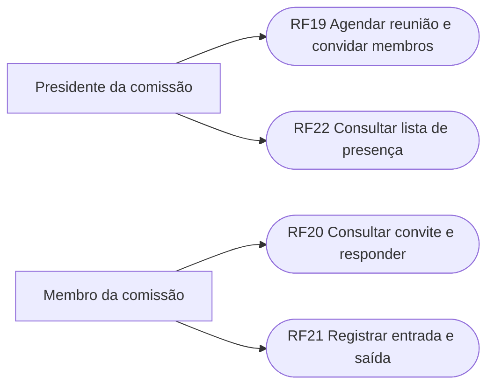
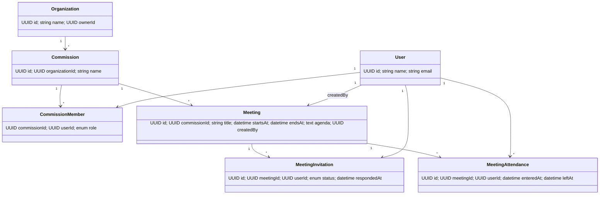
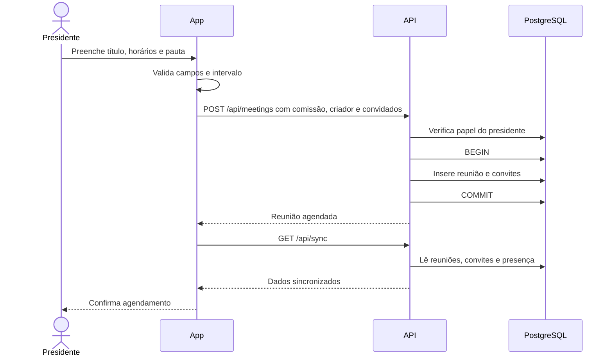
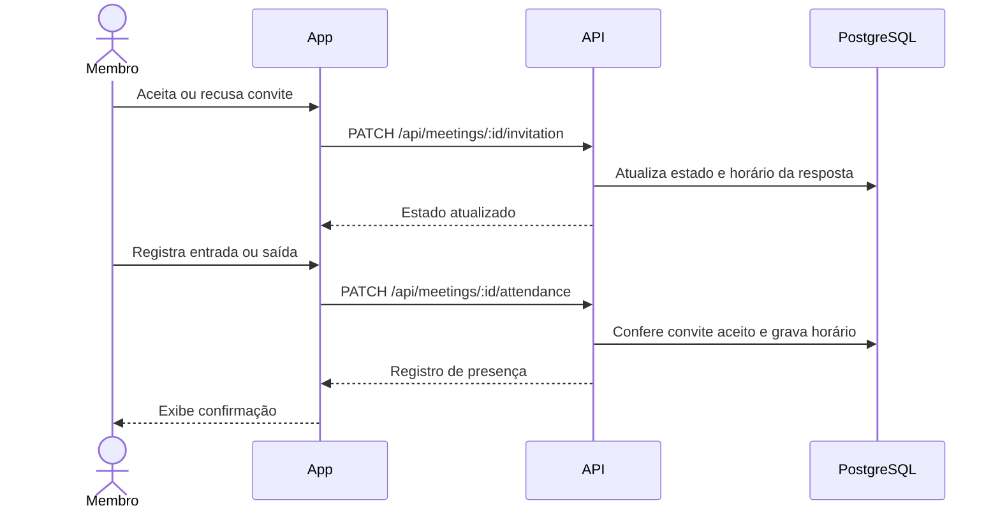
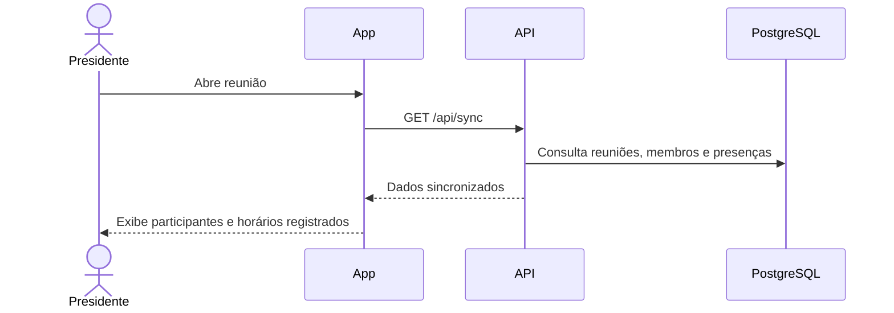

# Especificação de Engenharia de Software — Incremento 2: Reuniões

Este documento preserva a especificação inicial da etapa de reuniões. A versão atual inclui atas, aprovação unânime pelos presentes e exportação PDF: consulte a [especificação atualizada](../Synple/docs/INCREMENTO_2.md) e os [diagramas completos do incremento 2](Diagramas/Incremento_2.md). As seções abaixo documentam o escopo inicial e não representam toda a implementação atual.

## 1. Requisitos funcionais

| ID | Requisito funcional | Ator |
|---|---|---|
| RF19 | Agendar reunião informando título, data/hora de início e término e pauta; convidar os membros da comissão | Presidente da comissão ou proprietário da organização |
| RF20 | Consultar reuniões para as quais recebeu convite e responder aceitando ou recusando | Membro convidado |
| RF21 | Registrar a própria entrada e saída de uma reunião após aceitar o convite | Membro convidado |
| RF22 | Consultar a lista de presença com participante, horário de entrada e horário de saída | Presidente da comissão ou proprietário da organização |

## 2. Diagrama de casos de uso



## 3. Casos de uso no formulário padrão

### RF19 — Agendar reunião e convidar membros

- **Identificador:** UC19 / RF19
- **Atores:** Presidente da comissão; proprietário da organização
- **Sumário:** Cadastra uma reunião para uma comissão e gera convites para os membros vinculados a ela.
- **Pré-condições:** O ator está autenticado; a comissão existe; o ator é seu coordenador/presidente ou proprietário da organização.
- **Pós-condições:** Reunião persistida com fuso horário; convites persistidos para os membros elegíveis.
- **Fluxo principal:**
  1. O ator abre a opção “Reuniões” e seleciona uma comissão.
  2. O sistema apresenta os campos título, início, término e pauta.
  3. O ator preenche os dados e aciona “Agendar e convidar”.
  4. O sistema valida os campos, as datas e se o término é posterior ao início.
  5. O servidor verifica o papel do ator e registra a reunião e seus convites em uma transação.
  6. O sistema atualiza os dados e informa que os membros foram convidados.
- **Fluxos alternativos:** Se houver mais de uma comissão, o ator seleciona a comissão antes de preencher a reunião.
- **Exceções:** Campos vazios, horários inválidos, término anterior ao início, comissão inexistente ou ator sem permissão impedem o cadastro.

### RF20 — Consultar convite e responder

- **Identificador:** UC20 / RF20
- **Atores:** Membro convidado
- **Sumário:** Exibe os dados da reunião e registra aceite ou recusa do convite.
- **Pré-condições:** O usuário está autenticado e possui convite para a reunião.
- **Pós-condições:** O convite fica com estado `ACCEPTED` ou `DECLINED` e a data de resposta é gravada.
- **Fluxo principal:** O usuário abre “Reuniões”, consulta título, horários e pauta e escolhe “Aceitar convite” ou “Recusar”. O sistema salva e apresenta o novo estado.
- **Exceções:** Convite inexistente ou falha de comunicação deixa a resposta sem confirmação e apresenta erro.

### RF21 — Registrar entrada e saída

- **Identificador:** UC21 / RF21
- **Atores:** Membro convidado que aceitou
- **Sumário:** Grava os horários em que o participante entrou e saiu da reunião.
- **Pré-condições:** O usuário aceitou o convite.
- **Pós-condições:** O registro individual de presença contém horário de entrada e, após a saída, horário de saída.
- **Fluxo principal:** O participante aciona “Registrar entrada” ao chegar e “Registrar saída” ao encerrar sua participação. O sistema registra os horários do servidor.
- **Exceções:** O sistema bloqueia a saída sem entrada e impede ações de usuários sem convite aceito.

### RF22 — Consultar lista de presença

- **Identificador:** UC22 / RF22
- **Atores:** Presidente da comissão; proprietário da organização
- **Sumário:** Exibe os convidados que registraram entrada e seus horários, incluindo saída quando registrada.
- **Pré-condições:** O usuário possui papel de gestão da reunião.
- **Pós-condições:** A lista fica disponível na tela da reunião; os dados não são alterados pela consulta.
- **Fluxo principal:** O gestor abre a reunião e consulta a quantidade de entradas e os horários individuais.
- **Exceções:** Quando ninguém registrou entrada, o sistema informa que ainda não há presença registrada.

## 4. Diagrama de classes e dicionário de dados



| Entidade | Campo | Tipo | Regra |
|---|---|---|---|
| Meeting | id | UUID | Chave primária |
| Meeting | commissionId | UUID | Comissão associada; exclusão da comissão remove reuniões |
| Meeting | title | VARCHAR(160) | Obrigatório |
| Meeting | startsAt / endsAt | TIMESTAMPTZ | Obrigatórios; término posterior ao início |
| Meeting | agenda | TEXT | Obrigatória |
| Meeting | createdBy | UUID | Usuário responsável pelo agendamento |
| MeetingInvitation | meetingId / userId | UUID | Chaves estrangeiras; combinação única por convite |
| MeetingInvitation | status | VARCHAR(20) | `INVITED`, `ACCEPTED` ou `DECLINED` |
| MeetingInvitation | respondedAt | TIMESTAMPTZ | Nulo até haver resposta |
| MeetingAttendance | meetingId / userId | UUID | Chaves estrangeiras; combinação única por participante |
| MeetingAttendance | enteredAt / leftAt | TIMESTAMPTZ | Entrada obrigatória antes de registrar saída |

## 5. Diagrama relacional e dicionário de dados

```mermaid
erDiagram
  ORGANIZATIONS ||--o{ COMMISSIONS : possui
  COMMISSIONS ||--o{ COMMISSION_MEMBERS : inclui
  USERS ||--o{ COMMISSION_MEMBERS : participa
  COMMISSIONS ||--o{ MEETINGS : agenda
  USERS ||--o{ MEETINGS : cria
  MEETINGS ||--o{ MEETING_INVITATIONS : gera
  USERS ||--o{ MEETING_INVITATIONS : recebe
  MEETINGS ||--o{ MEETING_ATTENDANCE : registra
  USERS ||--o{ MEETING_ATTENDANCE : comparece
  MEETINGS { uuid id PK; uuid commission_id FK; varchar title; timestamptz starts_at; timestamptz ends_at; text agenda; uuid created_by FK }
  MEETING_INVITATIONS { uuid id PK; uuid meeting_id FK; uuid user_id FK; varchar status; timestamptz responded_at }
  MEETING_ATTENDANCE { uuid id PK; uuid meeting_id FK; uuid user_id FK; timestamptz entered_at; timestamptz left_at }
```

As tabelas relacionais correspondentes estão em `Synple/backend/src/db/schema.sql`. Convites e presença têm unicidade por reunião e usuário para evitar duplicação de registros.

## 6. Requisitos não funcionais

- **RNF01 — Compatibilidade:** os fluxos devem funcionar no Expo para Android e iOS.
- **RNF02 — Integridade temporal:** datas são persistidas como `TIMESTAMPTZ`; o servidor rejeita término igual ou anterior ao início.
- **RNF03 — Integridade referencial:** reunião, convite e presença referenciam entidades existentes; excluir a comissão remove suas reuniões e dados dependentes.
- **RNF04 — Consistência:** agendamento e criação dos convites ocorrem na mesma transação.
- **RNF05 — Usabilidade:** títulos, pauta, horários e estado do convite são exibidos em português; ações principais possuem alvos de toque adequados a celular.
- **RNF06 — Atualização:** reuniões, convites e presenças são sincronizados pelo endpoint de sincronização do aplicativo.
- **RNF07 — Autorização:** o servidor verifica papel de coordenador da comissão ou proprietário da organização para agendar e consultar presença; convite aceito é exigido para registrar presença. A autenticação geral atual do projeto ainda depende de IDs enviados no corpo da API e precisa ser substituída por sessão/token antes de produção.

## 7. Diagramas de sequência

### Agendamento e convite



### Resposta ao convite e presença



### Consulta da lista de presença


